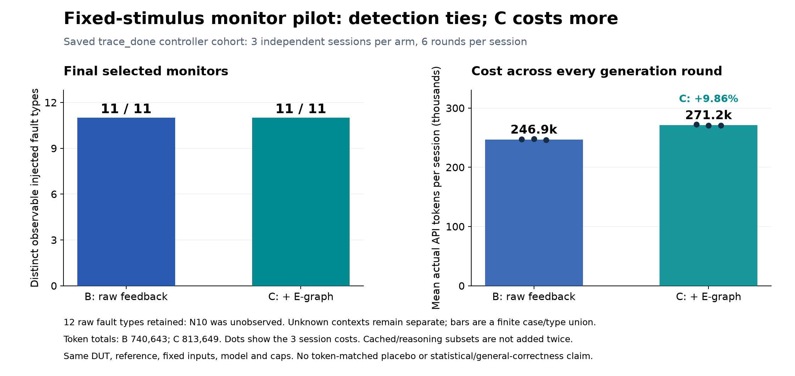

# P2: prototype and pilot results

## Verified submission update — November 6, 2026

The official P2 template now confirms **two pages, excluding references**, in
10pt two-column US Letter format, due **November 9, 2026, 11:59 PM ET**.
Project **B5**: Chiyu Chen, Mingyuan Zheng, Yiwen Chen.

[Final two-page PDF](../output/p2/submission-b5/B5_P2.pdf) ·
[Editable TeX](../output/p2/submission-b5/latex/main.tex) ·
[Source ZIP](../output/p2/submission-b5/B5_P2_source.zip)

The [final PDF review](audits/agent_bridge_2026-11-06/P2-PDF-review.md) returned
**PASS_WITH_LIMITS** for the actual template, two Letter pages, figure and
scientific statements. Export/render evidence is in
`output/p2/submission-b5/export-verification-v1.json`. The PDF has not been
submitted. Actual instructor/TA technical feedback and its response are still
missing; this does not establish completion of every P2 content requirement.

The earlier screenshot year/format-unknown wording below is superseded by this
verified update. The complete previously reviewed draft is retained unchanged
in [MILESTONE2-reviewed-source.md](../output/p2/submission-b5/MILESTONE2-reviewed-source.md),
and its historical review records remain unchanged. New I2C online work waits
for the user's concrete decision tomorrow; the current state stays offline.

---

Offline review draft for the screenshot's **Nov 9 P2** requirement. The screenshot
does not specify a year or submission format. Historical runs below are saved
evidence, not experiments rerun tonight. Actual instructor/TA midterm feedback
has not been located in the bounded local search; that response remains open.

## Completion matrix

| P2 item | Current state | Evidence or remaining work |
|---|---|---|
| Minimal end-to-end prototype | Completed historical execution | Fixed inputs, monitor generation, compilation/feedback, freeze, hidden grading and report below |
| One pilot comparison figure | Offline deliverable ready | Figure 1 and exact saved numeric data |
| Main risk and bounded next experiment | Ready | Saturation/generalization risk; I2C task card below |
| Response to actual midterm feedback | Missing source | No teacher/TA feedback original found; response cannot be invented |
| New cross-IP online pilot | Tomorrow's proposed work | Not required to relabel existing P2 pilot; no new calls authorized tonight |
| General G1/formal qualification | Paused with limits | R04 candidate/checks recoverable; not a prerequisite for a separate finite simulation pilot |

## Question and implemented prototype

The formal proposal asks whether structural E-graph feedback improves RTL
verification coverage and token efficiency over text/raw-coverage feedback.
Its A/B/C stimulus-generation track remains background evidence. The separately
authorized **test2** extension fixes stimuli and generates passive SystemVerilog
monitors. Its outcome is effective fault detection and false alarms, rather
than newly covered DUT points. This does not claim an official CVDP/Pass@1 result.

The implemented path uses frozen DUT/specification/inputs and a separate
Claude-authored reference, then GPT monitor generation, compilation and public
development feedback, per-round source/prompt snapshots, candidate release,
hidden scoring, saved-response replay and cost reporting. B receives raw
coverage/common feedback. C adds validated typed complete-guard relations.
Hidden faults, final traces and reference implementation stay outside candidate
prompts. Semantic groups never merge source-counter denominators.

Concrete prototype artifacts, relative to the repository:

| Stage | Entry or saved artifact |
|---|---|
| Fixed contract/data | `test2/configs/controller_done_study_v1.json`; `test2/tasks/axis_length_done_v1/{input-freeze,evaluation-freeze}.json` |
| Generation and public feedback | `test2/scripts/controller_done_generate_v2.py`; `controller_done_generation_v2.json`; `test2/results/controller-done-live-v2/` |
| Release | That run's `release.json` and `final-candidates.json` |
| Postprocessing entry | `test2/scripts/controller_done_live_post_v2.py` |
| Independent score paths | `controller-done-live-grade-v2/scores.json`; `controller-done-live-replay-grade-v2/scores.json` under `test2/results/` |
| Numeric audit/report | `test2/results/controller-done-live-acceptance-v3/audit.json`; `controller-done-live-report-v4/report.md` |

Exact historical commands and exits are in `controller-done-live-post-v2/progress.json`
and `controller-done-live-post-recovery-v3/progress.json`. The original final audit
adapter failed and remains preserved. Recovery used a new read-only adapter on
saved evidence; it did not repeat generation, physical or formal experiments.
This is an executed prototype with documented recovery, not a newly passing
single-command invocation. The compact [evidence index](audits/p2_offline_preparation_2026-11-06/end-to-end-evidence.json)
records the concrete file identities.

## Figure 1: saved controller B/C pilot

**Caption.** Historical fixed-stimulus controller pilot, three independent
sessions per arm and six rounds per session, 36 generation calls total. All six
final selected monitors pass the finite correct-control gate and detect11/11
confirmed observable fault types. The raw denominator remains12; N10 was not
confirmed observable. Unknown contexts and invalid earlier rounds remain in the
source evidence. Left: a finite, unattributed case/type union, not category-specific
proof. Right: mean actual API input+output tokens over all six rounds per session;
dots show the three session totals. B totals740,643 and C813,649, so C uses9.8571%
more generation tokens without extra final fixed-trace kills. Cache/reasoning
subcounts are not added twice. This is not total compilation/simulation/wall cost,
an invoice, statistical significance or isolated semantic causation.

The [numeric data](../output/p2/2026-11-06/pilot-data.json) comes directly from the
saved acceptance audit; plotting reruns no research. The same DUT, reference,
fixed inputs, model and resource caps apply within the cohort. Equal caps do
not imply equal actual spend. Reference-unknown contexts remain38 per candidate;
one B candidate has40 total unresolved pairs after candidate unknowns are included.
Formal diagnostics remain separate:540 jobs,75PASS/104FAIL/361TIMEOUT;74 BMC
witnesses remain unreproduced/unresolved. None becomes a confirmed fault, pass,
general monitor-correctness result or128-cycle proof here.

## Main risk and next different IP

The main research risk is **low discriminatory power and weak generalization**:
the current fixed-trace endpoint saturates while C adds context cost. A missing
token-matched placebo also limits attribution to semantic content. A bounded
different-protocol simulation study is more useful for P2 than extending generic
formal/tool qualification. Negative/tied results remain valid observations.

| Candidate | Existing assets | Cost/limit before a new test2 pilot |
|---|---|---|
| **OpenTitan I2C READB, recommended** | Original RTL/spec, finite Claude reference, fixed driver/two-simulator calibration, proved guards | New passive monitor ABI, disjoint hidden inputs and physical DUT mutants; independent review of unchanged oracle scope |
| OpenTitan SPI_HOST core | Real dependencies, Claude v4 reference, safe-offer driver and semantic assets | Same-CS contract/diagnostic attribution issue raises preparation cost; avoid unsupported expansion |
| ZipCPU WBXBAR | Original sources, Claude reference, fixed driver and semantic relations | Prior six sessions all functionally unresolved; larger interface/attribution burden |

I2C and SPI are different protocol IPs from the same upstream project, not two
independent upstream sources. Earlier divider/queue stimulus work remains
background; the original divider's known remainder defect prevents treating it
as an unqualified correct-DUT false-alarm baseline.

The one-page [I2C task card](../test2/tasks/i2c_read_p2_draft_v1/task-card.md)
and32-field public mapping/role allowlists are prepared. They are **draft
interfaces**, not an implemented/tested SV adapter or new experiment. The old
READB checker has finite wire/queue scope and no liveness deadline; pending,
invalid, extra-STOP and stretch/256-byte limits remain. Old trace-corruption
controls are not physical DUT mutants. GPT does not repair the Claude oracle.

Tomorrow's unapproved small-pilot proposal is B/C, two independent sessions per
arm × three rounds, with matching model/caps and all-round freeze before hidden
grading. First review the oracle scope; if changes are necessary, use a separate
Claude author and fresh reviewer. Before candidate calls, qualify only the adopted
driver's input/reset/first sample/pre/post path and positive/negative/unknown
controls; freeze new inputs, physical fault labels and prompt boundaries. Count
tokens, compilation, physical runs/cycles, monitor replay and wall costs separately.
Actual models/rates/worst-case fees and a concrete service grant still need
tomorrow's decision. No API/count/Claude/key requests or new SV experiments ran during this P2 preparation.

## Midterm feedback response

| Actual feedback original | Response/change | Evidence | Limit |
|---|---|---|---|
| **Not provided/found in the bounded local search** | Pending an authentic instructor/TA comment | `feedback-search.json` in the offline evidence directory | Course platform/email/other conversations were not searched; absence here is not proof no feedback exists |

The user's current direction to prioritize different IPs, proposal alignment and
a minimal P2 deliverable is incorporated above. That user direction and internal
Codex reviews are not relabeled as classroom feedback. The feedback response is
the remaining content gap; no new live experiment is needed to make it up.

Sources: the formal two-page proposal in `project_background_reading/`, the
trusted screenshot transcription `docs/audits/agent_bridge_2026-11-06/P2-REQUIREMENTS.md`,
the saved v4 controller report/acceptance audit, and the bounded
`research-priority-review.md`. No prior result, oracle, frozen configuration or
user Git index was modified to prepare this P2 draft.
