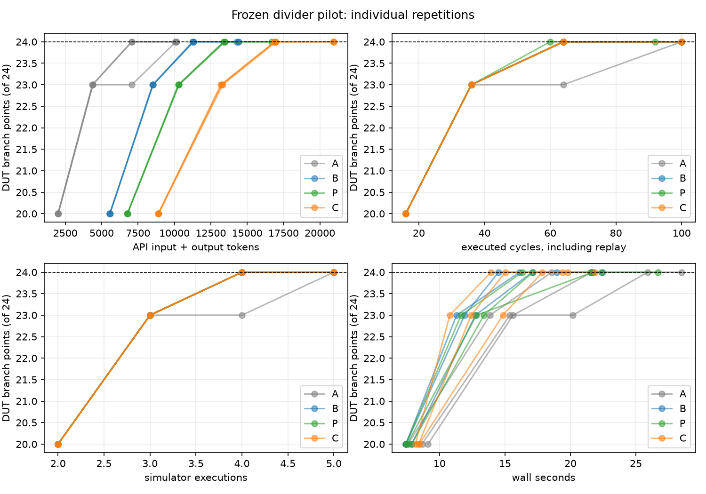

# Matched A/B/placebo/C pilot on a CVDP iterative divider

**30 October 2026 — completed live pilot, one fixed IP.** The primary
question was whether egg-normalized coverage feedback (C) improves an LLM's
branch coverage or cost against raw coverage feedback (B) under matched
limits. This run found **no C-over-B advantage**. The result is descriptive,
not a claim about E-graphs in general.

## Selection and frozen methodology

The subject is the original CVDP `cvdp_copilot_radix2_div_0001` 8-bit divider,
SHA-256 `64f9f4f2f8adece3b8630e8e14c1a8774c307def39ffc79655f978ef6ca77e30`.
The raw source is unchanged. Its task prompt contains failing examples and
repair text; neither was copied to the experimental prompts. A separately
written [fixed arithmetic contract](../examples/heldout_divider/docs/specification.md)
and [public-I/O checker](../scripts/divider_fixture.py) specify nonzero
unsigned quotient and remainder, asynchronous active-low reset, completion
timing and a declared divide-by-zero sentinel assumption. The JSON driver
accepts only `rst_n`, `start`, 8-bit `dividend`, and 8-bit `divisor` per cycle.
The model can change stimulus only. A separate behavioral RTL control passes
the checker; a single-remainder-fault control and the original DUT fail it.
That is evidence of checker discrimination, not a complete formal proof.

Outcome-blind static screening found five source-distinct, typed,
Z3-checked complete guard groups under matched clock/reset contexts. Each
member mapped to an original Verilator source counter, was zero-hit under the
four-cycle reset/idle seed, and was reached by separate calibration stimulus.
Seven unsupported extraction cases remain explicit. The initial source map
treated line 86's `if`/`else` pair as ambiguous. After discovering that the
original target is the unique `if` path, we archived the [old screen](../results/midterm_candidate_preflight/divider-next/screen-v1-before-if-mapping.json),
applied a documented true-path mapping rule, and ran a **fresh independent B
development screen**. It covered four of five groups in round 1; the final
group's line 86/101 counters remained zero until round 2. B reached 24/24
branches in round 3. The [frozen manifest](divider-frozen-pilot-2026-10-30.json)
was written before the four-arm calls and records source/checker/driver/seed,
feedback scripts, tool implementation hashes, budget and the preregistered
24/24 original DUT branch target. The manifest was not separately committed
before the calls; its timestamps and hashes are preserved, but this is not a
signed preregistration.

The four arms used identical `gpt-6.1-sol` Responses API settings: low
reasoning, 8,192 output-token cap, 90-second timeout, at most one retry, three
independent repetitions, and four refinement rounds of at most eight new
cycles. Each repetition had a fresh model session, fresh simulator coverage,
the same four-cycle seed, and the same fixed checker and clock driver. Each
simulation replays the seed, accepted history and new batch. The raw DUT
denominator stays 22 line, 24 branch, 51 expression and 152 toggle points;
testbench counters are excluded. Coverage is flushed even when the checker
flags a DUT failure. The model receives no deterministic search results,
formal witnesses or calibration vectors.

* **A:** specification, RTL, common seed, prior actions, checker findings and
  execution trace; no coverage evidence.
* **B:** A plus selected raw uncovered DUT line/branch/expression locations,
  outcomes and source text.
* **P:** B plus a neutral appendix byte-matched to C's extra JSON value.
* **C:** B plus bounded Rust egg groups, typed atoms, complete activation
  guards, event context, Z3 pair-check evidence and original per-location
  counters. This is a two-state combinational claim only; different behavior
  cases and source counters are not merged.

## Observed target and costs

All **48** live model responses requested and returned `gpt-6.1-sol`, were
accepted on attempt 1, and completed their full batches. All 12 repetitions
reached the 24/24 branch target. The first-target costs retain the seed run,
all model calls and all replayed cycles:

| Arm | First target round, reps 1/2/3 | API tokens at target, reps 1/2/3 | Mean tokens | Executed cycles at target |
| --- | --- | --- | ---: | --- |
| A | 3 / 3 / 4 | 7,072 / 7,066 / 10,112 | 8,083 | 64 / 64 / 100 |
| B | 3 / 3 / 3 | 11,307 / 11,241 / 11,324 | 11,291 | 64 / 64 / 64 |
| P | 3 / 3 / 3 | 13,379 / 13,474 / 13,444 | 13,432 | 60 / 64 / 64 |
| C | 3 / 3 / 3 | 16,913 / 16,985 / 16,881 | 16,926 | 64 / 64 / 64 |

The seed covered 7/24 branches. **Token ROI** is newly covered original DUT
branch points per 1,000 API-reported input-plus-output tokens at first target;
mean per-repetition ROI was A 2.164, B 1.506, P 1.266 and C 1.004. Cached
input and reasoning-output token details are saved in call logs, but are
subsets of the reported totals and are not counted again. B, P and C each
needed four simulator executions to reach target (including the seed run);
A needed four, four and five. The full fourth round was still executed after
target attainment, and final costs are separately preserved.

The repeated coverage path shows the ceiling: every arm reached 20/24
branches and four/five semantic groups in round 1, then 23/24 and all five
groups in round 2. Eleven of twelve runs reached 24/24 in round 3. The last
point was an `if` or `else` outcome at RTL line 51, **outside every C group**;
therefore C had no relevant equivalent-group information for the decisive
branch. C and B had the same first-target round and cycles in all three
repetitions. C used about **50% more API tokens** at target on average. Wall
time averaged 15.6 seconds for C and 15.9 seconds for B at target, a small
difference dominated by API latency noise. The original DUT's nonzero
remainder defect was eventually identified in every repetition; repeated
failing cycles count as **one distinct `remainder` defect category**, not
multiple defects. The correct checker rejecting the faulty DUT was not a
testbench failure. Toggle differences are exploratory; toggle was not the
preregistered target.



## Independent Claude audit and limitations

Claude Code 2.1.310 made two read-only `claude-opus-5-5` calls: an anonymous
W/X/Y/Z aggregate review with tools disabled, then an unblinded artifact
review restricted to Read/Glob/Grep. Its [blind review](../results/divider_abcp_frozen_live_20261030/claude_audit/blind-review.txt)
recomputed all 12 target rows correctly. Its [revealed review](../results/divider_abcp_frozen_live_20261030/claude_audit/reveal-review.txt)
confirmed the ceiling and group/target mismatch. The [point-by-point
disposition](../results/divider_abcp_frozen_live_20261030/claude_audit/disposition.md)
independently checked the material findings against hashes, raw prompts and
coverage locations. Claude did not replace Verilator's counters.

The **placebo is not API-token matched**: its round-1 extra value matches C's
serialized byte length closely, but P rep1 used 6,538 API input tokens while
C used 8,660. It controls added bytes, not token-processing load. The blind
packet also abbreviated the replay policy, and `branch_covered_at_stop` in
the saved CSV actually refers to first target (or final observation if not
reached). These are documented presentation limitations; the raw data were
not rewritten after audit. A local check found none of the ten benchmark
failing dividend/divisor pairs in the seed or any model-generated action.

This pilot is **one small IP and one model**, with three repetitions per arm.
The full RTL was visible to every arm, group coverage saturated by round 2,
and the deciding target was outside C's mapped groups. No statistical or
general causal E-graph claim follows. A stronger next experiment needs a
second independent, deeper controller/FIFO with several *late, reachable,
source-distinct equivalent groups*, and a prospectively token-matched placebo.
The target should include the group's original source counters, while still
reporting the complete raw coverage denominator. Select and freeze that
design before observing any new A/C outcome.

## Reproduce and inspect

The [per-call JSONL](../results/divider_abcp_frozen_live_20261030/calls.jsonl),
[per-round JSONL](../results/divider_abcp_frozen_live_20261030/rounds.jsonl),
[round CSV](../results/divider_abcp_frozen_live_20261030/rounds.csv),
[first-target cost CSV](../results/divider_abcp_frozen_live_20261030/target-costs.csv),
[source-counter group progress](../results/divider_abcp_frozen_live_20261030/group-progress.json),
all rendered prompts, raw `.dat` coverage, compile logs, and model IDs are
retained. The [metadata](../results/divider_abcp_frozen_live_20261030/metadata.json)
records commit `054898f27816362e73bd91eabe2960711f85d42d`, selected
input hashes, package versions and limits; the frozen manifest additionally
records all 16 file hashes. Main versions: Verilator 5.050, Icarus 12.0,
Yosys 0.70+post, Rust/Cargo 1.99.0, OpenAI SDK 2.54.0, matplotlib 3.11.2.

A [model-free replay](../results/divider_abcp_frozen_replay_20261030/validation.json)
matched all **60** seed/round simulations on every original DUT counter
identity and hit count, checker outcome and coverage summary. Replay results
remain separate from live API costs.

```sh
.venv/bin/python -B scripts/screen_divider_next.py
.venv/bin/python -B -m unittest discover -s tests -p 'test_divider_fixture.py' -v
.venv/bin/python -B scripts/run_divider_experiment.py --mode mock --config configs/divider_abcp_frozen.json --output build/divider-recheck-mock
.venv/bin/python -B scripts/analyze_divider_pilot.py --run results/divider_abcp_frozen_live_20261030
```

The live command requires a fresh hidden-staged OpenAI key and a new output
directory. The runner deletes that staged key after completion. The Claude
audit likewise deletes its separately staged Anthropic key. Mock/replay
results are labeled separately and are not pooled with live observations.
