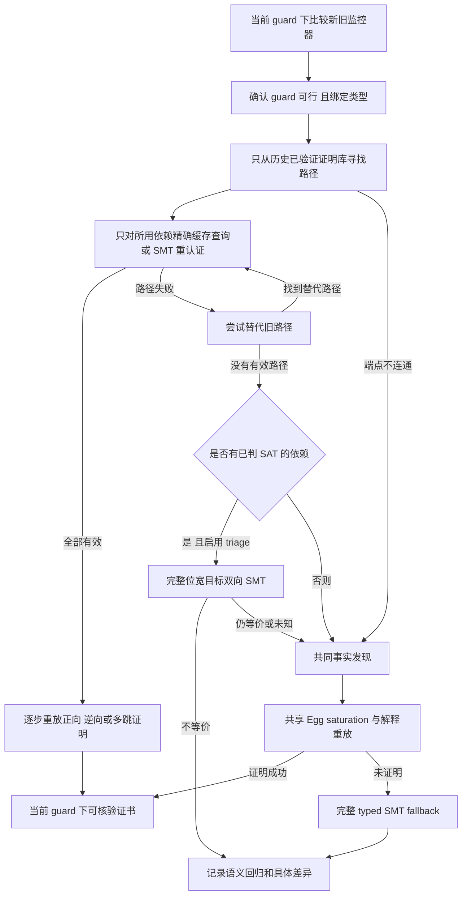

# Milestone 3 · Dependency-Driven Proof Reuse

本轮研究的是 **如何跨作用域维护 LLM 生成的 RTL 监控器的等价证明**，而不是把 E-Graph 强行放入每次 SMT 查询。先前 shared Egg 在查询历史证明之前会认证整个当前事实森林；本轮用历史 Egg explanation 实际使用的具名等式作为依赖，先认证该路径所需前提，再独立重放证明。无法复用才做完整事实发现及新的等式饱和。这里的依赖集合针对具体证明，并不声称是整个目标等价的全局最小充分条件。

[预先冻结的实验协议](egg_dependency_reuse_protocol.md) · [独立后续失效分流消融协议](egg_dependency_triage_protocol.md) · [上一轮语义回归](egg_regression_results.md) · [真实 API 作用域维护结果](egg_regression_live_results.md)

**结论：**在真实的 `4→5→4` 监控器历史及受控长证明链上，依赖复用能够正确阻止失效证明、跨 guard 重放仍有效的路径，并避免不必要的全事实搜索。仅做依赖优先，在原 224 项矩阵及实际在线历史上几乎没有减少宽位 SMT 查询；增加实际依赖失败后的定向分类，真实历史查询 181→153、native graph 4→2。在 9 属性的受控聚合报警上，2079→410（−80.28%），包括冷启动与失败成本。但 **普通 Z3 UNSAT-core 依赖复用达到相同或更少的查询，直接增量 SMT 的查询数仍显著更低**。这些结果支持有作用域的可核验证据维护，不支持 Egg 独占的加速或 LLM 质量收益。

## 1. 方法：证明依赖不是整组事实

对旧证书记录边 `P = Q @ G_old`：

- 固定原始类型化端点、guard、类型位宽和规则签名；记录实际 flat explanation、每步规则、改写方向、位置及**只被该证明使用**的 ground equalities。历史库中的边都已经独立检查。
- 在当前可行的 `G_new` 下，对于每个实际依赖 `a = b`，查精确缓存或提出位宽正确的 SMT 查询 `G_new ∧ (a XOR b)`。`UNSAT` 才重新授权该等式。在 `SAT` 时仅阻止当前证明路径，`unknown`／缺失也不能当作有效前提。缓存绑定类型 schema、精确公式、guard、求解配置和 Z3 版本；unknown 不缓存。
- 将旧具名 rule 绑定到新 guard 的认证 rule 名，独立重放每一步。即使某个依赖的原子不出现在当前两个目标公式中，也可通过历史中间节点的准确类型绑定重新认证。允许反向和多跳组合；优先同 guard 的最短路径，然后尝试其他最短历史路径，失败边从本次搜索排除。端点不连通时不遍历无关依赖。回到同一 guard 且依赖在精确缓存中时无需重新求解。
- 不可行 guard 单独报告，不把空条件下的 vacuous equality 计入成功。不存在可重放路径时不接受等价，回退为完整共同事实森林、共享 native Egg 与必要的完整目标 SMT 双向检查。

第一次实验发现：`SAT` 的旧依赖有时意味着目标已不等价，有时只是选错了证明路径。故另冻结一个后续策略 **typed triage**：针对已确认存在 SAT 依赖、且全部历史路径均被阻止的目标，先做完整位宽双向目标判定。若 `strengthened/ weakened/ incomparable` 已确定，该目标不再触发全事实发现或 native proof search；只有当整个组没有其他未解决目标时才略过该组完整事实森林。若仍 `equivalent`，保留原来的搜索，以建立新证明；`unknown` 不触发提前通过。此项额外 SMT 开销全部计入结果，不是离线 grading oracle 提供的信息。



这里保存的是**可移植、已检查的等式证明图**；native E-Graph 本身没有跨轮次持久化，没有把旧 e-class ID 用于另一 guard。库在同一 workload 内按实际顺序积累，本轮并未实现产品化的跨进程证书加载、任意时序 SVA 依赖系统或 RTL ECO 自动重验证。

## 2. 数据来源与公平对照

原始 RTL 仍为先前锁定的 AXI Frame Length Adjuster，使用真实九项事务规格及独立 ghost tracker。输入来自之前的 transaction archive 与 Mac 真实 scoped-maintenance API archive，两份归档均校验哈希。本轮没有新 API 请求、没有修改 RTL，没有把 fixture 算为真实 LLM 数据。

| Workload | 比较 | 分组 | 来源与目的 |
|---|---:|---:|---|
| `matrix` | 224 | 66 | 上轮全部固定语义回归：真实初稿/重复后续、受控修改、作用域控制，不按新结果删选 |
| `live` | 6 | 6 | 真实 GPT-6.1-sol/low 的三个 `4→5→4` 阶段：每阶段对被带入的监控器与实际合格新回复各比较一次 |
| `ladder` | 10 | 9 | 真实 `data_last` 监控器受控组成的传递路径、失效后目标仍成立、真实不等价、返回旧 guard、不可行 guard |
| `portfolio-01/03/05/09` | 24 | 24 | 1/3/5/9 个真实事务报警公式的受控 OR 组合，各 6 次 guard 变化（含冷启动） |
| 合计 | **264** | **105** | **233 等价、30 不等价、1 不可行**；其中 61 项是非恒等的等价请求 |

实际 live archive 有九个真实响应、三组会话。三组的逐阶段 carry 和合格候选文本一致；只保留一条六次 assessment 的真实公式时间线，并在每个请求保留三组来源 ID，不把重复的三组历史算作独立机会。两个 `incomparable` 是**旧 scope 监控器被带到新 guard 的 preflight**，不是模型新回复不合格。controlled ladder/portfolio 明确标注受控组合，不能称为新增实际 LLM 错误样本。

### 比较臂

| 方法 | 实现 |
|---|---|
| `smt_exact` | 强直接增量 SMT，精确 guard 内之前全目标等价的连通性复用及方向缓存 |
| `smt_subscope` | 进一步支持新 guard 包含于旧 guard 时转移全目标等价；对本 DSL 的 unsigned 区间包含精确计算、审计中用 SMT 独立复核 |
| `egg_eager` | 上轮 shared Egg：先认证共同事实，再查询历史、必要时建共享 E-Graph |
| `egg_cache` | 先尝试路径，但只允许已缓存的精确依赖；缺失不主动再认证，作为 cache-only 消融对照 |
| `egg_dependency` | 本轮依赖优先：仅对请求路径上实际使用的缺失依赖重新认证，再完整回退 |
| `ordinary_dependency` | 同样的事实、精确缓存及路径策略；用 Z3 Boolean assumption UNSAT cores（两个方向 core 的并集，再独立验证 XOR）替代 Egg explanation。普通证书可跨作用域重新认证；精确 typed fallback 的前缀等价只在精确 guard 内复用 |
| `egg_dependency_triage` | 第二次试验追加 SAT 依赖失败后的完整目标分类，明确不等价时节省搜索 |
| `ordinary_dependency_triage` | 同样的 triage 优化应用于普通依赖证书 |

Primary 先冻结 6 臂与全部数据；follow-up 冻结相同数据、重跑两条 dependency 基线并新增两个 triage 臂。两个重跑基线的所有非计时汇总**完全一致**。每个 workload/arm 都从空事实缓存与空历史库开始，分组内证明查询只使用此前组证书；直接 solver baseline 还可用当前组较早请求，未人为限制强基线。当前仍可能缺少最优路径，因为搜索顺序确定但不是最小查询成本搜索。冷启动的宽范围事实挖掘保留原算法和相同预算；使用原 Rust `egg_regression_forms`、原固定 23 条规则、20 iterations/20k nodes/5s native budget（进程外 30s），单 SMT 超时 5s。原始程序及说明未修改。

## 3. 实验结果：全宽 SMT 查询

总数包含 guard 可行性、primitive 事实发现、依赖再认证、直接完整目标/方向查询以及 triage。缓存命中不算新求解，普通的抽象 Boolean 检查、native Egg 搜索与独立 grading/audit 不算 typed SMT；另在完整 summary 中统计。一次精确 primitive XOR 与一次完整目标方向检查的成本不相同，查询数与耗时不能直接互换。

### Primary：当前路径优先 vs. 缓存消融

| Workload | Direct exact | Direct subscope | Eager Egg | Cache-only Egg | Dependency Egg | Ordinary core dependency |
|---|---:|---:|---:|---:|---:|---:|
| 224 matrix | 69 | **57** | 581 | 581 | 583 | 572 |
| Real live history | **10** | **10** | 181 | 181 | 181 | 181 |
| Ladder | **19** | **19** | 288 | 288 | 214 | 212 |
| Portfolio 1 | **15** | **15** | 357 | 357 | 132 | 131 |
| Portfolio 3 | **15** | **15** | 587 | 587 | 218 | 217 |
| Portfolio 5 | **15** | **15** | 1897 | 1897 | 718 | 717 |
| Portfolio 9 | **15** | **15** | 2079 | 2079 | 786 | 785 |

矩阵中原 cache 已经很有效。Dependency Egg 将完整事实发现组从 40 降到 35，但 6 个新的 targeted 查询中有 4 个后来也会在完整发现时发生，净多了 2 个独立 obligation；建图次数仍 35。Cache-only 也减少发现组但未减少实际 query miss。真实 6 次历史中，新 guard 的变更恰好使两条旧依赖失效，纯 dependency-first 仍需要完整事实搜索，因此真实 query 数没有减少。不应只凭减掉了事实发现组或增加了历史命中数声称实际 solver 加速。

受控 ladder 则有真正的新跨 scope 有效依赖，lazy 方式 288→214，cache-only 仍 288；实际成功的历史路径包含一个不在当前目标语法的中间原子。四个 portfolio 对同一复杂报警反复改变 guard，每次只认证同一个 gating dependency，原完整事实枚举随组合规模而增长。普通 core 对照获得近乎相同的收益。

### Follow-up：失效路径先做 typed 分类

| Workload | Eager Egg | Dependency Egg | Dependency+triage Egg | Ordinary core+triage | Egg 相对 eager 查询减少 | Egg 完整发现组 (dep→triage) | Native 图 (dep→triage) |
|---|---:|---:|---:|---:|---:|---:|---:|
| 224 matrix | 581 | 583 | 516 | 505 | 11.19% | 35→33 | 35→33 |
| Real live history | 181 | 181 | 153 | 153 | 15.47% | 4→2 | 4→2 |
| Ladder | 288 | 214 | 139 | 139 | 51.74% | 4→2 | 4→2 |
| Portfolio 1 | 357 | 132 | 76 | 76 | 78.71% | 2→1 | 2→1 |
| Portfolio 3 | 587 | 218 | 120 | 120 | 79.56% | 2→1 | 2→1 |
| Portfolio 5 | 1897 | 718 | 376 | 376 | 80.18% | 2→1 | 2→1 |
| Portfolio 9 | 2079 | 786 | 410 | 410 | 80.28% | 2→1 | 2→1 |

两个试验中全部方法所有 264 请求均与独立 fresh typed directional oracle 一致，**没有错误等价接受，也没有把不可行 guard 当普通等价**。每组 oracle 在操作策略完成后独立检查，从不作为优化的输入。Primary 1,584 个 arm-request 判定，follow-up 1,056 个（含重复基线），这是判定次数，不是独立统计样本。

正例质量（非恒等且真实等价的 61 项）：Egg eager/dependency/dependency+triage 均保存或复用可核验路径 59/61（matrix 29/31，其余 30/30）；普通 core/dependency+triage 的历史/core 路径为 60/61，普通路径可能包含精确 scope 的完整目标 SMT 前缀。Triage 不降低这些 proof-route 覆盖，但 4 个仍等价的目标在证明前增加了完整目标检查（matrix 3 个最后有 proof route，ladder 1 个），故 Egg 完全不做完整目标 SMT 的非恒等正例由 59 降至 55。这是更可靠的失效分流与额外目标查询间的明确取舍。Triage 中 matrix 实际做 6 次目标分流（4 等价、2 不可比），live 两次不可比，ladder 1 等价/2 弱化，每个 portfolio 1 弱化；只有真正不等价者提前结束。

### 实际计时（描述性单次运行）

| Workload | Direct subscope (s) | Eager Egg (s) | Egg dep+triage (s) | Ordinary dep+triage (s) |
|---|---:|---:|---:|---:|
| 224 matrix | 0.384 | 2.006 | 1.638 | 1.092 |
| Real live | 0.083 | 0.383 | 0.269 | 0.254 |
| Ladder | 0.167 | 0.537 | 0.261 | 0.268 |
| Portfolio 1 | 0.116 | 0.553 | 0.133 | 0.131 |
| Portfolio 3 | 0.312 | 0.921 | 0.224 | 0.234 |
| Portfolio 5 | 0.659 | 2.856 | 0.695 | 0.692 |
| Portfolio 9 | 1.057 | 3.142 | 0.776 | 0.829 |

计时是每 workload 各操作组的单次 Python wall time（包含查询、证明检查、native 进程调用等，不含独立 oracle、来源 audit、build 或 API）。Primary 与 follow-up 是不同运行，非计时指标复跑一致不代表计时具有统计显著性。较复杂的 3/9 属性受控组合上，虽然 typed 查询次数更多，经过复用的 proof-based 方法在该单次运行更短；普通也有同样现象，且组合是同一监控器的人工构造。真实 matrix 与 live 明显仍是直接 SMT 更省时。不能把受控计时推广到整套 RTL 仿真、formal harness 或 LLM loop。本轮 direct 比较需要双向分类，尚未增加针对只需等价的直接整公式 XOR 的进一步性能对照；不能以此宣称 Egg 是最快算法。

例如 9 属性受控组合的总 410 次不是只算已建证明后的复用成本：第一次在 `N=4` 需 399 次（包括 guard + 全发现），在 `N=5/6/7` 每次正向更换 guard 仅 2 次（1 次 guard + 1 次实际依赖），`N=8` 依赖失效时 5 次（2 次事实层含 guard + 3 次 full target solver），返回 `N=4` 0 次。已建立证明后的新 guard 正例无需重新建图，但冷启动仍占 97% 左右，直接 SMT 整个序列共 15 次查询。下一步要真正研究解决这个成本，而非只报告热缓存。

## 4. Egg 证明可迁移的实证

取真实 T1 `data_last` 监控器为 `P`，受控定义 `Q = P ∧ (N<8)`、`R = P ∧ (N<9)` (`N = data_n`)。

| 请求 | 新 guard / 目标 | 证明及决策 |
|---|---|---|
| C01/C02 | N=4, P↔Q、Q↔R | 一次共享 native graph，保存两条独立已检查边 |
| C03 | N=5, P↔R | 重新认证 `N<8 = true`、`N<9 = true`；只做两次新依赖 XOR（另一次 guard）。P→Q→R 两跳四改写步；`N<8` 不在 P/R 当前端点的原子清单中。无建图、无全事实发现 |
| C04 | N=5, R↔Q | 反向重放并使用准确依赖缓存，无新查询 |
| C05 | N=8, P↔R | 旧 P→Q 边的 `N<8=true` 为 SAT 反证，旧路径被阻止；但完整目标仍等价，保留建图并生成新 P↔R 证书 |
| C06/C07 | N=8 P↔Q；N=9 P↔R | 依赖确实失败，完整目标分别判为 weakened，triage 跳过不可能证明的宽搜索 |
| C08/C09 | N=4 的反向边，N=5 的原边 | 回到已认证 guard，缓存且正确重放 |
| C10 | unsigned N<0 | guard UNSAT，单独标记 infeasible |

证明语义可以用一个例子说明区别：旧证明需要在 guard 下 `N<8`，但这不是 `P↔R` 在全部可能 guard 下成立的必要条件。`N=8` 时它失效，`N<9` 仍真。旧证明失效 ≠ 被证明的目标一定错误。这里只撤销当前请求上的证明授权，不删除原有历史证明，也不用失败的局部等式制造目标不等价。如果将同样流程送入后续 LLM 反馈，应区别“此证书已不再适用，需寻找替代证明”和“监控器已产生可正式验证的语义回归”，不能给模型错误的修改指令。

真实 live 序列获得两份新的可检查 Egg 证明（20、26 步），回到 `N=4` 时重放先前证明；从 `N=4` 切至 `N=5` 及回来之前的 stale preflight 均是真正的 scope 不匹配，依赖失败有精确 SMT 回执，两次由 typed triage 直接判不可比。最终三条非恒等真实正例都有证明路径。没有重跑或更改实际 LLM prompt、实际回复及 usage。本轮实现是为现有 feedback loop 提供依赖维护证据的**离线实验实现**，未替换原有 live loop `egg_regression_live.py` 的证据路径；也没有评价新策略的 token/轮数/首次成功率。

## 5. 物理及独立形式化复核

保留两个不同层级的证据：

1. **自由类型化快照上的形式化比较：**Z3 QF_BV 用完整 8/16-bit unsigned 及 Boolean 语义、当前 guard，检查 `G ∧ old ∧ ¬new` 与 `G ∧ new ∧ ¬old` 两个方向。每一个依赖、事实现状及完整目标结论都从原始公式按类型重建。两个独立审计从空缓存及空历史库重新认证 typed checks、重建普通 core、 replay archived Egg 改写和正反路径，核对所有记录、状态、计数及最终 store，而不重新运行 native 搜索。审计与操作实现共享 typed parser/证明规则检查器和 solver，并非另一 SMT 后端的独立形式化证明工具。
2. **既有真实 RTL 轨迹：**使用锁定的 21 条原 RTL 与功能对照轨迹（12,712 PRE/POST snapshots）以及另 9 条端口敏感对照（5,448 snapshots），重放本轮新增 `live/ladder/portfolio` 共 40 个比较；含受控组合，以独立 imperative reference 的 OR 对照所选事务报警。31 个等价请求均在两组采样中 guard 有实际出现、差异和 unknown 均为 0；主轨迹观测到全部 8 个不等价请求的差异，另 9 条对照只区分其中 5 个，另 3 个不能靠这组物理采样观测到；仍有完整类型化符号反证。重复/组合差异不代表不同 RTL bug。

| 实际/受控差异 | 主 21 条轨迹 (`old_only/new_only`) | 另 9 条轨迹 |
|---|---:|---:|
| Live 阶段 2 stale carry | 84 (2/82) | 36 (0/36) |
| Live 阶段 3 stale carry | 56 (4/52) | 24 (0/24) |
| Ladder N=8 弱化 P/Q | 4 (4/0) | 0 |
| Ladder N=9 弱化 P/R | 4 (4/0) | 0 |
| Portfolio 1 的 N=8 | 4 (4/0) | 0 |
| Portfolio 3 的 N=8 | 24 (24/0) | 18 (18/0) |
| Portfolio 5 的 N=8 | 25 (25/0) | 36 (36/0) |
| Portfolio 9 的 N=8 | 69 (69/0) | 38 (38/0) |

整个研究仍以 RTL 验证为目的；但以上 formal verification 证明的是**在显式 guard 的类型化监控快照上语义等价、强化、弱化或不可比**，并不是用 LLM 或抽象 e-class ID 代替完整 DUT 验证。原项目的 full-wrapper transaction BMC、单帧及 bounded assumptions 见 [跨周期事务 formal](egg_frame_txn_results.md)。本轮没有新增 DUT 的时序 BMC/无界证明，也没有在未出现的真实轨迹上声称找到实际 defect。Symbolic free snapshots 允许不一定可达的状态，物理采样不能代替证明。

## 6. 环境、脚本与从 Mac 复现

Linux x86_64：Python 3.12.14、Z3 Python API 4.16.0、Rust/Cargo 1.90.0、egg 0.11.0，由 `egraph/Cargo.lock` 锁定。实验读取先前已记录的真实 API archive 与 RTL traces；不需要重新调用 API 或安装/执行新的 Yosys/模拟器。清洁 Mac 可用 Homebrew 安装 Python 3.12、Rustup（如已有环境不必重新安装，沿用之前 `frame-venv` 和已经构建的工具）。初次需网络获得 Python wheel / Cargo 依赖。

```bash
cd "$HOME/projects/coms6998-mac"
# 仅在尚未准备环境时：brew install python@3.12 rustup
# rustup toolchain install 1.90.0
FPY="$HOME/rtl-tools/frame-venv/bin/python"
if [ ! -x "$FPY" ]; then
  mkdir -p "$HOME/rtl-tools"
  python3.12 -m venv "$HOME/rtl-tools/frame-venv"
fi
"$FPY" -m pip install 'z3-solver==4.16.0.0'
FBUILD="$HOME/rtl-tools/frame-rust"
RUSTUP_TOOLCHAIN=1.90.0 CARGO_TARGET_DIR="$FBUILD" cargo build --locked --release \
  --manifest-path egraph/Cargo.toml --bin egg_regression_forms
BINARY="$FBUILD/release/egg_regression_forms"
OUT="$HOME/rtl-tools/egg-dependency-$(date +%Y%m%d-%H%M%S)"
mkdir "$OUT"
export PYTHONDONTWRITEBYTECODE=1

"$FPY" scripts/run_egg_dependencies.py --binary "$BINARY" --output "$OUT/primary"
"$FPY" scripts/audit_egg_dependencies.py --run-dir "$OUT/primary" --output "$OUT/primary/audit.json"
"$FPY" scripts/run_egg_dependencies.py --triage --binary "$BINARY" --output "$OUT/triage"
"$FPY" scripts/audit_egg_dependencies.py --triage --run-dir "$OUT/triage" --output "$OUT/triage/audit.json"
"$FPY" scripts/summarize_egg_dependencies.py --primary "$OUT/primary" --triage "$OUT/triage" --output "$OUT/comparison.json"
"$FPY" scripts/check_egg_dependency_physical.py --output "$OUT/physical.json"
"$FPY" -m unittest discover -s tests -p 'test_*dependency*.py' -v
```

两个 `--output` 实验子目录必须**尚不存在**，runner 自己创建；先 `mkdir` 它们会报 `FileExistsError`（不要复用/删除原实验目录）。Audit、比较及 physical JSON 也拒绝覆盖。请使用同一新编译的 binary 比较两次试验，跨平台 native binary hash、Z3 打印/选择的 core、native proof 可能与已保存 Linux 结果不同；Mac 新运行必须用自己的 evidence 进行独立审计，而不是要求旧平台 raw bytes 或计时一致。无 `--live` 选项，不要求设置 `OPENAI_API_KEY`。

| 新文件 | 实现职责 |
|---|---|
| `scripts/egg_dependency_workload.py` | 核验两个原始归档及真实历史一致性，生成并锁定七个 workload 的全部请求、来源、类型、顺序和预期标签 |
| `scripts/egg_dependency_reuse.py` | 统一精确事实缓存、实际依赖 XOR 认证、最短历史路径和重新绑定、反向/中间端点重放、普通 Z3 assumption-core 证书、直接 guard 包含 |
| `scripts/run_egg_dependencies.py` | 组织强直接、eager/cache/dependency Egg、ordinary core 消融；`--triage` 单独运行后续失效分流；逐组保存证据、实际查询/graph 数、独立 oracle 与 stores |
| `scripts/audit_egg_dependencies.py` | 独立从源头重建工作量、从空缓存及历史库重认证和逐步重放、核验全部记录与计数，无需 Rust binary 执行 |
| `scripts/summarize_egg_dependencies.py` | 检查两次 audit 与文件哈希、数据/预算一致性，复核重复的基线非计时计数，生成对照与具体组级路径摘要 |
| `scripts/check_egg_dependency_physical.py` | 在已有两套真实 RTL corpus 上重放新增 40 次比较，独立参考、scope、方向与 XOR accounting、首个差异证据 |
| `tests/test_egg_dependency_reuse.py` | 6 项单元测试：跨 guard cache/no-fresh、缺中间原子、失败但目标真、无路径不探无关事实、篡改/不可行、普通 core 与 guard 范围 |
| `tests/test_audit_egg_dependency_runs.py` | 4 项真实归档路径回放与篡改反例，包括两跳重放、失败后的再证明、弱化提前判定、普通 core、伪依赖状态/缺边/错误 guard/虚假目标判定 |

仍使用原 `egg_regression_facts.py`（共同事实语义）、`egg_regression_reuse.py`（证明存储及逐步 checker）、`egg_regression_smt.py`（类型化双向检查）、`egg_regression_forms.rs`（native Egg）及原事务 typed DSL/physical scorer，无需改 RTL 或原 online provider。新 tests 共 10 项；在 Linux 隔离副本全部 Python **238** 项、旧 indexed engine **7** 项、定向 Rust **19** 项均通过（共 **264** 项、无跳过项）。已从空历史复核主实验六臂与 follow-up 四臂各 264 请求/105 组，所有最终 store 与非计时账目准确重建。Git 原有预编译产物可能与平台不兼容，完整回归用本机既有 Linux build，隔离测试不将 Mac Mach-O/Linux ELF 等 build 产物加入项目。

## 7. 保存的证据与研究价值

[实验目录](../results/milestone3/frame-txn-dependency-reuse/)：

- `primary/`、`triage/` 各自的 `protocol.json`（在操作之前固定的输入和规则、archive/binary hash）、`groups.jsonl.gz`（所有比较的分组完整收据、实际路径、失败及 native explanation）、`stores.json`（最终证书/等价连通性）和 `summary.json`（计数、单次耗时）；对应 `audit.json` 绑定原证据 sha256。
- [comparison.json](../results/milestone3/frame-txn-dependency-reuse/comparison.json) 是两次独立复核后的对照摘要。[physical.json](../results/milestone3/frame-txn-dependency-reuse/physical.json) 保留两个 corpus 的每个新增比较的采样统计及差异证据。`provenance.json`、`validation/` 含版本、源码和结果哈希、完整测试日志。原始真实归档不变。

本轮把前一次“缺少当前 facts 就拒绝旧证书”推进到**缺少 facts 时可以重新证明它们，并可在当前目标不包含历史中间原子的情况下使用历史证据**。对于 LLM 修改监控公式/约束、formal review 与规格回归，这是有可检查的适用边界的证据，不只是布尔相等标签。受控正反例证明流程能够准确区分局部前提失效和整个目标真的失败。本实验尚未证明 Egg 比普通 core 方法更有效；显式、具名的改写路径比 core 有额外的结构信息，但人工/LLM 诊断收益未在本轮量化。

最有价值的下一步，是检验 **demand-driven proof construction**：减少初次构建完整事实森林的成本，在新的自然 RTL 模块/监控器修改上只为实际改写所需的少量 typed facts 求解，同时和直接 SMT、ordinary core 策略进行同预算对照。之后可让现有 Proof-Carrying LLM loop 使用已独立检查的依赖条目、失效事实及目标方向结果，再独立报告真实生成质量与 token 成本。本文不将这种未来工作算成本轮成果。
