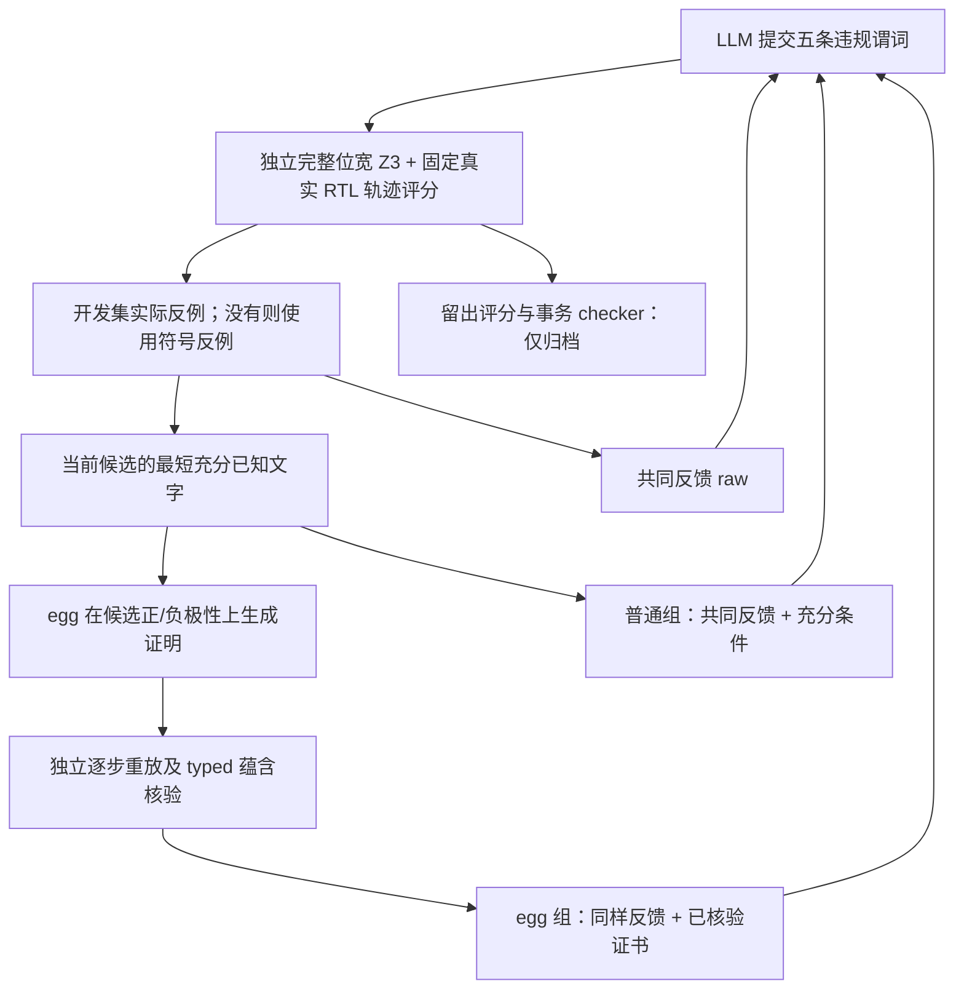

# Milestone 3 · Proof-Carrying LLM Verification

本轮实现并验证了一个新的反馈闭环：让 egg **证明当前 LLM 候选在反例上的诊断条件**，将完整可重放的证书交给下一轮模型，而不是只返回“等价 / 不等价”或直接提供正确参考断言。新实验还发现，证明整个候选 DNF 对漏报样例并不适合；把目标改为证明观察到的最短充分条件蕴含候选当前结果后，可核验且可发送的证书从 **10/24 提高到 20/24**。全部 24 个目标实际生成了完整证明，4 个因反馈大小限制仅归档。

本轮只有确定性 fixture 回复，没有新的模型 API 调用。它证明闭环和证书有效性、覆盖以及反馈开销，不能推断真实 LLM 的修订能力、token 收益或额外 RTL 故障检出率。此前真实 API 实验保持不变。

[固定协议](egg_frame_pc_protocol.md) · [上一轮诊断实验](egg_frame_diagnostic_results.md) · [旧真实 API 结果](egg_frame_live_results.md) · [独立审计说明](egg_frame_pc_audit.md)

## 1. 新的 LLM feedback loop



三组在每次相同候选时收到逐字一致的位宽反例和可见 RTL 反馈，只有下列差异：

| 组 | 公共语义/实际反例 | 最短充分诊断 | egg 具名证明 |
|---|---|---|---|
| raw | 有 | 无 | 无 |
| ordinary | 有 | 有 | 无 |
| egg | 有 | 有，逐字与 ordinary 相同 | 有则提供完整可回放证书 |

这里的 raw 比上一轮仅物理反馈的 raw 更强，因为现在三组都获得同一语义判断和反例。不能将旧在线三组 token 与本轮新组直接比较。模型每个 profile/重复/组有独立对话记录，固定轮数，轮转调用顺序；反馈由之前的候选和公共证据重建。原版、F02、F05 为可见开发集（两个故障匿名），F01/F03/F04/F06 不进入任何模型请求。所有候选仍使用 21 条固定真实 Icarus 轨迹评分。

对于额外报警，令 `signed_candidate = candidate`；对于漏报，令 `signed_candidate = not(candidate)`。最短充分条件只包含**实际已知**的候选原子文字，最多 12 个独立原子；在所有兼容的 Boolean 赋值上取最小，再用完整位宽 Z3 独立证明 `cube ∧ not(signed_candidate)` 不可满足。候选正负极性、原子映射、观测值和临时证书上下文均绑定。部分未知引脚不能被擅自赋值。故而即使候选是错误公式，诊断也可以声称“观察到的条件足以使错误候选作此判断”，而不是错误地称候选符合规范。

## 2. 难度分层与完整位宽判定

三组起点在任何新模型调用之前冻结，共 15 个错误公式，与五条真实原规格做独立完整位宽 XOR，全部 SAT 并回放符号模型。对照将原版 21 轨迹与附加灵敏度对照另外评分；实际闭环的评分只使用原 21 条轨迹，不把额外端口控制算成新 RTL 缺陷。

| 起点 | 不等价性质 | 21 轨迹额外报警 | 漏报 | 未知比较 | 选取的首次开发反例（物理/符号） |
|---|---:|---:|---:|---:|---:|
| historical | 5/5 | 894 | 5 | 0 | 4 / 1 |
| mixed | 5/5 | 202 | 17 | 14 | 4 / 1 |
| corner | 5/5 | 0 | 0 | 0 | 0 / 5 |

**corner 尤其重要：** 五条公式在原有所有实际采样上和参考结果完全一致，独立 oracle 却在每条公式上找到了语义反例。因此不能仅凭零仿真报警差异断言 LLM 修订已经合格。符号反例覆盖 unrestricted 两拍引脚域，不声称在该 RTL 输入约束下全部可达。完整位宽检查防止 vacuity/边界条件遗漏被当作通过；真正 RTL 可达性与 DUT 性质仍需要下节 formal 检查。

[固定起点、缺陷逐项说明、30 条不同轨迹控制评分](../results/milestone3/frame-pc-seeds/README.md)

## 3. 为什么从 DNF 证书切换到目标证书？

最初对 signed candidate 做 source-only DNF 提取。对额外报警的 10 个诊断机会均有证明；对漏报的 14 个机会全部因为整个否定式的 DNF 搜索膨胀，达到节点（6 次）或迭代（8 次）限制。仅提高饱和预算不是可靠的解决方案，因为实际上只需要证明一个已观测的充分条件。

新的 restricted-cube 策略：以模型当前候选为源，固定共同最短充分条件的原子为 `true/false`，其它原子保持自由。egg 在最多 20 轮、20,000 节点、5 秒 runner 上限内搜索该受限式与 `true` 的等价性，目标合并即结束。19 条固定规则覆盖常量传播、互补、幂等、双重否定及德摩根；规则独立穷举 40 组局部赋值。即使消去变量的规则用于反向证明，也必须提交明确的替换子树，独立检查变量绑定、语法路径和每步变换。完整 proof 只有在 32 步、6,000 字符预算内才可发给模型，绝不将截断证书称为完整证明。这个新方法证实的是 `cube ⇒ signed_candidate`，不是 DNF 的全式等价，并且不包含参考答案。

两种策略使用相同预设候选与同一实际/符号观察。离线时先在固定顺序运行所有共同查询，再运行两个证书方法，排除先前 Z3 查询造成的附带模型选择差异。独立对照逐字节比对了 144 份共同候选、物理与语义评分、原始回包和诊断文件，以及 12 份 raw/ordinary 请求。每个 profile 两轮、每轮三组，共 18 次预设回复/策略；首轮修复 2/5，第二轮 5/5（三组固定返回相同候选之一，**不是实测学习**）。24 个诊断机会含 15 个不同的候选/观察组合，其余是后一轮尚未修正的重复项。以下是实际进入请求的诊断机会，而非重复统计末轮反馈。

| 指标 | DNF 策略 | restricted cube 策略 |
|---|---:|---:|
| 普通最短充分条件（共有） | 24/24 | 24/24 |
| 有完整独立核验的 egg 证明 | 10/24 | **24/24** |
| 符合反馈预算且实际发送的完整证书 | 10/24 | **20/24** |
| 去重后的完整公开证书 | 7/15 | **13/15** |
| 搜索资源受限未证 | 14 | 0 |
| 已证但超过反馈预算 | 0 | 4 |
| 解释候选为真（10 个） | 10/10 | 10/10 |
| 解释候选为假（14 个） | 0/14 | **10/14** |
| 真实 API 调用 | 0 | 0 |

| 起点名称 | 诊断实例 | DNF 公开证书 | cube 公开证书 |
|---|---:|---:|---:|
| historical | 8 | 6 | 6 |
| mixed | 8 | 4 | **8** |
| corner | 8 | 0 | **6** |

20 个公开 cube 证书共 106 个具名步骤（每份 2–10）。4 个未公开的头部保持证书分别需要 56 或 50 步、7,195 或 6,900 个紧凑 JSON 字符，超过两个阈值，完整证据仍归档。额外用完全相同的 24 个目标去掉两个德摩根规则再运行，全部仍合并、20/24 符合反馈限制，未缩短这四个长证明至预算内；未据此重新选择预算或隐瞒失败。[17 条规则消融](../results/milestone3/frame-pc-cube-rule-ablation/README.md)

[配对比较全部 24 项](../results/milestone3/frame-pc-comparison/summary.json) · [DNF 原始请求/证明](../results/milestone3/frame-pc-dnf/transcript.tar.gz) · [cube 原始请求/证明](../results/milestone3/frame-pc-cube/transcript.tar.gz)

## 4. 实际反馈例子

在 mixed 的 `header_hold`，可见 Probe B 的独立背压轨迹第 17 拍出现实际漏报：

- 前一拍 `h_valid=1`、`h_ready=0`，两拍 reset 均为 0，当前 `h_valid=0`。
- 多个当前 header payload 引脚是未知值 `-1`；独立 typed 采样仍确定参考报警为真、候选报警为假。
- 最短充分条件仅为 `h_valid=false`。错误候选把 `h_valid` 当作必要的报警前提，因而在掉 valid 时根本不会报警。
- DNF 策略搜索受限；restricted cube 在候选否定式中将 `h_valid` 固定为 false，经 4 个具名步骤证明它必为 true（即错误候选为 false）。完整步骤和实际观测作为第二类工具反馈发送给 egg 组。ordinary 得到同一个充分条件，但不含等价证明。

另一个 corner 的 `clamped_length` 反例仅由完整位宽 Z3 找到：`h_original_length=8`、`h_length=65527`、`h_valid=1`、`rst=0`。此候选遗漏恰好等于 8 的分支。三个关于原始长度范围的已知为假比较足以推出候选为假；8 个具名步骤核验证书。该例是符号反例，并非真实 RTL 曾输出 65527 的声称。

## 5. Payload 开销和 formal quality gate

每组实际送入的 6 份新反馈（3 profile × 2 轮）合计 UTF-8 字节如下；另测所有请求 messages 紧凑 JSON 序列化长度，包括累积对话历史，不含网络传输或 provider 的序列化 overhead。它们**都不是 token**。

| 策略 / 组 | 新反馈 bytes | 请求 messages bytes |
|---|---:|---:|
| raw（两种策略相同） | 23,724 | 64,857 |
| ordinary（两种策略相同） | 29,565 | 75,640 |
| egg / DNF | 43,046 | 101,671 |
| egg / cube | 61,165 | 134,559 |

cube 发送更多完整可核验证书，但新反馈字节数约是 ordinary 的 2.07 倍。**不能提前声称省 token**；需要真实 usage 以及修复质量/轮次共同衡量。两种方式都不是比普通最小充分诊断多发现 20 条错误，普通对照已有全部 24 项充分诊断。egg 增加的是局部推导的可审计性。

fixture 最后的 9 批合格表达式只有一种完整写法（来自先前真实实验已归档的模型终稿）。另外保留新的独立形式回放，不靠 fixture 的合格标签：重解五条位宽 XOR；独立渲染 actual candidate 的 SV，在固定 pin-level 完整 RTL 上通过 Yosys SAT 24 状态有界检查，数据/头部两项保持性质又通过 3 状态基例与 Z3 时序归纳。其它三项仍为有界结果。该实验不增加原五条规格对六种内部变异的覆盖（仍为 3/6，事务 checker 6/6）。[形式结果](../results/milestone3/frame-pc-fixture-formal/summary.json)

## 6. 审计及复现环境

实际环境：Linux Python 3.12.14、Python Z3 4.16.0、Cargo/Rust 1.90.0（Cargo.lock 固定 egg 0.11.0）、Icarus 12.0、Yosys 0.52、Z3 CLI 4.16.0。本次每个离线策略均由独立审计重新读取全部 200 份记录，重建全部 18 次请求，确认各组 9 次非末轮回复确实进入下一轮，重新评分和验证公开证书。原始 provider 计数均为 0，usage=null。证书不存在、错误 proof、改变候选、留出信息泄露、跨组请求、伪造用量等均有负控制。在线归档也支持同样的离线审计，包括每轮原始 usage 及截至首次合格轮的累计 usage。

最终回归：全量 Python `make test` 131 项、indexed 专项 7 项、两个 Rust 证书引擎专项 8 项，共 **146 项通过**，无跳过或失败。追加测试拒绝用无关 `assert false` 伪装全位宽 UNSAT 回执；合法 SMT 排版差异仍可复核。修正前后的两份 matched fixture 比较结果逐字节一致。

[DNF 独立审计](../results/milestone3/frame-pc-dnf/audit.json) · [cube 独立审计](../results/milestone3/frame-pc-cube/audit.json) · [审计命令](egg_frame_pc_audit.md)

在 MacBook 原 repo 根目录（此前已跑通的 OSS CAD Suite 环境）执行：

```bash
"$(brew --prefix python@3.12)/bin/python3.12" -m venv "$HOME/rtl-tools/frame-venv"
FPY="$HOME/rtl-tools/frame-venv/bin/python"
"$FPY" -m pip install 'z3-solver==4.16.0.0'
FBUILD="$HOME/rtl-tools/frame-rust"
RUSTUP_TOOLCHAIN=1.90.0 CARGO_TARGET_DIR="$FBUILD" cargo build --locked --release --manifest-path egraph/Cargo.toml --bin egg_diagnostic_forms --bin egg_cube_proofs
OUT="$HOME/rtl-tools/frame-pc-check-$(date +%Y%m%d-%H%M%S)"
mkdir -p "$OUT"
"$FPY" scripts/egg_frame_pc_loop.py --fixture --certificate-mode dnf --binary "$FBUILD/release/egg_diagnostic_forms" --output "$OUT/dnf"
"$FPY" scripts/egg_frame_pc_loop.py --fixture --certificate-mode cube --binary "$FBUILD/release/egg_cube_proofs" --output "$OUT/cube"
"$FPY" scripts/audit_egg_frame_pc.py --run-dir "$OUT/cube" --output "$OUT/cube-audit.json"
```

两条 fixture 命令每条预期 `18 fixture responses, 0 provider calls`。不需 API key。可重新打包并执行配对分析：

```bash
tar -C "$OUT" -czf "$OUT/dnf.tar.gz" dnf
tar -C "$OUT" -czf "$OUT/cube.tar.gz" cube
"$FPY" scripts/compare_egg_frame_pc.py --dnf "$OUT/dnf.tar.gz" --cube "$OUT/cube.tar.gz" --output "$OUT/comparison.json"
```

如果拿到真实 run 合格候选，则可独立执行完整 RTL formal：

```bash
"$FPY" scripts/m3_controller_replay.py --fetch "$OUT/fixture"
"$FPY" scripts/check_frame_pc_candidate_formal.py --run-dir "$OUT/cube" --fixture "$OUT/fixture" --output "$OUT/formal"
```

| 脚本/引擎 | 职责 |
|---|---|
| `egg_frame_pc_seeds.py` | 冻结三种起点、独立证实错误及固定 fixture 的来源 |
| `egg_frame_pc_observation.py` | 仅按固定开发集选择实测反例，或回退到已回放的位宽符号反例 |
| `egg_frame_pc_diagnosis.py` | 从候选正/负极性搜索最短充分条件，独立 typed implication |
| `egg_frame_pc_certificate.py` | 原 DNF 证明生成、回放、匹配共同最短条件、反馈预算 |
| `egg_frame_pc_cube_certificate.py` | 受限候选的 `true` 证明、独立支持消去变量的改写核验 |
| `egraph/src/bin/egg_cube_proofs.rs` | 独立 egg 目标证明引擎，真实常量目标 `true`，目标合并即停止 |
| `egg_frame_pc_loop.py` | 三组独立历史、匹配共用证据、真实/fixture 模式、保存下一轮实际请求 |
| `audit_egg_frame_pc.py` | 不需模型与 egg 二进制的独立回放、身份与 token 账目重建 |
| `compare_egg_frame_pc.py` | 配对归档交叉核验、证书覆盖及请求字节测量 |
| `check_frame_pc_cube_rule_ablation.py` | 固定输入移除两个德摩根规则的独立事后消融 |
| `check_frame_pc_candidate_formal.py` | 独立检查合格候选，在固定实际 RTL 重新 formal |

## 7. 下一步真实在线实验（MacBook）

本轮云环境未配置 API key，实际在线结果等待本地使用之前可用的 `gpt-6.1-sol/low` 和 API key 执行。建议使用新的 `cube` 策略作为首次真正的 proof-carrying 三组实验。先跑单个 `mixed` profile（6 次 API），确认账目与完整流程；完整三 profile 单次重复是 18 次 API 调用。预算用 profile、轮数、重复数显式固定。多次独立重复才适合研究模型质量与 token 的可复现性。

```bash
LIVE="$HOME/rtl-tools/frame-pc-live-$(date +%Y%m%d-%H%M%S)"
(
  printf 'OpenAI API key: '
  IFS= read -rs OPENAI_API_KEY
  printf '\n'
  export OPENAI_API_KEY
  "$FPY" scripts/egg_frame_pc_loop.py --live --certificate-mode cube \
    --model gpt-6.1-sol --reasoning-effort low --rounds 2 --max-output-tokens 3072 \
    --profiles mixed --replicates 1 --binary "$FBUILD/release/egg_cube_proofs" --output "$LIVE"
)
cat "$LIVE/summary.json"
"$FPY" scripts/audit_egg_frame_pc.py --run-dir "$LIVE" --output "$LIVE-audit.json"
tar -C "$(dirname "$LIVE")" -czf "$LIVE.tar.gz" "$(basename "$LIVE")"
```

完整实验把 `--profiles mixed` 改为 `--profiles historical mixed corner`。重复实验加 `--replicates 3` 为 54 次真实 API（这不会被 fixture 统计混淆）。模型如果首轮已正确仍需固定进入下一轮，以免不同组调用预算不一致。如果 provider 调用失败，保留 `provider-error.json` 和 `incomplete.json`，不把不完整运行汇总成完成的实验。

**研究结论。** 本轮证明 egg 可以在 LLM feedback 中承担可核验的局部证明任务，并给出对漏报的目标导向方法；但强普通诊断本身覆盖 24/24，证明文本增加了 prompt 长度，尚未获得模型修订相对普通组的收益。在线实验才是检验 proof-carrying feedback 是否值得其 token 开销的下一步。不能因为全部受限式被证真而把错误候选或 DUT 判为正确。
