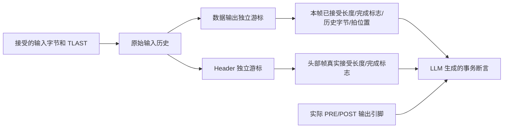
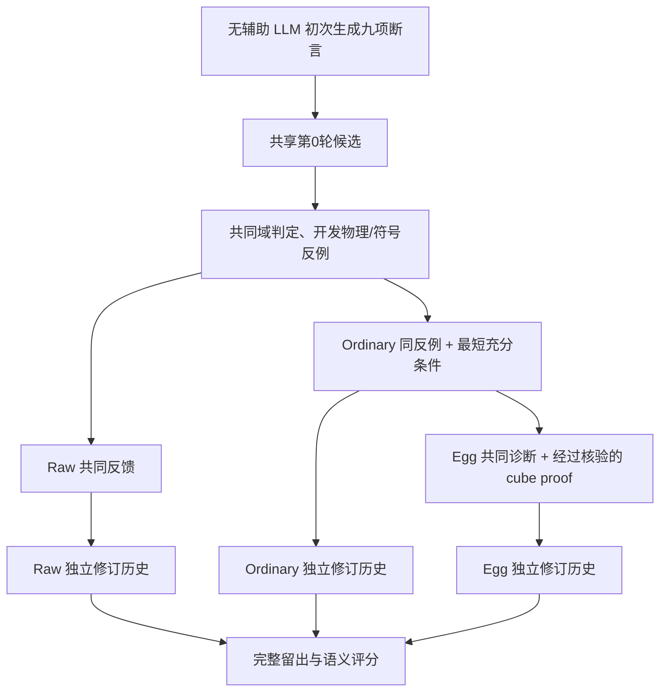

# Milestone 3 · 更困难的 AXI 帧事务验证与 Proof-Carrying LLM 闭环

上一轮真实 API 实验里，五条局部属性对 `gpt-6.1-sol/low` 已经出现首轮成功率天花板，Raw 也是 3/3。本轮不再人为增加布尔式的括号或给真实模型一个固定错误 seed，而是扩展到**跨周期、跨独立数据/头部通道的九条事务级规格**，并让每个真实 trial 从一次无辅助模型生成开始，再共享该实际初稿给 Raw、Ordinary、Egg 三组。工程、独立评分、真实 RTL 有界形式检查、证书反馈和审计均已建立；本轮只执行离线固定回复，不声称新模型的实际难度或修订收益已测得。

[冻结协议](egg_frame_txn_protocol.md) · [上一轮真实 API](egg_frame_pc_live_results.md) · [本轮轨迹覆盖](../results/milestone3/frame-transaction-coverage/summary.json)

## 1. 从两拍局部规格到真正事务级规格

新验证对象仍是固定上游 `frame_task`（AXI Frame Length Adjuster + 独立数据和状态 FIFO），原 RTL 未改变。之前的局部保持属性仍保留；新九项针对帧处理事务，**不把之前的五条复用结果当成新证明**。

| 新属性 | 验证义务 |
|---|---|
| `data_entitlement` | 数据输出有对应接受过的输入帧/前缀，或已完成短帧允许的补齐，不得提前、多发、越过最大八字节 |
| `data_payload` | 实际输出保持对应输入字节的顺序与内容，补齐部分必须为零 |
| `data_last` | 正确输出帧最后一拍；短帧补齐到四，超过八截断，即使输入 TLAST 尚未到达也必须在八结束 |
| `header_entitlement` | Header 必须对应独立 header 游标上的已完成输入帧，不能未完成就报告 |
| `header_original` | 报告真实接受的原始帧长度，而不是验证 DUT 自报值自身的一致性 |
| `header_adjusted` | 报告真实原始长度夹紧在 [4,8] 的正确结果，而不只是处于范围内 |
| `header_flags` | 相对于真实接受的长度判断 pad 和 truncate，包含恰好 4/8 的边界 |
| `reset_clear` | 同步复位边沿后两个输出 valid 均清零 |
| `drain_complete` | 有足够静默排空尾部的有限实验结束点，输入无部分帧，数据与 header 分别完成所有事务，无未完成输出 |

### Ghost tracker 是什么？

用 `s_valid && s_ready` 收集**实际被 DUT 接受**的输入字节与 TLAST，在每个 reset epoch 记原始帧历史。数据游标根据观察到的 `m_valid && m_ready && m_last` 推进；头部游标根据独立的 `h_valid && h_ready` 推进。数据拍位置从 1 开始，两个游标互不代替。游标过界在故障中允许出现，不能由规格假设排除。



模型只获得自然语言规格、原始上下文字段（原始长度、实际接受字节、状态、游标），**没有**预先计算好的期望输出字节、TLAST、夹紧值或旗标答案。PRE 依据之前边沿历史、POST 依据当前边沿更新；复位前的 PRE 不作复位清零检查。检测并不要求输出消费者 ready 才能检查 presented valid 的正确性。候选本身不参与历史更新，避免模型通过修改 scoreboard 逃避检查。本阶段可信 ghost tracker 是独立实现，模型负责生成九条违规公式，不是让模型生成整个 tracker，也不声称已解决任意状态程序的合成。

## 2. 真实 RTL 事务检测结果

主闭环使用原版和先前冻结的六种内部 RTL 变异，每个设计有长度扫描、独立背压和中途复位三条原生 Icarus 轨迹。共 21 条、6,384 周期；PRE（非 reset）和 POST 共 12,712 个采样点，九项共 **114,408 次性质比较**。独立 Python 命令式事务规范与 typed 参考公式在所有这些采样上逐项一致。本语料没有未判定或因历史缺失而不合格的性质比较；X/Z 若将来出现则按所有结构域合法补全求值，不强行填值；不可观察历史显式记录。

| 设计 | 检出的事务报警次数 | 代表性事务属性 | 独立原事务 checker |
|---|---:|---|---|
| 原版 | 0 | 无 | PASS |
| F01 · 补齐错误字节 | 58 | `data_payload` | FAIL |
| F02 · 长度 8 错误标记截断 | 8 | `header_flags` | FAIL |
| F03 · 截断后漏末拍 | 481 | `data_last`, `data_entitlement`, `data_payload`, `drain_complete` | FAIL |
| F04 · stalled 输入被错误计数 | 32 | `header_original`, `header_adjusted` | FAIL |
| F05 · 错用数据 ready 消费 header | 214 | `header_entitlement`, `header_original`, flags/length, drain | FAIL |
| F06 · Header FIFO 未正确复位 | 106 | `reset_clear`, header 对应, drain | FAIL |
| 总计 | 899 | 九项都在至少一种变异报警 | 6/6 |

之前五项局部性质只能检出三种内部变异；现在九项事务性质可以在相同物理语料上检出 **6/6**。18 条变异轨迹中恰好 13 条报警，和冻结的完整独立事务 checker 的 FAIL 轨迹逐条一致，原版三条均通过。899 是性质 × 采样的报警次数；F03 的错误帧边界可导致游标后续偏移而产生多次关联报警，不能算作 481 个独立缺陷，也不要将旧 PRE 五属性 23 次和新 PRE/POST 九属性 899 次当成同分母的倍数收益。

另外独立评分先前的三个端口灵敏度对照 D01–D03（9 条额外轨迹），8/9 条有明确报警与原事务 checker 一致。合并去重后的 30 条轨迹、163,440 次性质判断、1,176 次报警中，所有原版、真实变异及端口控制的轨迹判定相符。额外端口控制不计入真实六变异检出率，也不进入 LLM 反馈。这些是复用已实际仿真的原始采样，未声称重新编译了全部 21/30 条轨迹。

## 3. 三个不同的 Formal 层次

### A. 独立完整位宽语义检查

新的 `egg_txn_terms.py` 支持与此前相同的布尔/无符号比较 S-expression，但类型是事务上下文：8-bit 实际和历史数据、16-bit 长度、游标与拍位置、Boolean 同步标记。参考式从独立规格导出，并用独立 piecewise bit-vector word spec 在结构域内逐项交叉检查。九个性质均具有可重放的 true 和 false 符号见证。

结构域：最多 512 个观测计数/拍位置，存在的输入帧记录长度 1–12；输出游标可以超过输入计数；缺失记录 n=0、done=false；同游标对应同原始记录；未完结输入仅可能在最新帧；final_sample 是 POST。**不约束实际 DUT 输出为正确值。** 语义合格是候选和参考在约定结构快照域上的 XOR UNSAT，不等于所有结构域赋值都在真实 RTL 可达。

### B. 真实完整 RTL 的独立 Bounded Model Checking

另行编写独立 SV ghost harness（不由 LLM 候选或上述 DSL 机械生成）。在原版 `frame_task` 上用 Yosys SAT 验证 **8 项事务安全性质，18 状态全部 PASS**。形式环境限定每个复位 epoch 至多一个输入帧、长度不超过 12、输入 stall 时保持、reset 时无输入，数据字节和独立消费者 ready 为任意符号输入。使用任意 3-bit byte slot 检查所有保留字节。`reset_clear` 用复位边沿后下一 PRE 表示。有限排空 `drain_complete` 另由实际有至少 128 静默 ready-high 尾部的轨迹检查，未在这个无公平性环境中宣称无界 liveness。

| 实际 RTL 形式对照 | 结论 |
|---|---|
| 原版八项安全性质 | 18 状态无反例，8/8 |
| 可达覆盖 | 6/6：非零保留字节、pad、长帧 header、两个独立消费者传输、pending output 时复位 |
| F01 对照 | `data_payload` 在第 7 状态得到反例 |
| F06 对照 | `header_entitlement` 在第 9 状态得到反例 |

六个 Z3 cover witness 均在真实原版 Icarus 重放对应状态并通过独立事务 checker；两个变异反例分别用完全相同输入在变异和原版上进行实际 Icarus 对照，变异明确失败、原版通过。这是新的原生形式/物理实验，不是从之前的局部属性推得。**有界单帧 harness 不证明任意多帧、无界时序或任意 LLM 候选直接通过 RTL formal；** 多帧独立游标由 21 条实际轨迹和结构域语义检查覆盖。正式更强的多帧/无界性质仍需扩展 formal harness。

[实际 formal 结果、工具、假设与原生反例](../results/milestone3/frame-txn-formal/summary.json)

### C. Egg 证明是候选诊断，不替代 A/B

对于选定实际或符号分歧，若候选报警为真，解释 `candidate`；若为假，解释 `not(candidate)`。从当前候选原子上求精确最短充分已知文字（上限从 12 扩展到 16），逐项独立检查观测与 Z3 蕴含：`cube ∧ ¬signed_candidate` UNSAT。只代入这些已知布尔原子，使用真实 `egg_cube_proofs` 证明受限式等价于真；其余原子保持自由。完整具名 proof 由 Python 重放，最多 32 步/6,000 字符才交给模型。证明仅来自候选及观察，不能把 reference 作为证书目标、不能把 held-out 样本作为反馈。Egg 证明不独立判定规格正确，也不取代真实 RTL 形式工具。

## 4. 重新设计真实 LLM 实验

旧实验人工固定三种 seed，模型往往直接首轮重新构造正确的五条断言。新 driver 在每个真实 trial 上从**一次无辅助初始生成**开始，只有 task 自然语言和类型 schema，无初始答案或反例；保留初稿原样（三组使用同一份真实输出），不根据是否出错重抽或挑选 trial。



开发为原版、F02、F05，公开后两者别名 Probe A/B；物理反例按固定设计、场景、时间顺序，找不到则用独立结构域符号反例。公开工具反馈计数按开发设计聚合三个场景，第一项反例保留实际场景拍号和原始 ghost/pin 字段。不公开独立参考公式、留出故障或全量审计文件。Raw 同样得到语义反例；Ordinary/Egg 的反例和最短充分条件严格一致。每 trial 第 0 轮只调用一次，共享初始 usage 只记一次；每臂固定两轮。若初稿语法失败，三组共享解析错误；若初稿完美，记录第 0 轮合格并仍执行固定预算，不以结果筛选。

**合格判定：** 九项结构域全位宽等价，物理判定无确定漏报、多报且无单侧未知分歧。共同不可判定或显式不合格采样另计，不视为已覆盖。在当前固定语料两者都为 0，故实际末轮结论无此缺口。有限测试台的尾部不少于 128 周期，区分排空与无条件 liveness，不允许不满足尾部条件的语料进入完整评分。真实 provider 用量、到首次合格的 incremental 和包含共享初调用的总量由审计逐会话计算。

## 5. 运行结果：离线闭环预检

固定 fixture 模拟有九处逻辑错误的初稿；第一轮只改四项、第二轮全部修订，用于保证实际存在后二轮证明反馈路径，**并非模型生成或学习**。

| 阶段（三个组共享固定 fixture 回复） | 域等价 | 多报 | 漏报 | 未知/不合格采样 |
|---|---:|---:|---:|---:|
| 共享初稿 | 0/9 | 843 | 396 | 0 |
| 第一次修订 | 4/9 | 633 | 120 | 0 |
| 第二次修订 | 9/9 | 0 | 0 | 0 |

初稿与参考的 899 次报警匹配 503 次，虽已能粗略标记 6/6 设计，仍有大量局部误判。不能仅以 fault detected 与否给候选判定合格。Egg 初始反馈 9/9 完整可发送证明（39 步）；修订后剩下五项再次 5/5 可发送（27 步），合计 14 次新的反馈证书机会、66 个具名步骤，包含 11 个真实物理反例和 3 个符号反例。普通组具有相同 14 个最短充分解释。14 次机会包含五个重复尚未修复任务，不是 14 个独立初稿。三组分别有 0、14、14 诊断送入，两轮新反馈 raw 16,725 bytes、ordinary 19,754 bytes、egg 37,629 bytes（非 token）。

1 份共享初稿 + 3 组 × 2 修订 = **7 fixture responses, 0 provider calls**。独立审计重建独立初稿与全部后继请求、共同诊断、证书和用量，确认第 1 轮后五份实际尚未修订属性的证明进入第 2 轮。当前云端无 API key，没有新真实 LLM 结果；这次工作真正新增了事务验证能力和一个公平的更难真实模型实验入口，不能宣称已经证明 Egg 对模型有收益。

[fixture 原始归档](../results/milestone3/frame-txn-loop-fixture/transcript.tar.gz) · [fixture 汇总](../results/milestone3/frame-txn-loop-fixture/summary.json) · [独立审计](../results/milestone3/frame-txn-loop-fixture/audit.json) · [审计方法与负控](egg_frame_txn_audit.md)

最终回归：在隔离仓库副本中使用完整工具和归档，Python 全量 159 项、indexed 专项 7 项、Rust 两个证书引擎 8 项，合计 **174 项全部通过**，无跳过。复核拒绝初稿答案泄露、跨臂历史、留出污染、陈旧证明、结构域弱化与错误 XOR 端点及重复共享调用用量。[冻结协议及归档哈希](../results/milestone3/frame-txn-loop-fixture/provenance.json)

## 6. 环境与脚本说明

实际本地环境：Linux Python 3.12.14、z3py/Z3 4.16.0、Icarus 12.0、Yosys 0.52、Rust/Cargo 1.90.0、锁定 egg 0.11.0。原实验继续兼容之前 MacBook 已安装的 Python 虚拟环境、OSS CAD Suite 与 Rust。用户已经编译过 `egg_cube_proofs`；如果二进制仍在，可直接复用。没有新 Rust 依赖。

| 文件 | 用途 |
|---|---|
| `scripts/egg_txn_terms.py` | 事务字段类型、解析、结构域、独立完整位宽 XOR、精确 X/Z 补全、抽象 |
| `scripts/egg_txn_observe.py` | PRE/POST 被动 ghost 更新、命令式参考判定、全语料评分及独立 checker 对照 |
| `scripts/egg_txn_certificate.py` | 16 原子上限的候选最短诊断、完整位宽蕴含、真实 egg 证明与独立回放 |
| `scripts/egg_txn_loop.py` | 共享初次生成、三组隔离历史、逐轮反馈与真实 usage、固定 fixture |
| `scripts/audit_egg_txn.py` | 离线重建并核验所有初始/修订请求、评分、证明、用量和留出隔离 |
| `scripts/egg_txn_formal.py` | 独立单帧 RTL BMC、覆盖见证、变异反例、Icarus 等输入对照 |
| `examples/axis_frame_length/transaction_formal/` | 实际 pinned wrapper 的形式验证与物理重放 SV harness |

### 离线复现（MacBook 仓库根目录）

```bash
FPY="$HOME/rtl-tools/frame-venv/bin/python"
FBUILD="$HOME/rtl-tools/frame-rust"
RUSTUP_TOOLCHAIN=1.90.0 CARGO_TARGET_DIR="$FBUILD" \
  cargo build --locked --release --manifest-path egraph/Cargo.toml --bin egg_cube_proofs
OUT="$HOME/rtl-tools/frame-txn-check-$(date +%Y%m%d-%H%M%S)"
"$FPY" scripts/egg_txn_loop.py --fixture --trials 1 --rounds 2 \
  --binary "$FBUILD/release/egg_cube_proofs" --output "$OUT"
"$FPY" scripts/audit_egg_txn.py --run-dir "$OUT" --output "$OUT-audit.json"
```

轨迹与独立 formal 复查（如本地已配置 OSS CAD Suite 且固定 fixture 已下载，可复用）:

```bash
"$FPY" scripts/egg_txn_observe.py --diagnostic-controls --output "$OUT-coverage.json"
"$FPY" scripts/m3_controller_replay.py --fetch "$OUT-fixture"
"$FPY" scripts/egg_txn_formal.py --fixture "$OUT-fixture" --output "$OUT-formal"
```

### 新真实 API 实验

建议先做 1 个 trial，固定 7 次 API 调用（第 0 轮共享初稿 1 次 + 三组各 2 次）；观察初稿的自然错误及修订过程。随后 3 个独立 trial 共 21 次，才能对模型效果作初步配对比较。若初稿已合格，记录天花板，不重复抽取困难样例。

```bash
LIVE="$HOME/rtl-tools/frame-txn-live-$(date +%Y%m%d-%H%M%S)"
(
  printf 'OpenAI API key: '
  IFS= read -rs OPENAI_API_KEY
  printf '\n'
  export OPENAI_API_KEY
  "$FPY" scripts/egg_txn_loop.py --live --trials 1 --rounds 2 \
    --model gpt-6.1-sol --reasoning-effort low --max-output-tokens 4096 \
    --binary "$FBUILD/release/egg_cube_proofs" --output "$LIVE"
)
cat "$LIVE/summary.json"
"$FPY" scripts/audit_egg_txn.py --run-dir "$LIVE" --output "$LIVE-audit.json"
tar -C "$(dirname "$LIVE")" -czf "$LIVE.tar.gz" "$(basename "$LIVE")"
```

真实模型首次无辅助请求的误报、漏报和不等价数量会独立保存。只有其自然出现的合法语义错误才能检验 Egg 证明反馈的真实增益。若 API transport 失败，保留 `provider-error.json` 和不完整 run，不伪造完整结果。
