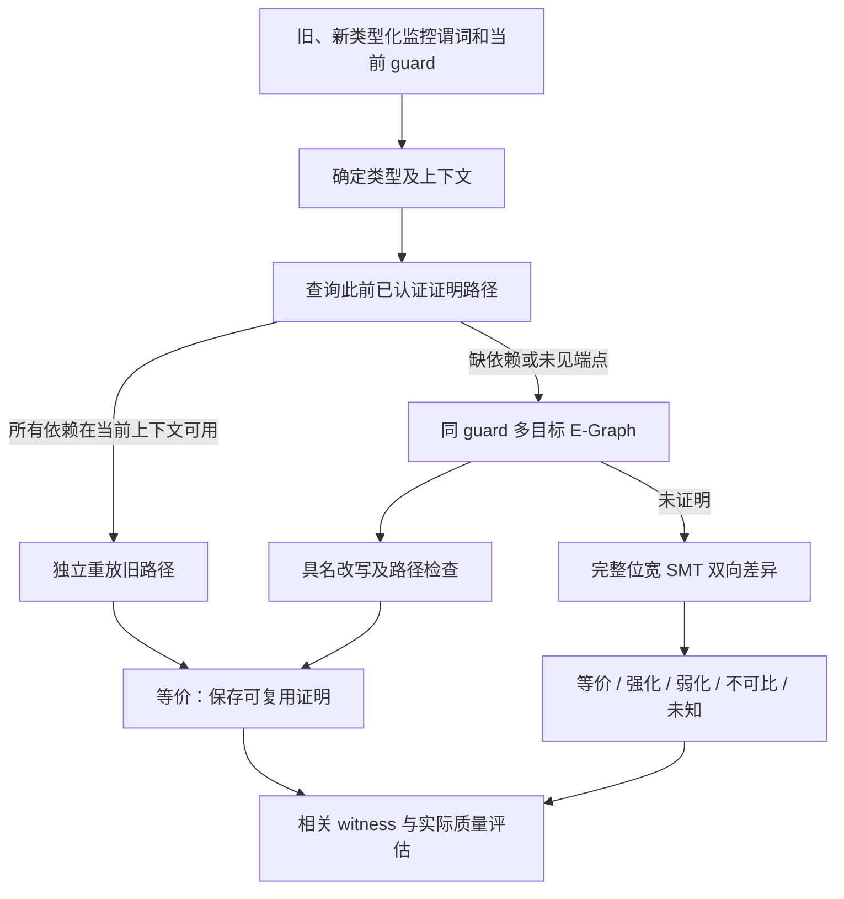

# Milestone 3 · Context-Aware Equality Saturation for Semantic Regression and Proof Reuse

本轮把之前独立的 context-sensitive egg、proof dependency、proof withdrawal 和 LLM 候选分析合并为**按轮次、性质、上下文分组的语义回归验证**。新系统能区分等价、强化、弱化、不可比，安全共享可检查的 Egg proof，针对新作用域失效的旧证据拒绝复用。首轮与独立复跑结果一致。

[冻结实验协议](egg_regression_protocol.md) · [相关工作与研究定位](egg_related_work_and_research_value.md) · [先前上下文证明](egg_txn_context_results.md) · [先前 RTL 修改及规则撤回](milestone3_proof_applications.md)

**核心结论：**共享 Egg 保持 224/224 语义分类正确，把 53 次逐对 native graph 减至 35 次，并将 8 次非恒等请求用已检查证明路径完成。但同事实普通对照和强增量 SMT 同样 224/224，后者包含等价连通性复用且总体更省求解。没有将上下文、缓存、普通传递性或证明复用的收益夸称为 egg 独占贡献。

## 1. 真实输入与对照

使用此前 Mac 真实 API transaction 归档（`gpt-6.1-sol/low`，3 个独立初稿、9 个会话各 2 次后继，即 21 个实际响应），严格锁定全部 43 个配置/请求/响应成员哈希。真实初稿是独立生成，非真实先后修改。由初稿选出所有固定比较，不按本轮 solver 结果筛选。现成真实后继 162 个逐性质变化机会**全部原式相同**；必须单独报告，不把这些 trivially identical 比较算作 Egg 优势。受控修改明确标识，不冒充 LLM 错误。物理模型仍是原始可信事务 ghost tracker，类型限定自由 8/16-bit unsigned 两态快照，不声称任意 SVA 或 DUT 无界可达性等价。

| 队列 | 比较请求 | 字符串非同形 | 等价 | 强化 | 弱化 | 不可比 |
|---|---:|---:|---:|---:|---:|---:|
| 真实三初稿逐性质比较 | 27 | 18 | 27 | 0 | 0 | 0 |
| 真实同会话后续两轮 | 162 | 0 | 162 | 0 | 0 | 0 |
| 真实 TLAST 的三路上下文比较 | 9 | 9 | 9 | 0 | 0 | 0 |
| 人工受控性质修订 | 20 | 20 | 0 | 9 | 9 | 2 |
| 人工受控局部语义与作用域修改 | 6 | 6 | 4 | 0 | 0 | 2 |
| 合计 | **224** | **53** | **202** | **9** | **9** | **4** |

表中的 224 为请求出现次数，不代表 224 个独立样本。局部比较与全域比较可能来自同一对 LLM 公式。所有目标都经独立完整位宽 SMT 双向方向查询复核，均符合预声明分类。

## 2. 语义回归与证据复用实现



实际新模块 `egg_regression_forms` 是 Rust native egg 0.11.0：一次插入多个原始布尔抽象端点，请求明确边集合，共用 23 条通用布尔规则及同一组 scoped typed facts；目标均合并即停，亦允许饱和/资源上限。每条需要合并的非恒等边必须有可检查的 flat explanation，不能凭 e-class ID 比较就认为已证明。普通、逐对 egg、共享 egg 获得同一组独立 SMT 认证事实；含全部相同端点的组只认证 guard 可行性。每个 E-Graph 仅覆盖一个精确 guard，Rust 图不跨轮次持久化，持久化对象是可重放证明库。

证明存储保存原始类型化端点、类型/规则签名、上下文、使用的 primitive ground receipts、改写方向及位置；支持同作用域正/逆向和多跳路径；跨作用域时只允许已知当前事实重新授权所用前提（纯 Boolean 规则无局部依赖）。以当前事实证明缺失时阻止而不声称不等价。双方基本监控谓词表示**报警**（违规=true），因此 old_only SAT/new_only UNSAT 表示弱化，反向表示强化；使用 SMT 独立检查这两个方向，不把未合并或抽象 SAT 当作 typed witness。

## 3. 主要实验结果

| 方法 | 全部分类正确 | 非恒等正例（31）中无需完整目标 SMT 的数量 | 错误接受非等价（22） | 原生图构建 |
|---|---:|---:|---:|---:|
| 增量 SMT + 已证明等价连通性 | 224/224 | 12/31（已有 SMT 等价路径） | 0/22 | — |
| 普通命题推理 + 同事实 + 连通性 | 224/224 | 30/31（含12次连通性） | 0/22 | — |
| 逐对 scoped Egg + SMT fallback | 224/224 | 29/31 | 0/22 | 53 |
| 共享 scoped Egg + proof store + SMT fallback | 224/224 | 29/31（21次新求证、8次复用路径） | 0/22 | **35** |

从 53 到 35 图是 **34.0%** 的下降，包含已证明路径复用、组内同对/反向去重、多个目标同图三项效应；不能全部算成 equality saturation 的优势。去掉 171 个原式恒等请求后，实际剩 53 个，其中 31 个等价，22 个不等价。共有 15 条非恒等归档证明边，59 步新提取 proof（逐对为 106 步）；借助既有路径而非新图的 8 次请求中 4 次一跳、4 次两跳；2 次同作用域复用、6 次跨作用域路径重新授权。实际这六个跨作用域复用例从全域 Boolean 改写继承至局部（其中三条路径也包含已在相同局部 guard 中证明的边），没有声称实际已跨 guard 迁移一个仅局部有效的 ground equality。此项更强能力在单元测试中受控验证。

真实 `header_adjusted` 的第三个初稿比较（R0029）由两个已有等价边形成两跳路径。真实 `data_last` 在三个局部 guard 下 9/9 有独立证据，其中六次可复用。其中 2 个全域非同形比较仍需完整位宽 SMT fallback，不能把局部证明当作未检查全域分区的直接结论。先前分区证明实验已单独覆盖这两项。

### 求解开销（必须与证明复用分开看）

| 方法 | 实际完整目标/方向/guard SMT checks | 共同 primitive 前提新查询 | 总 typed SMT checks（不含离线 oracle） | 其他工作 |
|---|---:|---:|---:|---|
| 增量 SMT + 连通性 | 69 | 0 | **69** | 12次等价连通性 |
| 普通 + 同事实 | 22 | 548 | **570** | 82次命题方向检查 |
| 逐对 Egg | 33 | 548 | **581** | 53张图 |
| 共享 Egg | 33 | 548 | **581** | 35张图 + 路径检查 |

共同事实查询含 66 次 guard 询问、527 次常量、1,406 次 primitive pair，合计 1,999 次逻辑请求，其中 1,451 个跨组 cache hits、548 个 solver misses。66 个事实出现次数去重得 21 个具名 facts，15 条归档证明边实际依赖 13 个不同 facts。共同事实发现不是 Egg 独占成本或节省：其成本应分别计入每个基于事实的比较臂。普通方法只回退未被命题 UNSAT 证明的方向，不人为增加 baseline 开销。上表未包含离线全量真值 grading /审计，后者各组同等不用于操作回路。

单次 Linux 运行中 native egg 过程累计约 0.89s（逐对）/0.66s（共享），包含进程发起；共同事实处理约 0.84s，直接增量 SMT 含路径维护约 0.53s。真实端到端 RTL 验证、人工审查、LLM latency 均未在本轮计时；不能推广成整体 RTL 加速。另一轮全部逐组规范化结果（含 SMT witnesses 和 proof store）完全一致，非计时汇总一致。

## 4. 证明失效与语义差异的实际证据

对真实初稿 T1 的完整 `data_last` 公式构造受控变体，只将 `data_index=data_n` 换成 `data_index=4`。保持原 RTL、其它 guard、类型不变：

| 请求 | 当前 guard | Egg 结果 | 直接 typed SMT 分类 | 操作 |
|---|---|---|---|---|
| R0222 | `data_n=4` | 2 步、1 个条件事实 | equivalent | 生成并存储证明 |
| R0223 | `data_n=5` | 旧证据被阻止；本地图未能合并 | incomparable | 两方向差异独立求解 |
| R0224 | 恢复 `data_n=4` | 原证明一跳回放 | equivalent | 安全复用 |

原 proof 实际依赖的具名事实是 `(eq 4 data_index) = (eq data_index data_n)`。在新 guard `data_n=5` 重新检查该事实得到不等价的双向 witness；不是仅因为名称或哈希改变而拒绝。

所有 6 个 `blocked` 请求均进行了**后验依赖审计**（与原始冻结实验分离，不修改其方法预算）。共 52 次缺失依赖出现、27 个不同的 current-guard+typed-equality 查询。46 次依赖确实在新作用域无效，6 次仍有效但未包含在本批共用事实森林中。三类结果都要区别：旧证明不能重放、旧前提实际上为假、整体目标不等价。后一项必须通过独立目标判定，不能从前两项自动推出。下一步可评估高效的 targeted re-certification，而不是将所有缺失依赖视为无效。

## 5. 原始 RTL 轨迹交叉检查

仍使用已锁定的 21 条 Icarus 原版与功能对照轨迹（12,712 PRE/POST snapshots），另有 9 条独立端口灵敏度对照（5,448 snapshots）。在这 18,160 个快照上评分 62 个非历史请求、去重后 59 个不同方向/guard 对；不把重复局部/全域采样加成不同的 bug。34 个去重实际 LLM 比较（25 个初稿+9 个局部），在两个语料均无差异、无未知、与独立参考一致。22 个不等价受控对中 18 个在现有物理语料可区分；其余四个是 `data_last` 和 `drain_complete` 的额外 ready gate 及恢复对照，只具备自由位宽符号证据，不能声称现实轨迹已覆盖。

| 实际 TLAST 边界对照 | 主轨迹差异 | 额外端口对照差异 |
|---|---:|---:|
| exact-four 缺支（全域或 N=4 局部） | 56（4旧独有、52新独有） | 24 |
| exact-four 缺支在 N<4,N>4 | 0 | 0 |
| fixed-index 在 N=4 | 0 | 0 |
| fixed-index 在 N=5 | 84（2旧独有、82新独有） | 36 |
| 恢复 N=4 | 0 | 0 |

在原正确 RTL 上，exact-four 变体产生 8 个新增报警，固定索引五字节变体产生 12 个新增报警；这说明只判断“变体覆盖了更多报警”不足以认为质量更好。形式化语义方向、实际原版误报和对照缺陷漏报需一起看。这里复用已有轨迹而没有修改 DUT 或新跑 LLM，既有 [事务 BMC](egg_frame_txn_results.md) 的有限深度和单帧假设不变；不宣称本轮已直接证明全部新谓词的无界时序 RTL 正确性。

## 6. 复现环境与脚本

Linux 实验使用 Python 3.12.14、Z3/z3py 4.16.0、Rust 1.90.0、egg 0.11.0（Cargo.lock）。Mac 可直接沿用此前 frame venv 和 Rust 目标目录。离线 replay 无需 OpenAI API 或重新仿真 RTL；原先 Yosys/Icarus 工具链用于既有真实轨迹与 formal harness。运行目录必须不存在，以免覆盖旧记录。

```bash
CARGO_TARGET_DIR=/tmp/egg-regression-rust cargo build --locked --release --manifest-path egraph/Cargo.toml --bin egg_regression_forms
python3 scripts/run_egg_regression.py --binary /tmp/egg-regression-rust/release/egg_regression_forms --output /tmp/egg-regression-run
python3 scripts/audit_egg_regression.py --run-dir /tmp/egg-regression-run --output /tmp/egg-regression-audit.json
python3 scripts/check_egg_regression_dependencies.py --run-dir /tmp/egg-regression-run --output /tmp/egg-regression-dependencies.json
python3 scripts/check_egg_regression_physical.py --output /tmp/egg-regression-physical.json
```

| 文件 | 职责 |
|---|---|
| `egg_regression_workload.py` | 冻结真实、历史、受控修订及 scope 生命周期；保留来源及响应哈希 |
| `egg_regression_facts.py` | 多目标共同类型化原子事实、精确 scope cache、普通增量命题推理 |
| `egg_regression_smt.py` | 完整位宽双向方向分类、guard-specific incremental solver、独立 oracle/witness 重放 |
| `egraph/src/bin/egg_regression_forms.rs` | 单上下文内真实多目标 Egg saturation，按请求提取 flat 解释 |
| `egg_regression_check.py` | 独立检查 e-class 及具名 proof 路径；冻结通用规则 |
| `egg_regression_reuse.py` | 绑定类型、作用域、依赖的证明库，反向/传递证据、重新授权及阻止 |
| `run_egg_regression.py` | 组织四组公平对照，保留全部 graph、solver receipts、候选和指标 |
| `audit_egg_regression.py` | 无需执行 Rust 的独立审计；重建全部冻结请求、shared/pair graphs、依赖及历史 store，核算指标 |
| `check_egg_regression_dependencies.py` | 后验重查被阻止证明的具体 typed facts |
| `check_egg_regression_physical.py` | 现有真实物理轨迹的独立差异及 reference scoring |

结果位于 `results/milestone3/frame-txn-semantic-regression/`，包括完整工作负载、组级压缩证据、证明库、独立审计、依赖复核、物理轨迹复核及 provenance。没有新增付费请求。

完整回归：在 Linux 隔离副本运行 223 项 Python 测试（包含新引擎、审计篡改反例、复用/作用域、物理轨迹及 live fixture）、7 项旧 indexed engine 测试、19 项 Rust 定向测试，共 **249 项全部通过，无跳过项**。仓库原有 `egraph/target/debug/rtl-predicate-egraph` 可能是另一平台预编译产物，不能在 Linux 或不同架构直接执行；本轮用已有 Linux 本机构建产物在隔离副本完成复核，仅恢复测试生成的旧 build 日志，不将平台相关产物纳入补丁。独立主实验审计复核 224 请求、66 组、15 归档证明边；运行两次，所有非计时组记录一致。新 live fixture 两次 summary 一致。

## 7. 研究意义及限制

本轮结合已有单设计证据，完成了一套实际的跨轮次语义维护与条件证明复用机制，并确认失效的 ground equality 对真实 TLAST 具有物理意义。共同事实开销和强普通基线相同结果说明目前没有证据表明应普遍用 Egg 取代 SMT；已有 Versioned E-Graphs、SMART 等工作使我们应声明这是应用和对照研究，而非新的通用等式饱和算法。

尚缺跨 RTL 模块、复杂 temporal SVA、实际自然出现的多轮模型性质改变与新 live-feedback 收益。162 个真实后续不变性质仍是 ceiling；不应把受控 scope 变化当作真实模型行为。已另行实现 [在线 scoped maintenance 实验入口](egg_regression_live_pilot.md)，在不更改实际 RTL 规格的情况下改变局部审阅作用域，比较相同目标、相同受限预算下原始 SMT 反馈、普通同事实反馈与可重放证明反馈，并保留真实 usage。离线 fixture 的 12 个预设回复、0 次 API 验证了实际序列化 prompt 包含前一阶段 proof ID、当前 guard 的阻止原因与 typed witness，返回原 guard 后重新复用证明。完整 [fixture transcript](../results/milestone3/frame-txn-regression-live-fixture/transcript.tar.gz) 明确不是模型输出。真实在线实验尚未执行；后续更广泛外部 benchmark 扩展仍待独立实现与评估。
