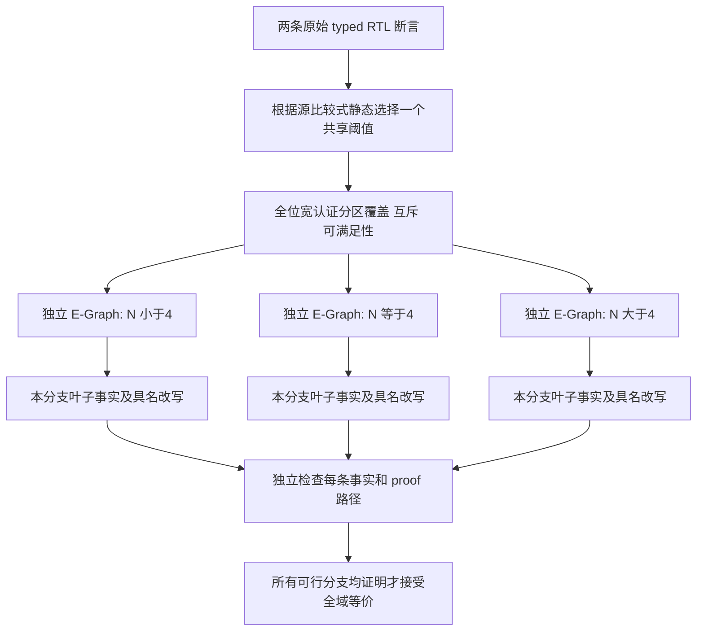

# Milestone 3 · Context-Sensitive Egg：带类型上下文的 RTL 断言等价证明

此前三次真实模型初稿均在第 0 轮正确，无错误可提供 Proof-Carrying LLM feedback，但它们生成了不同的合法断言。在这些实际公式的后验对照中，普通布尔等价和宽规则 egg 只证明了 10/12 对；剩余两对 `data_last` 的正确性依赖 `data_n=4` 时的位宽关系。本轮以 egg 本身为研究对象，实现了**上下文隔离的真实 scoped E-Graph 与可独立重放的局部类型证书**。它在同一组真实非相同原文组合上获得 12/12，并在 13 个独立不等价负例上零错误证明。强普通条件基线也达到相同结果；收益是条件证明的可解释性、可审计性，尚不是一个证明 egg 超过普通 solver 的结果。

[主冻结协议](egg_txn_context_protocol.md) · [实际事务在线实验与先前限制](egg_frame_txn_live_results.md) · [原始 RTL 背景](egg_frame_txn_results.md)

## 1. 问题是什么：条件等价不能作为全局 rewrite

设 `N=data_n` 为当前帧实际已接受长度、`I=data_index` 为当前输出拍位置。上一轮实际 LLM 的两种 TLAST 表达在短帧边界的归类不同：

- T1：`N<4` 时用 `I=4`；`N>=4` 分支用 `I=N`。
- T2/T3：`N<=4` 时用 `I=4`；`N>4` 分支用 `I=N`。
- 两种都有完整的输出依据、复位、有效位和固定最大长度 8 等共同条件。

两式在 `N=4` 时要求完全一样；但是 `(I=N)` 与 `(I=4)` 绝非全域相等。举例 `N=5,I=5`，前者真、后者假。若将它们作为一个全局 egg equality 合并，后续重写可能引入无效证明。直接完整位宽 Z3 已经可以证明两整个公式等价；问题是如何利用 egg 产生**可审查的条件证明及其实际依赖**，而不是简单增加更多无条件规则。

## 2. 新方法：真正的 scoped equality saturation



具体实现如下：

1. 对两个原始输入做同名类型化原子映射；静态比较共享总线和阈值字面量，优先差异的严格/非严格比较，再考虑共享阈值有关的跨总线原子差异；只选一个阈值，按 `<k,=k,>k` 分支。没有符合选择条件时单一 `true` guard。选择不询问两个完整候选的等价结果。
2. 独立完整位宽 Z3 认证分支可满足性、覆盖和两两互斥。边界 0、255 的无符号不可能分支也必须明确认证为 UNSAT，不允许无证据跳过。
3. 每个可行分支，在该 guard 中独立认证**原始 primitive 比较原子**与布尔常量、另一 primitive 原子的相等/互补，避免把两个完整目标作为 ground equality 偷渡。优先固定常量，其余关系选择有符号等价类代表，保证逻辑不矛盾。条件事实保存 guard、类型式、准确的 SMT 查询及结果。模型未被调用，RTL 不变。
4. **新 Rust 二进制 `egg_context_forms`** 每个进程只创建该 guard 的图。输入的是两条完整、原始抽象表达式而非 Python 已经归一化的目标；经认证的具名 ground 事实实际进入 egg 的局部改写。固定 23 条布尔改写包含常量传播、互补、幂等、双重否定、德摩根、and/or 结合和交换；20 轮/20,000 节点/5 秒预算，目标合并即结束。图内 fact 必须带同一个上下文 ID，不允许混合；不同分支不共用 eclass。
5. Python 独立核对图的两端、具名规则、每次改写的路径和替换，在逆向消去变量的情况下同样局部重放。再核对该局部证明使用的 ground SMT 证书确实属于当前 guard。少一个可行分支、混用上下文或漏掉证明都不得称全局已证明。

同一套规则和停止策略也用于不分区的 `true` 全域对照。普通对照获得完全相同的局部事实，用强命题 XOR (`facts ∧ XOR`) 判定，在同样的分区上合并结果；另有全位宽独立 Z3 oracle。一个 `SAT` 命题抽象反例可能源自缺少位宽关系，不能当作真正 typed SAT 或 RTL 可达反例。完整 proof 与证明根因可审查，而不是以图 ID 宣称规格正确。

## 3. 冻结 workload 和实测有效性

共 29 对：上一轮三个实际初稿不同原文的全部 12 对（18 次非相同出现去重）、此前固定 9 个错误 fixture 与对应正确规格、以及 8 个预先声明的边界控制（4 正、4 负）。后者包含共享四/八字节边界、8-bit 0/255 极端和对实际 T1 改掉唯一 `N>=4` 的 C08 近失误控制。对全部独立完整位宽 XOR：16 个等价、13 个不等价，与预先标签一致。该主 proof 工作负载使用**自由无符号声明位宽**（不使用 ghost 结构约束，更不用 DUT 输出应正确的前提）。

| 数据组 | 已知等价对 | 无上下文 Egg | 上下文 Egg | 无上下文普通 | 上下文普通 |
|---|---:|---:|---:|---:|---:|
| 实际 LLM 初稿 | 12 | 10/12 | **12/12** | 10/12 | 12/12 |
| 人工等价边界控制 | 4 | 0/4 | **4/4** | 0/4 | 4/4 |
| 合计真正等价 | 16 | 10/16 | **16/16** | 10/16 | 16/16 |
| 固定错误 fixture + 非等价边界控制 | 13 | **0/13 误证** | **0/13 误证** | 0/13 误证 | 0/13 误证 |

上下文 proof 完整覆盖真实两对旧引擎在抽象 SAT 时无法证明的写法；基于原子事实的普通命题对照也完全覆盖，**不能宣称 egg 独占证明增益或比完整位宽 solver 强。** 重要的新成果是把这些依赖条件的位宽事实真正引入 egg 局部 eclass；留下可独立重放、可核验分支的证明链。

| 工作量 / 证据 | 全域一图/对 | 分区后的图 |
|---|---:|---:|
| 所有分支记录（含不可行） | 29 | 51 |
| 实际可行图 | 29 | 48 |
| 认证不可行 | 0 | 3 |
| 有完整非恒等 local proof 的图 | 10 | 33 |
| 饱和未证图 | 19 | 15 |
| 本次节点/时间/迭代上限 | 0 | 0 |
| 可回放改写步骤 | 14 | 135 |
| 其中本地 ground fact 应用 | 0 | 98 |
| 提供已认证 ground fact 次数 | 22 | 106 |
| 原子事实发现查询 | 1,268 | 1,628 |

分区策略实际选出 11 对三路分区，10/12 个非相同实际对不需分区、2 个实际对都自动选择 16-bit `data_n=4`。三个不可行 guard 为 8-bit 极端的 `<0` 或 `>255`。33 个可证明图中包括不等价全域对中**确实局部等价**的分支，不是 33 个全局成功；只有全部可行分支通过才接受整对。事实发现查询计 const/pair 探测，不含 guard 可行性/覆盖与再次独立复核等额外 solver 工作，因此不能把分区方法称为端到端加速。

独立总审计复核 29 对、58 个方法记录、77 个可行图、128 份 ground 认证和三条不可行 guard。另对各可行分支直接求解全位宽 `guard ∧ XOR`（不作规则发现的输入）：全域策略 16 UNSAT/13 SAT；分区策略 33 UNSAT/15 SAT。分区后恰有 7 个来自整体不等价负例的局部等价分支，Egg 和普通均正确证明局部等价，另外至少一个可行分支不等价，整对均未误证。主实验首次运行与最终规范化复跑，除计时和文档澄清版本哈希，逐项证据、原始图和具名步骤完全相同。

[独立全量审计](../results/milestone3/frame-txn-context-proof/audit.json) · [主矩阵汇总](../results/milestone3/frame-txn-context-proof/summary.json) · [完整具名证明和 SMT 证据](../results/milestone3/frame-txn-context-proof/cases.jsonl.gz) · [具体冻结案例/规则](../results/milestone3/frame-txn-context-proof/protocol.json)

## 4. 实际四字节边界的 proof 依赖及撤销对照

对于 L02/L03（两种实际 data_last 对），三个 guard 的重放步数分别为 10/16/10 和 8/14/8。恰好等于四的分支中，egg 的真实改写解释引用了这一事实：

```text
context: data_n = 4
(eq 4 data_index)  =  (eq data_index data_n)
```

另外四个布尔长度比较在各分支分别变为 true/false，经具名常量折叠与关联/交换等规则产生完整原式→原式证明。上述事实被两份不同真实公式的 eq4 分支共同引用；实验共 106 个供给 fact 出现次数、58 个按 (context, relation) ID 去重事实，使用的 fact 按每图去重为 57 次、32 个不同事实。重复关系是明确的可复用证书位置，**本轮仍逐图认证，没有把其当成已实测的缓存或批处理加速**。

事先固定独立撤销控制：对两个实际 `data_last` 的 `N=4` 分支，保持 guard、全部四个固定常量事实、23 布尔规则和两个原式不变，移除仅在该 guard 成立而不在全域成立的非恒定原子等式。两条关系各有全位宽 SAT 控制：

- `(I=4) ⇔ (I=N)`：`I=N=65531` 时两边 false/true。
- `(I≤4) ⇔ (I≤N)`：`N=0,I=1` 时两边 true/false。

| 实际分支 | 原始事实：Egg | 移除条件原子关系：Egg | 普通原始 → 移除 |
|---|---:|---:|---:|
| L02 / N=4 | 16 步已证明 | 饱和未证 | UNSAT → SAT |
| L03 / N=4 | 14 步已证明 | 饱和未证 | UNSAT → SAT |

原完整位宽目标仍是 UNSAT，两份 proof 真正用的是第一条 conditional equality。抽象控制说明上下文事实是必要表达能力，而不是通过重复更多无条件 Boolean rules 得到。两次撤销实验逐案例记录完全一致，真实 T2/T3 的不分区 L04 不属于控制，明确排除。不把 Booleans SAT 当成真实 RTL 反例。

[撤销协议](egg_txn_context_ablation_protocol.md) · [撤销结果](../results/milestone3/frame-txn-context-fact-ablation/summary.json)

## 5. 与实际 RTL 验证的连接

对三个实际 `data_last` 在固定 21 条原始 + 功能变异轨迹上按相同 guard 分组重新评价；额外 9 条灵敏度端口控制单独统计。物理评判仍使用实际握手构建历史，必要时在同一未知引脚补全下检查两式的异或。这里的物理快照是 **ghost 结构域**的可观察样本，与主证明的 unrestricted typed 域区别明确。

| 主轨迹上下文 | PRE/POST 快照 | 有输入依据的有效数据呈现 | TLAST 参考报警 | 人为 C08 误报 / 漏报 |
|---|---:|---:|---:|---:|
| data_n < 4 | 7,268 | 934 | 8 | 0 / 0 |
| data_n = 4 | 853 | 815 | 4 | **52 / 4** |
| data_n > 4 | 4,591 | 3,330 | 22 | 0 / 0 |

三种实际模型正确原式完全匹配 12,712 个主采样和额外 5,448 个诊断采样。<4 的 6,086 个无对应输入帧的快照没有被算作有输入依据的实际数据呈现。C08 负例将 T1 唯一 `(uge data_n 4)` 改成 `(ugt data_n 4)`，即人为遗漏长度刚好为四的常规分支；**主轨迹 52 次误报和 4 次漏报全在真正的四字节完结帧的第四拍。** 原始完整 RTL 也出现 8 次假报警；F03 / backpressure 的 197 拍 POST 是 actual 漏报例，实际错误 TLAST 被正确断言检出，但 C08 放过。额外 9 轨迹有 24 次同边界误报。C08 的全域与 =4 限制的 typed XOR 都为 SAT，其他两条 guard 均为 UNSAT；主 egraph 同样只证明其他两支，不能接受整体。实际数据证明了该条件边界在现有 RTL 测试中有意义，不是仅在不可能位宽模型上虚构的差异。

[实际逐轨迹和 12 个独立位宽查询](egg_txn_context_physical.md) · [实测汇总](../results/milestone3/frame-txn-context-physical/summary.json)

原有 8 个实际事务安全性质的 18 状态单帧 BMC 与实际模型的完整位宽等价实验仍独立；本轮重用原生 Icarus 轨迹，没有重新编译 RTL 或将分区 proof 直接当成真实任意多帧无界形式验证。目标是验证器/断言的证明复核层，不改变被测硬件。

## 6. 研究价值和边界

本轮证实了一个实际 Egg 功能：**在可信的位宽条件下，给不同写法建立局部等式证明并保留哪条设计上下文事实被使用**。这比全域普通布尔抽象有完整得多的证明覆盖，并为审核断言改写、规格边界变更及 proof dependency 提供结构化证据。强普通条件求解对照同样达到16/16，因此只是证明了这套上下文抽象有效，以及 egg 可提供完整具名 proof，不证明 egg 准确性或性能优于 solver。下一步有意义的研究是用已认证局部原子事实和 eclass 同时审计多条同域候选，减少重复公式/证明、检查规格变更后哪些证明需要失效；本轮的重复事实计数只是机会而非实现收益。一阈值策略也可能无法处理多变量相关性、复合时序上下文，需后续采用适当预算并保留独立位宽判定。

## 7. 复现、环境、脚本

实测 Linux Python 3.12.14、z3py/CLI 4.16.0、Rust/Cargo 1.90.0，Cargo.lock 固定 egg 0.11.0。复用上一轮已归档的 Mac 真实响应及 Icarus 12.0 物理采样；**无需 API key，也不调用模型**。以下 MacBook 或 Linux 从仓库根目录运行（Mac 沿用此前虚拟环境和 `FBUILD`）：

```bash
FPY="$HOME/rtl-tools/frame-venv/bin/python"
FBUILD="$HOME/rtl-tools/frame-rust"
RUSTUP_TOOLCHAIN=1.90.0 CARGO_TARGET_DIR="$FBUILD" \
  cargo build --locked --release --manifest-path egraph/Cargo.toml --bin egg_context_forms
OUT="$HOME/rtl-tools/frame-txn-context-$(date +%Y%m%d-%H%M%S)"
mkdir -p "$OUT"
"$FPY" scripts/run_txn_context.py --binary "$FBUILD/release/egg_context_forms" --output "$OUT/proof"
"$FPY" scripts/audit_txn_context.py --run-dir "$OUT/proof" --output "$OUT/audit.json"
"$FPY" scripts/check_txn_context_fact_ablation.py --source "$OUT/proof" --binary "$FBUILD/release/egg_context_forms" --output "$OUT/ablation"
"$FPY" scripts/check_txn_context_physical.py --controls results/milestone3/frame-diagnostic-faults --output "$OUT/physical"
```

| 文件 | 职责 |
|---|---|
| `egraph/src/bin/egg_context_forms.rs` | 实际单 guard 进程的 scoped egg，完整原始抽象端点与认证地面规则，目标停止 |
| `scripts/egg_txn_context.py` | 静态共享阈值分区、覆盖/互斥/可行性、局部原子类型事实与普通基线、SMT 证据绑定 |
| `scripts/egg_txn_context_check.py` | 独立通用规则验证、上下文/端点约束、每步具名证明重放 |
| `scripts/run_txn_context.py` | 实际初稿、9 固定负例、8 控制冻结工作负载，三种证明对照，完整汇总 |
| `scripts/audit_txn_context.py` | 独立全域及逐组分支证据审计，核验完整分区、不跨域、不依赖未认证 equality |
| `scripts/check_txn_context_fact_ablation.py` | 撤销只在 guard 下成立的非恒定事实，独立 SAT 控制与重跑 |
| `scripts/check_txn_context_physical.py` | 实际数据类分支评分、相同 X/Z 完成、4 字节负控制与真实轨迹复验 |

最终回归：隔离仓库副本的 Python 全量 178 项、indexed 专项 7 项及三个 Rust 证书引擎的单元/集成 14 项，合计 **199 项全部通过，无失败或跳过**。独立审计拒绝重新哈希的无关 UNSAT 证据、遗漏/重复/交换分支、替换原子、跨上下文事实与部分证明冒充整体。复制进仓库的主矩阵再次审计后与最初独立结果逐字节一致。[协议和证据哈希](../results/milestone3/frame-txn-context-proof/provenance.json)

新增独立工具、模块和报告；未修改之前的 LLM/API 试验或旧 Rust 引擎。
