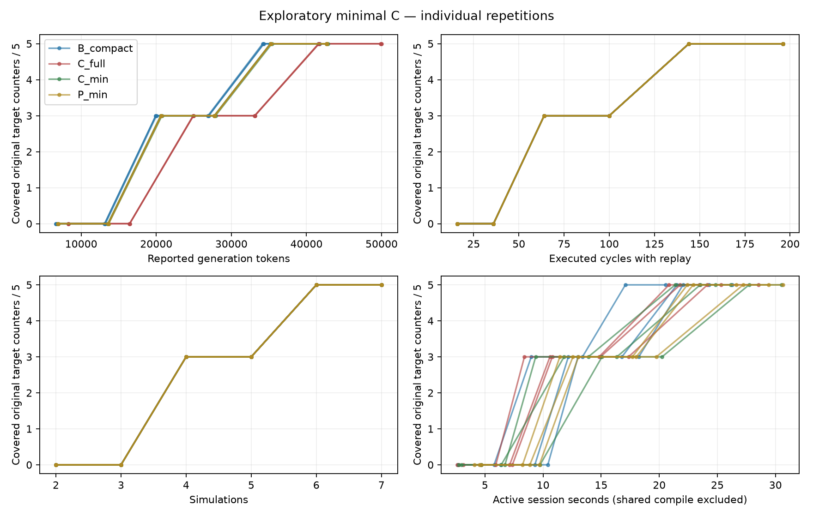

# Minimal C FIFO ablation — 3 November 2026

**Completed live exploratory run:** shortening the semantic appendix reduced
token overhead, but did not improve the preregistered five-source-counter
target against B-compact. All twelve fresh sessions reached the target in
round 5. This is a diagnostic on the previously used synthetic FIFO variant,
not a new independent-IP replication and not evidence of statistical significance.

## Frozen treatments and runner checks

The immutable depth-16, 8-bit FIFO, specification-based public-I/O checker,
JSON driver, four-cycle seed and five target branch/`if` locations
`{91,161,96,129,179}` are reused. All 400 original counters remain in the
denominator: 22 line, 24 branch, 16 expression and 338 toggle points. The two
proved event groups retain every original source counter independently.

The [new config](../configs/sfifo_minimal_c_exploratory.json) uses three
repetitions, six rounds, at most eight new cycles per round, requested and
returned `gpt-6.1-sol`, low reasoning, 8,192 maximum output tokens, a
32,000 input-token cap, 90-second request timeout and at most one retry.
No deterministic witness or calibration enters a model prompt. Four arms:

- B-compact: unchanged reversible raw-counter packing.
- C-full: B-compact plus the previous full semantic appendix.
- C-min: B-compact plus proved equivalence relations, event context, source
  sites/polarity/hit counts and the two-state/no-hit-transfer qualification.
- P-min: B-compact plus neutral filler, API-token-matched to a C-min prompt
  constructed on P's **own** history and measured coverage.

The model sessions are independent and stateless across treatments. The runner
executes round-major and repetition-major, rotating the arm order by
`(round + repetition - 2) modulo 4`. The order is saved before live calls. It
compiles once as explicitly shared setup, and each simulation starts a fresh
process and counters and replays seed plus that session's accepted actions.
Active session wall time excludes waiting for other sessions; global wall time
and shared setup are separate. This differs from the old sequential runner,
so comparisons between *old and new* wall times are not treatment effects.

The new failure handling saves every generation attempt and every input-count
request, including failures. Invalid output and incomplete responses retain
reported usage before bounded retry. Missing usage is marked unknown; cached
and reasoning tokens are never added again. Count errors or measurement errors
stop the affected session. The analyzer retains all twelve planned sessions,
including missing/incomplete sessions and not-reached outcomes. Checker
violations remain DUT evidence, not invalid stimulus. Seventeen focused tests
cover runner accounting, timeout/validation/count failures, feedback isolation,
case/alias extraction, and the separate parameterized screen.

## Live result

| Arm | Target round, reps 1/2/3 | Input + output tokens to target, reps 1/2/3 | Mean ± sample SD | Final toggle points / 338, reps 1/2/3 |
|---|---|---|---:|---|
| B-compact | 5 / 5 / 5 | 34,277 / 34,340 / 34,161 | 34,259 ± 91 | 171 / 174 / 175 |
| C-full | 5 / 5 / 5 | 41,676 / 41,602 / 41,655 | 41,644 ± 38 | 181 / 174 / 177 |
| C-min | 5 / 5 / 5 | 35,221 / 35,187 / 35,398 | 35,269 ± 113 | 171 / 167 / 158 |
| P-min | 5 / 5 / 5 | 35,211 / 35,227 / 35,284 | 35,241 ± 38 | 156 / 175 / 166 |

At first target, every session used **144 replay-counted cycles and six
simulator executions**, and covered 22/24 original DUT branch points.
Final line/branch/expression counts were 22/22, 22/24 and 14/16 in every
session. Toggle counts differ and are reported above; do not describe *all*
coverage as identical. C-full's mean final toggle count is four points higher
than B's, while C-min is eight lower. These small, secondary, unpowered
observations are not a repeatable semantic-feedback advantage or a basis for
selecting the next benchmark.

C-min used **15.31% fewer tokens than C-full**, but **2.95% more than
B-compact** at the same primary target. C-full cost 21.56% more than B.
First-round input usage was 6,491 tokens for B, 8,153 for full C, 6,709 for
minimal C and 6,710 for P in every repetition. The semantic increment thus
fell from 1,662 to 218 input tokens (86.9% smaller). The overall cost reduction
is smaller because specification, RTL, traces, history and raw B feedback
remain unchanged. Token ROI is newly covered original branch points above
the 11-point seed per 1,000 input-plus-output tokens; at target its numerator
is eleven for every session.

All **72 generation calls** were accepted on attempt 1; no checker failures,
retries or unknown-usage calls occurred. Usage was **517,399 input + 13,699
output = 531,098 tokens**. Cached input 90,163 and reasoning output 3,153 are
subsets. There were 108 separately logged count-only requests, none failed;
all P matches were within one token and generation counts agreed with the
pre-counts. These count-only operations are not generation-token usage; their
latency is included in active session time.

The complete run executed **84 simulations and 2,352 cycles** including all
seed runs, with one shared compilation taking 2.848 s. Global runner wall
time was 319.987 s. Candidate screening/tool installation also occurred on
the host during the run, so wall-time comparisons are descriptive, not a
controlled hardware-performance result. The staged credential was deleted
automatically. No new Claude audit was performed for this run.



## Mechanism evidence and interpretation

Across all 72 measured rounds, the hit counts of members within each equivalent
group were identical, although each location remained separately measured.
The five counters represent **two event types**, not five independent planning
problems. For representative repetition 1, every arm's branch trajectory was
`17,17,20,20,22,22`; all line points were already covered after round 1.
The first batch mixed reads, writes and simultaneous operations. Rounds 2/3
mostly filled the FIFO, and rounds 4/5 mostly drained it. Separate calibration
shows a four-round path exists, but none of the treatments selected it.

This weakens the specific hypothesis that a long semantic appendix is the
main reason the current FIFO shows no primary gain. A much shorter relation
payload still ties B. It does not prove token load never matters, and minimal
C changes detail/presentation as well as length. A padded-minimal-C arm would
be needed to isolate the length intervention further; this run supplies no
reason to spend more calls on that arm before improving task opportunity.

The common instruction optimizes broad structural coverage, whereas the
primary target is a hidden late-event subset. Early mixed operations improve
other branch points, so they should not simply be called a model mistake.
For a future target-specific study, provide the same target IDs to **all**
arms and freeze that as a separate protocol; do not give C private witnesses.
See [IP diagnosis and next qualification work](ip_selection_diagnosis_2026-11-03.md).

## Evidence and reproduction

The [run directory](../results/sfifo_minimal_c_live_20261103/) contains per-call
and per-round JSONL, every rendered prompt, all count inputs and responses,
raw Verilator counters, actions, checker results, `sessions.csv`, `rounds.csv`,
`comparison.json`, and `mechanism-diagnostics.json`.

[Independent replay](../results/sfifo_minimal_c_live_20261103/replay-validation.json)
matched every source location/hit count, coverage summary and checker result
for **84/84** successful executions. The [prompt/accounting audit](../results/sfifo_minimal_c_live_20261103/prompt-accounting-validation.json)
matched all 72 own-trajectory prompts and usage rows and all 19 frozen hashes.
The [metadata](../results/sfifo_minimal_c_live_20261103/metadata.json) records
commit `c71a3e580646d08fb6496c742b7b42b711179b36`, the uncommitted implementation
hashes, schema, limits, schedule and tool versions. The simulation still uses
Verilator 5.050, Icarus 12.0 and the prior Yosys 0.70+post semantic evidence;
the newly installed separate Slang frontend did not generate this treatment.

From the repository root, using unused output directories:

```sh
.venv/bin/python -m unittest tests.test_minimal_c_runner tests.test_minimal_c_feedback tests.test_sfifo_prompt_ablation tests.test_semantic_candidate_scan tests.test_parameterized_ip_screen -q
.venv/bin/python scripts/run_minimal_c_ablation.py --mode mock --output build/minimal_c_mock_new
.venv/bin/python scripts/analyze_minimal_c_ablation.py --run build/minimal_c_mock_new
.venv/bin/python scripts/run_minimal_c_ablation.py --mode replay --replay-source results/sfifo_minimal_c_live_20261103 --output build/minimal_c_replay_new
.venv/bin/python scripts/verify_minimal_c_run.py --run results/sfifo_minimal_c_live_20261103
```

A fresh paid replication, after hidden credential staging:

```sh
.venv/bin/python scripts/stage_midterm_openai_key.py
.venv/bin/python scripts/run_minimal_c_ablation.py --mode live --output results/minimal_c_live_new
.venv/bin/python scripts/analyze_minimal_c_ablation.py --run results/minimal_c_live_new
```
