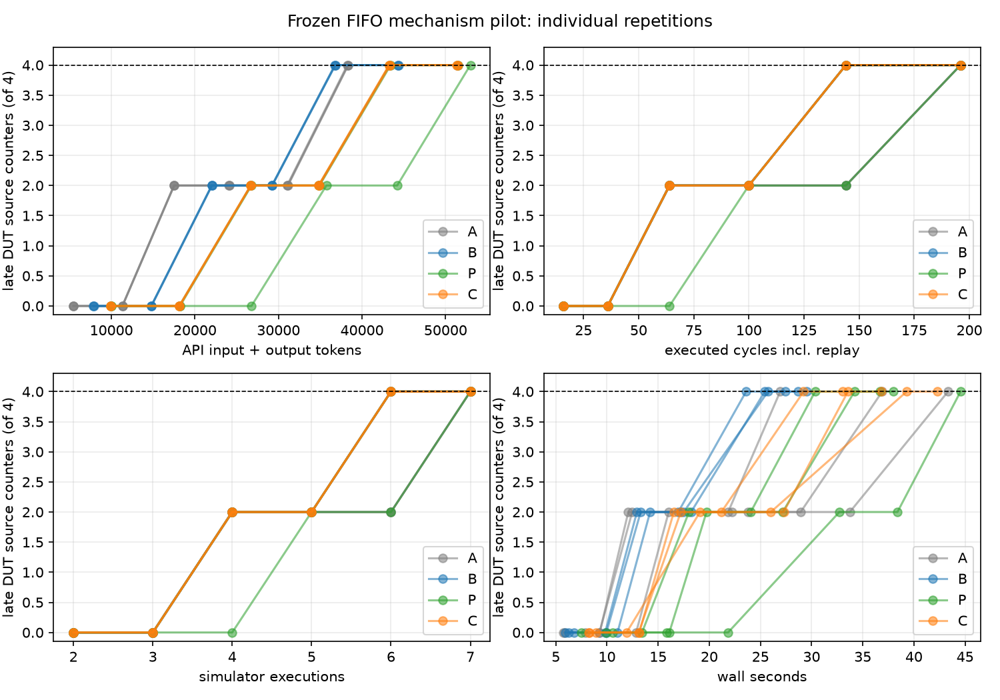

# Token-matched A/B/placebo/C pilot on a depth-16 FIFO stress variant

**30 October 2026.** This is the second independent RTL *IP family* after the
CVDP divider, using the ZipCPU synchronous FIFO. The tested source is a
**disclosed, equivalence-proved synthetic redundancy variant** of a previously
examined FIFO, not a second naturally redundant CVDP benchmark. It is a
mechanism test. The primary question remains whether C's egg-normalized
coverage evidence improves the same stimulus-generating GPT model over B's
raw coverage evidence under matched generation budgets. The observed answer
on this variant is **no C-over-B gain in coverage or time-to-target**.

## Provenance and pre-outcome boundary

The original public-domain ZipCPU FIFO is pinned at commit
`2e8d3bc2d26ddc33d1881022a2a2b9d3f0c16b9b`, SHA-256
`76a653781f1ecca1c1da92c4e5105ecd5d0f832b13cbfd31300ec88d9947e0c1`.
The [stress variant](../examples/heldout_sfifo_stress/rtl/sfifo.v), SHA-256
`309bf3231693e5f468a00c9b2ef8e9f02f7fc4728c3592a7932d520ba53b9289`,
was built by a checked [transformation recipe](../scripts/build_sfifo_stress_variant.py).
It adds repeated deep branch predicates at distinct source locations while
preserving functional assignments. Under the fixed 8-bit, depth-16,
asynchronous-front-read configuration, Yosys `equiv_make`/`equiv_simple`
[proved all 157 paired cells](../results/midterm_candidate_preflight/sfifo-stress/original-vs-variant-equivalence.log);
`equiv_induct` had no unproven cells left. This establishes two-state state
correspondence for the fixed configuration, not a four-state or full-spec
proof. The independent [functional contract](../examples/heldout_sfifo_stress/docs/specification.md)
and [public-I/O checker](../scripts/sfifo_fixture.py) retain the specification
boundary. The checker passes the original, variant and separately written
behavioral control, and rejects a data-order mutant. The RTL is never repaired
inside an experiment.

The [preflight](../results/midterm_candidate_preflight/sfifo-stress/screen.json)
found four source-distinct, typed complete-guard groups, including two late
groups. The first late group is a pure read at read-pointer wrap, mapped to
separate Verilator branch/`if` points at RTL lines 91 and 161. The second is a
pure write when fill is 15, mapped at lines 96 and 179. Both are zero-hit in
the common seed and positive-hit in a separate checker-passing reachability
calibration. Egg class membership is checked pairwise with Z3; both groups
retain the clock and synchronous-reset activation context. An additional
similar condition at line 129 is **not** promoted into an e-class because the
current frontend leaves its case-priority atoms opaque. Its raw counter stays
in the denominator. One unsupported extraction case is reported. Behavioral
read and write cases remain separate groups.

The independent B-only development trial covered the near-full pair in round
3 and did not cover the wrap-read pair by round 4. This passed the predeclared
"not first-round saturated" selection gate. It is not pooled with the formal
comparison. A **pre-outcome Claude Opus 5.5 review** recommended no-go on the
initial target and information boundary. The [point-by-point disposition](sfifo_stress_preaudit_disposition_2026-10-30.md)
records repairs made before the frozen run: removing a B-plateau-derived
threshold, giving 48 rather than 40 new cycles, removing target hints from
the model-visible specification, removing calibration-based filtering from C,
and checking that P is built on its own trajectory. The [frozen manifest](sfifo-stress-frozen-pilot-2026-10-30.json)
was written before formal generation calls and contains 27 file hashes,
the target, model settings, budget and raw denominator. It was not separately
committed before the calls, so this is hash/timestamp evidence rather than a
signed preregistration.

The primary target is **both late events**, represented by all four distinct
source branch/`if` counters. The four counters are still four separate raw
locations, although each pair is triggered by one event. The full fixed DUT
denominator remains 22 line, 24 branch, 16 expression and 338 toggle points;
the target subset never replaces it. The seed covered 14/22 line, 11/24
branch, 7/16 expression and 6/338 toggle. Calibration reached both late
events and 22/24 branches. The two residual branch outcomes are associated
with `OPT_WRITE_ON_FULL=0` and `OPT_READ_ON_EMPTY=0` option paths; they stay
in the raw denominator.

## Frozen four-arm method

Each arm used `gpt-6.1-sol` with low reasoning, 8,192 maximum output tokens,
90-second request timeout and one retry limit. There were three independent
sessions per arm, six refinement rounds and at most eight new legal JSON
cycles per round. The same seed, source, checker, clock driver, simulator
options and raw denominator were used everywhere. Every simulation replayed
the seed, all previously accepted actions and the complete new batch. An
accepted checker finding would be retained with flushed coverage; none
occurred in this correct FIFO. No deterministic search, solver witness,
calibration action or benchmark repair vector was supplied to the model.

* **A:** specification, RTL, seed, own prior actions, checker summary and
  execution trace; no coverage feedback.
* **B:** A plus raw uncovered original DUT line/branch/expression counters,
  source positions, outcomes and source text.
* **P:** B plus a neutral repeated-letter appendix. Before each generation
  attempt, its **complete prompt** was matched against a C-style prompt built
  from P's **own** trajectory using the official OpenAI Responses
  `input_tokens.count` endpoint. The allowed difference was at most two
  input tokens, and the run failed closed above that tolerance.
* **C:** B plus bounded Rust egg normalization, typed atoms, complete
  activation guards, equivalent-expression groups, event context, Z3 pair
  checks, unsupported cases and each original source counter separately.

The official [count-only preflight](../results/sfifo_stress_token_preflight_20261030/count-evidence.json)
gave C 9,736 versus P 9,737 input tokens, with zero model generations. In
the live run, all **18** P attempts were one token from their hypothetical
C-style own-trajectory prompt; API generation usage matched each P count
exactly. There were **54 count endpoint calls** (three per P prompt), recorded
separately from the 72 generation calls and their input/output tokens. P's
wall time includes counting latency, so P wall time is not a pure
semantic-content comparison. A neutral filler may itself influence behavior;
token matching controls input load, not every contextual effect of filler.

## Live observations

All 72 generation responses requested and returned `gpt-6.1-sol`, were
accepted on attempt 1 and completed their full batches. All 12 sessions
reached the target by round 6. The first-target costs include the seed
simulation and every replayed cycle:

| Arm | First target round, reps 1/2/3 | Tokens at target, reps 1/2/3 | Mean tokens | Executed cycles at target |
| --- | --- | --- | ---: | --- |
| A | 6 / 6 / 6 | 38,335 / 38,240 / 38,346 | 38,307 | 196 / 196 / 196 |
| B | 5 / 5 / 5 | 36,754 / 36,803 / 36,796 | 36,784 | 144 / 144 / 144 |
| P | 5 / 5 / 6 | 43,422 / 43,303 / 52,965 | 46,563 | 144 / 144 / 196 |
| C | 5 / 5 / 5 | 43,251 / 43,364 / 43,264 | 43,293 | 144 / 144 / 144 |

The first event appeared in round 3 in 11/12 sessions; P repetition 3
reached it in round 4. B and C reached the second event in round 5 in all
three repetitions. **C versus B: same target round, simulator executions (6)
and replayed cycles (144) in every repetition; C used about 17.7% more API
input-plus-output tokens at first target.** B versus A saved one round,
one simulator execution and 52 replayed cycles. C versus token-matched P
looks better in one repetition but the sample is too small to attribute this
to semantic information, particularly since C did not outperform B.

At the fixed sixth round every arm reached 22/22 line, 22/24 branch and
14/16 expression points. Thus line and final branch are ceiling-limited.
Toggle directions varied between repetitions and were not the preregistered
target. Token ROI is newly covered original DUT branch points over the
11-point seed per 1,000 API-reported input-plus-output tokens. At first target
the numerator was 11 for all 12 sessions, so C's ROI was lower than B's
because its prompt was longer; reasoning and cached-token detail fields are
subsets of usage, never added twice. Repeated sessions showed similar action
patterns despite separate model calls and are not treated as three diverse
strategies. No statistical significance or general natural-IP claim follows.



## Independent audits and limitations

The [read-only blind Claude review](../results/sfifo_stress_abpc_frozen_live_20261030/claude_audit/blind-review.txt)
received anonymized W/X/Y/Z rows with no treatment names or file tools. It
recomputed all 12 first-target rows correctly and highlighted that four
counters represent two events, that line coverage saturates immediately,
that cycles/executions are functions of the target round, and that nearly
identical action paths reduce the effective diversity of three sessions.
The [revealed file review](../results/sfifo_stress_abpc_frozen_live_20261030/claude_audit/reveal-review.txt)
then examined frozen sources and sampled prompts without write or shell
tools. It confirmed P's own-trajectory construction, exact input-count
matching, fixed checker capacity, model IDs and the C-versus-B null result.
It identified incomplete case-priority normalization and the possible
behavioral effect of P's explicit neutral-field label. Its suggestion that
simultaneous read/write lines 133/165 are equivalent to pure read/write
groups is too broad: those activation guards differ. The [disposition](../results/sfifo_stress_abpc_frozen_live_20261030/claude_audit/disposition.md)
separates confirmed findings from that correction and unresolved limits.

A separate [boundary audit](../results/sfifo_stress_abpc_frozen_live_20261030/boundary-audit.json)
reconstructed all 72 rendered prompts from each arm's own preceding traces,
coverage points and accepted actions; verified A/B/P/C information isolation,
all 27 frozen hashes, model IDs, valid action widths, P provider counts and
absence of calibration text. A model-free [replay](../results/sfifo_stress_abpc_frozen_replay_20261030/validation.json)
exactly matched all 84 seed/round simulations on every original DUT counter
identity and hit count, checker result and summary. Mock and replay data are
not pooled with live model costs.

The principal limitations are: a deliberately constructed, previously
examined FIFO variant; one GPT model; three near-deterministic repetitions;
a two-event target with only round-level resolution; P's content-neutral
filler not perfectly behavior-neutral; and incomplete case-priority
normalization at line 129. Arms ran sequentially A/B/P/C; API caching and
latency confound wall time. P's 54 count calls add wall cost and may have
separate service charges that are not represented in generation-token ROI.
The P retry rematching path was not exercised by a live failed response.
These results do not refute E-graphs generally.
A stronger next test should use a **naturally redundant held-out controller or
FIFO**, prove source-distinct complete guards before outcomes, use an
independently reviewed checker and target, and repeat the token-matched
four-arm design. A cross-model stimulus generator can be a separate factorial
extension, never silently substituted for the fixed GPT model here.

## Reproduce and inspect

The full [per-call JSONL](../results/sfifo_stress_abpc_frozen_live_20261030/calls.jsonl),
[per-round JSONL](../results/sfifo_stress_abpc_frozen_live_20261030/rounds.jsonl),
[round CSV](../results/sfifo_stress_abpc_frozen_live_20261030/rounds.csv),
[target-cost CSV](../results/sfifo_stress_abpc_frozen_live_20261030/target-costs.csv),
[group progress](../results/sfifo_stress_abpc_frozen_live_20261030/group-progress.json),
[P token counts](../results/sfifo_stress_abpc_frozen_live_20261030/placebo-token-counts.jsonl),
original Verilator `.dat` files, prompts, compile logs and checker traces are
saved. Repo HEAD was `054898f27816362e73bd91eabe2960711f85d42d`;
the working tree contains the frozen uncommitted experiment files, so the
27-file manifest is needed in addition to the commit. Key versions:
Verilator 5.050, Icarus 12.0, Yosys 0.70+post, Z3 5.1.0, Rust/Cargo 1.99,
OpenAI Python SDK 2.54.0 and Python 3.13.9. Both hidden staged API key files
are deleted by their runners after use.
The three Claude audit calls were separate from stimulus generation; Claude
Code reported $0.8603 for the pre-outcome review and $0.2912/$1.8898 for
blind/revealed post-outcome reviews. Those audit costs are excluded from
the A/B/P/C Token ROI and preserved in the raw Claude response envelopes.

```sh
.venv/bin/python -B scripts/build_sfifo_stress_variant.py
.venv/bin/python -B scripts/screen_sfifo_stress.py
.venv/bin/python -B -m unittest discover -s tests -v
.venv/bin/python -B scripts/run_sfifo_stress_experiment.py --mode mock --config configs/sfifo_stress_abpc_frozen.json --output build/NEW_MOCK_OUTPUT
.venv/bin/python -B scripts/analyze_sfifo_stress_pilot.py --run results/sfifo_stress_abpc_frozen_live_20261030
.venv/bin/python -B scripts/audit_sfifo_stress_run.py
.venv/bin/python -B scripts/validate_sfifo_stress_replay.py
```

Exact live and model-free replay commands (use a fresh `NEW` output path):

```sh
.venv/bin/python scripts/stage_midterm_openai_key.py
.venv/bin/python -B scripts/run_sfifo_stress_experiment.py --mode live --config configs/sfifo_stress_abpc_frozen.json --output results/sfifo_stress_abpc_live_NEW
.venv/bin/python -B scripts/run_sfifo_stress_experiment.py --mode replay --config configs/sfifo_stress_abpc_frozen.json --output results/sfifo_stress_abpc_replay_NEW --replay-source results/sfifo_stress_abpc_live_NEW/calls.jsonl
.venv/bin/python scripts/stage_anthropic_crosscheck_key.py
.venv/bin/python -B scripts/run_claude_sfifo_audit.py --source results/sfifo_stress_abpc_live_NEW --output results/sfifo_stress_abpc_live_NEW/claude_audit
```

Run those from the repository root and enter each key hidden in the terminal.
Never reuse or overwrite the frozen live result. Each runner deletes its
staged key in `finally`. The public experiment report contains no credentials.
