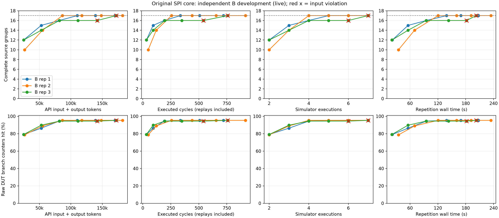

# SPI core：独立 B 开发试跑结果（2026-11-04）

模式：**live**。原登记的开发门槛：**未通过**。本轮只有 B，不能推断 C 优于或不如 B。

独立 Claude v4 checker 与 GPT 固定 JSON driver 已通过 [有限冻结检查](spi_core_checker_freeze_2026-11-04.md)。原版 OpenTitan core 包含真实子模块，17 组可达、seed-zero 的源目标中 8 组非平凡；3,107 个原始 DUT counter 全保留。同一 SPI 家族已有开发历史，不能称为独立 held-out IP。

固定版本 `0ea5236fe749e70ba18f56ba19c4be982ef46da7`；仓库基线 commit `50d7ee83d61989017e28e981420cd58f4c5f0787`，另附工作区实际文件 SHA-256。checker `07765601452ca14f078e8a3889f6d2d21574181091eb404c717087ce2d20a540`；配置 SHA-256 `c32d95f9626b601295965d564f794d0aaac7a358a5a291036121a672021f7f8c`。

预算没有变化：3 次重复 × 6 轮 × 最多 64 新周期，seed 8 周期；gpt-6.1-sol、low，输入 32,000 / 输出 16,384 tokens，每请求 timeout 120 s、最多一次重试。无会话串用、无 solver/generated witness 或校准泄漏；独立重复不保证模型确定性。

| 重复 | 首轮未全部命中组 | 最后未命中组 | 后续组进展 | 完整/输入合法 | 最终 checker | 全部目标首次命中 |
|---|---:|---:|---|---|---|---|
| 1 | 5 | 0 | True | True/True | pass | 4 |
| 2 | 7 | 0 | True | True/True | pass | 3 |
| 3 | 5 | 0 | False | True/False | blocked | not reached (legal inputs); raw hit round 6 |

目标命中只看各个原始 source counter；等价组里每个源点都必须实际命中。未达目标的试次保留，不能从成本平均中删除。开发 gate 另外要求三个重复都完整且输入合法，至少两个重复首轮还剩两组，至少两个重复在后续轮次取得组进展。DUT failure 不等同于错误 testbench。

| 重复 | line | branch | expr | toggle | 输入+输出 token | 仿真次数 | 实际周期 | DUT 失败诊断/类别数 | 输入违规 |
|---|---|---|---|---|---:|---:|---:|---|---:|
| 1 | 59/64 | 223/234 | 330/349 | 1949/2460 | 170144 | 7 | 720 | 0/0 | 0 |
| 2 | 59/64 | 223/234 | 330/349 | 1848/2460 | 182277 | 7 | 916 | 0/0 | 0 |
| 3 | 59/64 | 223/234 | 330/349 | 1804/2460 | 172299 | 7 | 758 | 0/0 | 1 |

输入违规跨累计重放共出现 2 条诊断，对应 1 个不同的（重复、周期、类别）记录；不能算成多个 DUT 缺陷。

- repetition 3，cycle 174，`cmd_transport`：offered command withdrawn or changed before pre ready&valid handshake。
  保存轨迹：cycle 173 valid=1、pre.ready=0；cycle 174 valid=0、pre.ready=1。

生成 API 调用 18 次，计数请求 18 次；API 输入 454,635、输出 70,085，合计 **524,720 tokens**。未知用量尝试 0。cached/reasoning 是子项，不重复相加；未凭空估算 API 美元费用。

编译 1 次 / 13.09 s；仿真 21 次 / 1.04 s；实际执行 2,394 周期（含 seed 和累计重放）；端到端 658.34 s。语义预处理复用已冻结证据，本轮新增为 0；其历史成本不能从整个项目成本中删除。checker 建设和 mock 成本另记。

Token ROI 定义：相对共同 seed 新命中的 DUT branch counter 数 / API 输入加输出 token × 1,000；每轮原始数值保存在 CSV。图中每条线是一个独立重复，wall time 不含该重复之前的编译，完整 run wall time 在 metadata 单列。红色 × 标记输入违规的 raw counter 观测，保留但不作合法达标。重复很少，只作描述，不做显著性或泛化声明。



需要保留的局限：普通轨迹已经覆盖多数目标，TX/RX 时间事件共用一个组合 stall group；即使 B gate 通过，也只说明没有在原预算的首轮立即饱和，并不保证 C 有收益。RX 采样不稳定、未完成命令均保留 inconclusive，软件复位/dummy 在此次范围之外。公开文档的 byte-order 合同是登记的项目解释，未获上游勘误确认。

本次不启动正式 A/B/C/placebo。保留原预算与失败原因；不能根据本结果缩短预算或删除不理想的重复。

## 对下一轮的诊断

合法达标成本：重复 1：136 个新周期、110,200 tokens；重复 2：128 个新周期、86,601 tokens。首轮实际新周期为：重复 1：16 周期；重复 2：32 周期；重复 3：16 周期。轮次差异必须结合预算使用情况解释，不能直接等同于 IP 的固有深度。单独剩余的组编号为 [51, 56]。这些组分别涉及 FULLCYC / Dual 模式，并非都要求复杂恢复序列。这比旧 FSM 首轮全满更有可测空间，但还不是 C 优势的证据。

输入违规与原始覆盖率是不同量。高 raw branch 命中不能使违反握手合同的刺激变成合法；出现 cmd_transport 问题时，需要核验相邻周期的 valid/payload 与 pre.ready，区别 DUT 错误和刺激错误。逐周期开环 JSON 对握手预测的要求，是需要与 e-graph 效果分开分析的因素。

建议另行预登记一个协议安全的固定 driver 版本：模型提交 command/TX offer，driver 只负责保持 valid/payload 到实际 handshake，所有等待周期都消耗同一 64 周期预算，超出预算保持 pending，不暗中补 drain 或执行额外周期。GPT 实现 driver，Claude 独立审阅接口合同；原 Claude checker 的 expected-output 逻辑不由 GPT 修改。先重新验证双仿真器、正反控制与计账，再用相同预算做新的独立 B 开发试跑。这是明确的新实验版本，不修补本次模型答案、不覆盖当前结果，也不能仅挑一个成功重跑替代失败重复。其后 C 只补充与 B 同一覆盖页对应的已证明关系，placebo 按自身轨迹的 shadow-C 实际 API token 计数匹配。

证据：[`summary.json`](../results/real_parent_screen_20261104/spi_core_b_live_v1/summary.json)、[`rounds.csv`](../results/real_parent_screen_20261104/spi_core_b_live_v1/rounds.csv)、[`target_cost.json`](../results/real_parent_screen_20261104/spi_core_b_live_v1/target_cost.json)，同目录有逐调用/逐轮 JSONL、提示词、完整动作、trace 和 coverage.dat。

```sh
.venv/bin/python scripts/report_spi_core_b_development.py --input results/real_parent_screen_20261104/spi_core_b_live_v1
```

## 保存结果的独立计账核查

18 个 prompt 与本重复先前执行证据精确重建一致；21 次原始覆盖文件、动作与 trace 核对通过。输入/输出 usage 与各轮累计和总账一致，原始分母身份不变。模型和 checker 正确性不由这些完整性检查证明。

额外观察：169 处 counter 的原始 magnitude 在相邻独立进程的累计 replay 间减少，本次均减少 2；没有任何非零覆盖点变为零。最初核查误把原始 magnitude 必然单调作为断言，随后修正核查口径，原始计数从未改写。组合计数与 simulator evaluation/settle 活动有关，并不等于硬件周期次数；终止与继续执行的边界活动是可能来源，未做额外因果隔离实验。全部差值保存在 audit.json / counter_decrease_observations.json。覆盖比例仍只用该轮真实 hits>0，不能用跨进程 max 或求和替代。

核查状态：pass；暂存 OpenAI key 已删除：True。

```sh
.venv/bin/python scripts/verify_spi_core_b_run.py --input results/real_parent_screen_20261104/spi_core_b_live_v1
```
