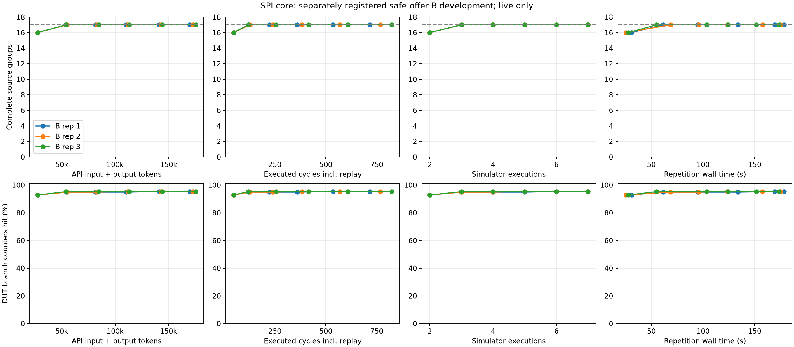

# SPI core：安全 offer driver 的独立 B 结果（2026-11-04）

原预登记门槛：**未通过**。本报告只有新的 B 开发数据，不与旧直接引脚 B 合并，不推断 C 收益。

[接口登记及独立复核](spi_core_safe_driver_2026-11-04.md)保留原 DUT、Claude v4 checker、17 组目标（8 组非平凡）、3,107 个原始 DUT counter。每轮最多 64 个新物理周期；等待握手计入预算，无隐式 drain。三重复、六轮，模型 gpt-6.1-sol/low，输入 32,000、输出 16,384，timeout 120 s，最多一次重试。

| 重复 | 首轮未全命中组 | 最后未命中组 | 完整/合法 | 最终 checker | 全目标首次合法命中 |
|---|---:|---:|---|---|---|
| 1 | 1 | 0 | True/True | pass | 2 |
| 2 | 1 | 0 | True/True | fail | 2 |
| 3 | 1 | 0 | True/True | fail | 2 |

门槛要求三个重复均完整且输入合法，至少两个重复首轮仍剩两组、至少两个后续取得组进展。目标命中看实际源 counter，不把等价源点合并；覆盖目标命中不等于所有已排队事务完成或整个 IP 正确。

| 重复 | line | branch | expr | toggle | token | 实际周期 | pending cmd/TX | verification_complete |
|---|---|---|---|---|---:|---:|---|---|
| 1 | 59/64 | 223/234 | 330/349 | 1659/2460 | 169803 | 716 | 0/0 | True |
| 2 | 59/64 | 223/234 | 330/349 | 1778/2460 | 172966 | 768 | 0/0 | False |
| 3 | 59/64 | 223/234 | 330/349 | 1776/2460 | 175506 | 824 | 0/0 | False |

| 重复 | 最终失败诊断/不同类别 | 最终输入违规 | 最终 unresolved |
|---|---|---:|---|
| 1 | 0/0 | 0 | [] |
| 2 | 6/2 | 0 | ["segment 8 incomplete at end of trace", "segment 9 accepted but not started at end of trace"] |
| 3 | 17/5 | 0 | ["segment 7 incomplete at end of trace"] |

失败诊断数与类别数分别保留；类别不是已经独立确认的 DUT 缺陷数量。累计重放可能重复同一诊断。producer 队列为空仅说明请求已送入 DUT，accepted-but-incomplete 或 RX 尚未交付仍可能令 checker inconclusive。

| 重复 | 首轮实际新周期 | 首轮未全命中组 ID |
|---|---:|---|
| 1 | 32 | [51] |
| 2 | 32 | [51] |
| 3 | 32 | [51] |

生成调用 18，计数请求 18；API 输入 457,523、输出 60,752，合计 518,275 token。未知用量尝试 0。cached/reasoning 是子项，不重复相加。

编译 1 次 / 14.35 s；仿真 21 次 / 1.07 s；实际周期 2,308（含 seed 与全部累计重放）；总 wall time 541.80 s。语义预处理复用已冻结证据，本轮新增为零，历史成本另记。

Token ROI = 相对公共 seed 新命中的 DUT branch counter / API 输入加输出 token × 1,000。每轮数值见 CSV。未命中 trial 保留为 not reached；不从均值中删除。图中仅连接成功测量轮，失败轮仍在 JSONL/CSV，不能用陈旧覆盖代替新观测。



审计重建 18 个实际 prompt，核对 21 个累计批次的动作、引脚、队列和原始 coverage.dat。原始 counter magnitude 下降记录 61 条，非零变零 0 条；保留实际值，不跨进程取 max 或求和。OpenAI 暂存密钥已删除：True。

局限：同一 SPI 家族已有筛选/开发历史；不是独立 held-out IP。许多组可由普通模式命中，TX/RX 时间事件也共享组合 stall guard，后续进展不等于深状态推理。原 checker 的有限范围、同作者 transport oracle、仅命令通道的完整 faulty-SV 控制限制均保留。三个重复只作描述，不声称统计显著性。

本轮不启动 C。保留原门槛、全部重复与未达到目标的结果；不得缩短预算或选择性重跑来制造 C 的机会。

冻结 SHA-256 `7ea4c6e6e6ef12582640f52679ecba0488855dffe22efc8f4f7801db153d10e4`；DUT revision `0ea5236fe749e70ba18f56ba19c4be982ef46da7`；checker `07765601452ca14f078e8a3889f6d2d21574181091eb404c717087ce2d20a540`。完整工作树哈希及包版本见 freeze.json / metadata.json。

证据：[summary](../results/spi_core_safe_20261104/b-live-v1/summary.json)、[CSV](../results/spi_core_safe_20261104/b-live-v1/rounds.csv)、[目标成本](../results/spi_core_safe_20261104/b-live-v1/target_cost.json)、[审计](../results/spi_core_safe_20261104/b-live-v1/audit.json)。

```sh
.venv/bin/python scripts/report_spi_core_safe_b.py --input results/spi_core_safe_20261104/b-live-v1 --report docs/spi_core_safe_b_development_2026-11-04.md --diagnosis results/spi_core_safe_20261104/b-live-v1-diagnosis/diagnosis.json
```

## 事后诊断：为什么仍然太快命中

普通写、普通三种 speed 和普通 full-cycle 读的校准并集，已经命中 16/17 组。TX starvation 和 RX backpressure 只额外命中同一个组 315；CSID 切换没有额外源组。这是对已经冻结目标的诊断，不据此改本轮目标或重新选择重复。

组 315 的八个源计数对应多个寄存器在 stall 时保持、clock flop 使能及 CSB 保持。它们证明该组合/时序 guard 被执行，不证明“阻塞后恢复并完成事务”。组 51 对应 shift-register 的 `full_cyc_i` 与 FSM 的 `full_cyc_o` 两个条件计数，普通 FULLCYC 配置就能触发。代码来自真正多模块 IP、存在非平凡等价关系，并不自动形成需要长序列推理的覆盖目标。

| 重复 | 首轮 stall 组全部命中 | 首轮已完成的 checker 事件 |
|---|---|---|
| 1 | True | [] |
| 2 | True | [] |
| 3 | True | [] |

新的协议队列消除了手动预测握手的要求，但它不提供目标刺激。三组在第 2 轮命中目标，支持“现有目标区分度不足”的诊断，不能证明 e-graph 无用，也不能用旧/新 B 的未配对差异估计 driver 的因果收益。

下一轮应另行预登记至少多组能区分具体多步事件的完整 guard，先比较普通操作与恢复/切换校准的源计数增量。若自然源码只提供共同 stall 条件，就不能把多个恢复事件当成多个不同语义目标；功能事件覆盖可单独报告，不能冒充原始 DUT branch。保留原预算，先验证可达和 checker，再做独立 B 门槛。当前结果没有证明提取算法速度或 C 提示词长度是瓶颈。

## 失败轨迹的额外复核

额外诊断共 2 次 Icarus 执行、416 周期，复用编译产物、零 API 调用；不计入模型的 B 预算，也不回写其指标。

重复 2 第 6 轮的引脚、队列和 checker 结果与原 Verilator 全部一致。6 条失败诊断分为 ['active_low_inflight', 'cs_rise_midsegment']，输入假设违规 0。这些是诊断类别，不能算成相同数量的独立 DUT 缺陷。保留原 fail；双仿真一致只能排除这次观察的工具差异，尚不能判定 DUT、checker 或规格解释中谁有错。

重复 3 第 6 轮的引脚、队列和 checker 结果与原 Verilator 全部一致。17 条失败诊断分为 ['active_low_inflight', 'cpol', 'cs_framing', 'cs_rise_midsegment', 'sck_phase']，输入假设违规 0。这些是诊断类别，不能算成相同数量的独立 DUT 缺陷。保留原 fail；双仿真一致只能排除这次观察的工具差异，尚不能判定 DUT、checker 或规格解释中谁有错。

完整诊断证据：[diagnosis.json](../results/spi_core_safe_20261104/b-live-v1-diagnosis/diagnosis.json)。

```sh
.venv/bin/python scripts/diagnose_spi_core_safe_b.py --input results/spi_core_safe_20261104/b-live-v1 --output results/spi_core_safe_20261104/b-live-v1-diagnosis
.venv/bin/python scripts/report_spi_core_safe_b.py --input results/spi_core_safe_20261104/b-live-v1 --report docs/spi_core_safe_b_development_2026-11-04.md --diagnosis results/spi_core_safe_20261104/b-live-v1-diagnosis/diagnosis.json
```
以上诊断目录已存在；重放请指定新目录，以保留原始诊断证据。
