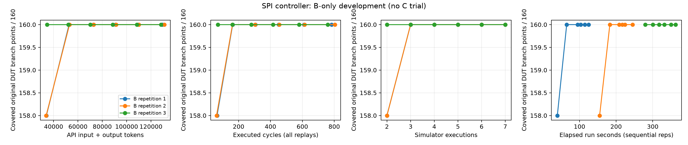

# SPI_HOST semantic repair and independent B development — 4 November 2026

**Decision: the extraction gap is repaired for the supported subset, but this
candidate still does not qualify for a formal A/B/C/placebo comparison.** Two
seed-uncovered, calibrated, nontrivial guard groups are now certified. In a new
live B-only development run, all three independent repetitions hit both groups
and all nine qualified source groups in round 1. The original development gate
fails. No C, A, placebo or Anthropic calls were made in this stage.

This report follows, and does not replace the historical evidence in, the
[initial preflight](spi_host_preflight_2026-11-04.md). The upstream DUT, scoped
contract, checker, driver, seed and simulator settings were reused unchanged.

## Why the initial screen found no nontrivial relationships

The initial result was **zero relationships found by the supported extraction**,
not a failed equivalence proof. Its six Boolean rewrite obligations were UNSAT
under their two-state interpretation. The adapter could not establish the
design-dependent relationships needed here:

1. It treated vector comparisons and derived signals as separate opaque atoms.
   It did not substitute unique acyclic continuous definitions such as
   `fsm_en`, `clk_cntr_en` and the command-acceptance dependencies.
2. It did not encode the default assignments, blocking-assignment order and
   ordered `if`/`case` choices in `always_comb`. Consequently `state_d` and
   `command_ready_int` were free values rather than expressions of the current
   state and inputs. This loses relations between a transition guard and the
   downstream logic activated by that transition.
3. It extracted true-path targets only. Opposite-polarity counters can expose
   different syntactic expressions for the same full activation condition.

Adding aliases alone established four different-expression pairs in an
already-seed-covered group. That did not qualify the candidate. Adding supported
combinational SSA established 46 different-expression pairs in total, including
the two eligible groups below. Neither step changed the DUT to manufacture
equivalence.

## Implementation and proof boundary

The new implementation is separate from the original adapter and results:

| Component | Implementation and evidence |
|---|---|
| Typed extraction | [`spi_semantic_v2.py`](../scripts/spi_semantic_v2.py): bit widths, signedness, packed-field offsets, sign/zero extension, truncation, supported operators, and exact branch polarity |
| Combinational dependencies | Unique acyclic continuous definitions; restricted whole-variable `always_comb` SSA; defaults and first-match `if`/`case` priority become conditional expressions |
| Independent IR check | [`spi_netlist_proof.py`](../scripts/spi_netlist_proof.py): translate independently lowered Yosys cells using installed `simlib.v` semantics, then compare each supported definition with the AST/SSA expression |
| Relation proof | QF_BV queries over source-distinct guards with matching event context; query files and all SAT/UNSAT/unknown statuses retained |
| Equality saturation | [`guard_proofs.rs`](../egraph/src/bin/guard_proofs.rs): actual `egg`, six Boolean rules plus certified design-specific ground rules, bounded saturation and rewrite explanations |
| Qualification | [`screen_spi_semantic_v2.py`](../scripts/screen_spi_semantic_v2.py): exact original-counter joins, seed-zero/calibrated reachability, and the existing static thresholds |

The attribution matters: **Z3 plus SSA discovers and proves the new
design-specific relations; egg saturates the certified rules and organizes
equivalent expressions.** The 46 ground rules are generated from all proved
different-expression pairs before looking at calibration or model outcomes.
There are no unconditional manual e-class unions. Every cross-source egg merge
is checked against the pair-proof ledger. This is an upgraded semantic backend,
not evidence that the original six-rule egg engine independently discovered
these relationships, or that egg is necessary for this small grouping task.
A future effect comparison would evaluate this combined feedback package;
isolating egg from SMT-derived grouping needs its own ablation.

Current-state flop outputs and primary inputs remain unconstrained binary bits.
The proof does not assume a reachable-state invariant or replace sequential
behavior with a combinational identity. Clock/reset contexts remain outside
normalization, including the original positive clock and negative asynchronous
reset. The prior 26 connection checks remain applicable because the source is
unchanged. Synchronous and asynchronous reset are never identified.

Unknown literals, unsupported casts/operations, dynamic or out-of-range selects,
cyclic/multiply-driven aliases and incompletely assigned procedural paths fail
closed. For Yosys synthesis don't-care values, 165 bits are fresh unconstrained
binary values, not zeros. The proof must hold for every assignment. Five used
`$pmux` selector sets are separately proved one-hot-or-zero before translating
their mux behavior. This remains a **two-state combinational proof**, not
four-state SystemVerilog equivalence or full-IP formal correctness.

The AST and netlist checks share the Slang frontend. They independently encode
different IRs, but are not independent compiler implementations or a substitute
for external checker review.

## What was proved and mapped

| Measure | Result |
|---|---:|
| Supported guard targets, including false paths | 199 |
| Same-context source-distinct pair queries | 11,271 |
| Pair outcomes: SAT / UNSAT / unknown | 10,771 / 500 / 0 |
| Certified different-expression ground rules | 46 |
| Supported definitions checked against Yosys | 68, all passed; includes 23 procedural outputs |
| Used parallel-mux selector checks | 5, all passed |
| Exact source-counter mappings | 186 |
| Unresolved mappings | 13; no unique exact opposite-polarity raw counter |
| Qualified source-distinct seed-zero reachable groups | 9 |
| Qualified groups merging different input expressions | 2 |
| Bounded egg run | 5 iterations, 290 e-nodes, 224 e-classes; saturated |

SAT pair results mean those two guards are not universally equivalent; they
are not DUT defects. All original counters remain in the raw denominator,
including counters with unresolved mappings. Equal expressions never transfer
hits between source locations. The inherited top-file denominator is still
**57 line / 160 branch / 246 expression / 836 toggle**, or 1,299 counters.

The two qualified nontrivial groups are:

| Group | Original source locations | Reason the relationship needs dependencies |
|---|---|---|
| Command acceptance/capture | `spi_host_fsm.sv` lines 133–145, 187, 457 and 463; 16 separate counters | `new_command` implies the necessary readiness, enable and software-reset conditions, so the complete guarded counter-load expressions agree with command capture |
| WaitTrail completion and entering WaitIdle | line 291 `if` and line 480 `case`; 2 separate counters | The full WaitTrail/expired-counter guard agrees with the full downstream guard selecting WaitIdle only after substituting the priority-preserving `state_d` expression |

These explanations are descriptions of the saved complete predicates, not
replacement proofs of shortened formulas. The second pair does not equate
WaitTrail with WaitIdle as states; it equates the complete conditions activating
two source points during the same combinational transition evaluation.

Every qualified member was zero under the common seed and positive in a valid
independent calibration. The original 35 calibration traces/checker outcomes
and Verilator/Icarus agreement were reused. Calibration schedules and solver
witnesses were not included in B prompts; the pair proof does not export
stimulus witnesses. Reachability of each target is not a promise that all
targets jointly require a long or difficult schedule.

Partial assignments in the `sd_en` procedure, general child-instance/generate
guard extraction, and the 13 unmapped false arms remain unsupported/unresolved.
The raw coverage denominator is not reduced to hide them. One legacy prose
field, `audit.json:proof_scope`, still describes continuous-only substitution;
`procedural_ssa_enabled: true`, the saved definitions and the independent 68
definition checks specify this version's actual scope. Frozen evidence was not
rewritten after the live run to repair this inherited wording.

## Independent B development result

The [original B configuration](../configs/spi_host_b_development.json) is
unchanged: three independent repetitions, six rounds, at most 64 new cycles per
round, `gpt-6.1-sol`, low reasoning, 32,000 input-token and 16,384 output-token
caps, 120-second timeout, at most one retry. Each request is a separate API
request with explicit own-run history, not a conversation shared across
repetitions. The API returned the requested model on all 18 generation calls.

The model can change only schema-validated JSON stimulus. The fixed eight-cycle
seed and all accepted actions are replayed in a fresh simulator each round.
There is no inserted drain. All replay cycles count. The driver runs the full
batch and flushes coverage before the checker evaluates the trace. Initialization
and reset activity count; testbench and separate child-source coverage do not.
Counters generated from scopes within the top source remain included.

The original development gate requires at least two of three repetitions to
leave at least two source groups unhit after round 1, and at least two to make
later group progress. An additional
[pre-run analysis plan](../configs/spi_host_v2_analysis_plan.json) records
nontrivial-group progress separately and requires a nontrivial group to remain
unhit after round 1 in at least two repetitions before formal readiness. Both
criteria failed; neither was altered after viewing model responses.

| B repetition | Round-1 branch | Round-1 groups hit | First round hitting both nontrivial groups | Final line / branch / expr / toggle | API tokens | Executed cycles |
|---|---:|---:|---:|---|---:|---:|
| 1 | 158/160 | 9/9 | 1 | 54/57 · 160/160 · 246/246 · 506/836 | 129,349 | 783 |
| 2 | 158/160 | 9/9 | 1 | 54/57 · 160/160 · 246/246 · 652/836 | 131,109 | 804 |
| 3 | 160/160 | 9/9 | 1 | 54/57 · 160/160 · 246/246 · 544/836 | 128,360 | 759 |

The first batches contained 49, 46 and 54 newly generated cycles, respectively.
They reached the selected groups before another feedback round could help.
The final counts still differ, especially toggle; **target saturation is not
complete coverage saturation**, and passing the scoped checker is not a proof
that every SPI behavior is correct.

| Account | Total |
|---|---:|
| Generation requests / token-count requests | 18 / 18 |
| Accepted / failed attempts / retries | 18 / 0 / 0 |
| API input / output / combined tokens | 341,857 / 46,961 / 388,818 |
| Cached input tokens, already included in input total | 59,386 |
| Reasoning output tokens, already included in output total | 2,027 |
| Calls with unknown usage | 0 |
| Compilation executions / time | 1 / 7.487 s |
| Simulation executions / time | 21 / 0.567 s |
| Actually executed cycles, including seed replays | 2,346 |
| Generation latency / token-count wall time | 347.811 s / 5.980 s |
| Live runner total wall time | 362.596 s |
| Input/scope violations / repeated checker failures / distinct defect categories | 0 / 0 / 0 |

The live wall time includes compilation and all repetitions, but excludes
earlier calibration, proof preprocessing and automated tests. Egg's own
saturation time is about 0.010 s. The v2 pair-proof/netlist-proof total wall time
was not separately recorded; the inherited `screen.json:semantic_seconds` is
legacy v1 telemetry and must not be presented as v2 total preprocessing cost.
This omission prevents a complete preprocessing-cost comparison and should be
fixed before a formal multi-arm run. It does not change the B gate result.

Token ROI in the CSV is `(covered original branch points - 79 seed-covered
branch points) / (cumulative API input + output tokens / 1000)`. Raw counters and
token totals are retained. No statistical significance or C effect is estimated
from these B-only trials.



The wall-time panel uses elapsed time from the common run start, so sequential
repetitions occupy different intervals; it is not a comparison of per-repetition
latency. All plotted measurements follow completed batches.

## Validation, provenance and reproduction

The final repository test run passed **94 tests**. Seven new tests cover typed
constants/casts, sign handling, bitwise versus logical operations, packed
offsets, alias-cycle rejection, false-counter identity, SSA/netlist agreement,
and unresolved unassigned paths. A deliberately inverted netlist condition
produces a SAT mismatch, confirming that the cross-check can reject an incorrect
translation rather than accepting every fixture.

The separate [saved-run recheck](../results/spi_host_v2_b_live_20261104/recheck.json)
verified 36 recorded hash entries, reconstructed all 18 B prompts from their own
raw histories, and recomputed the 21 checker/coverage results and 2,346 executed
TRACE cycles. It checks each group's individual raw counter values and all
1,299 counter identities. This used no new API calls or simulations and is an
accounting/isolation check, not an independent correctness proof of the checker.

The preserved upstream revision is `0ea5236fe749e70ba18f56ba19c4be982ef46da7`,
`NumCS=2`; DUT SHA-256 is
`5324b93183a0475c5e955b76a7b1e9c1c9739e810a70d213491c5657837ee47c`.
Repository base commit is `c71a3e580646d08fb6496c742b7b42b711179b36`;
this work is uncommitted. Exact checker/driver/semantic implementation and
configuration hashes are in the saved screen and run metadata. Tool versions
are Verilator 5.050, Icarus 12.0, Slang 12.1.0+42710c788, isolated Yosys
0.70+309 (`bd3168b1a`), Z3 5.1.0, egg 0.11.0 and OpenAI SDK 2.54.0.
The staged OpenAI key was deleted after the run.

From the repository root, use a new output directory to regenerate proof
artifacts rather than overwriting the certified/live evidence:

```sh
cargo build --locked --offline --manifest-path egraph/Cargo.toml --bin guard_proofs
.venv/bin/python scripts/spi_semantic_v2.py --ast results/spi_host_preflight_20261104/ast.json --procedural --output build/spi-proof-new/ssa_audit
.venv/bin/python scripts/spi_netlist_proof.py --ast results/spi_host_preflight_20261104/ast.json --netlist results/natural_ip_parameter_screen_20261103/spi_host_slang/netlist.json --output build/spi-proof-new/netlist_proof
.venv/bin/python scripts/screen_spi_semantic_v2.py --base build/spi-proof-new
.venv/bin/python scripts/run_spi_host_b_development.py --mode mock --screen build/spi-proof-new/screen.json --output build/spi-mock-new
make test
```

The exact live command already executed was:

```sh
.venv/bin/python scripts/run_spi_host_b_development.py --mode live --screen results/spi_host_semantic_validated_20261104/screen.json --output results/spi_host_v2_b_live_20261104
```

It required the hidden-key staging script. Repeating it requires a fresh output
path and credentials; it is not necessary to reproduce the saved analysis:

```sh
.venv/bin/python scripts/verify_spi_b_development.py --run results/spi_host_v2_b_live_20261104
MPLCONFIGDIR=build/mplcache .venv/bin/python scripts/analyze_spi_b_development.py --run results/spi_host_v2_b_live_20261104
```

Canonical new evidence is under
[`spi_host_semantic_validated_20261104`](../results/spi_host_semantic_validated_20261104/)
and [`spi_host_v2_b_live_20261104`](../results/spi_host_v2_b_live_20261104/).
The staged alias/SSA diagnostic artifacts remain separately under
`results/spi_host_semantic_v2_20261104/`; historical negative results were not
deleted. CSVs contain all rounds and each source point's first hit.

## Implications for the next candidate

The repair establishes that the old semantic representation omitted useful
relations. The live result establishes that these particular targets are easy
for B under this interface and budget. They concern accepting a command and
finishing a short transfer; many source locations observe those same two events.
More equivalent locations therefore did not create more independent temporal
challenges. The controller driver also bypasses the bus and FIFO scheduling
needed by the complete SPI_HOST subsystem.

The next qualification should prioritize at least three distinct multi-step
events, such as constrained backpressure/recovery, abort/restart and ordered
transaction switching, with a specification checker that actually covers those
behaviors. Current checker exclusions must be resolved before using such
targets. Each event needs complete supported guards, independent reachability
and the same outcome-blind B progress gate. Do not shorten the budget or choose
new targets after observing these B traces simply to force a C advantage.

Expanding SPI_HOST can test hierarchy support, but is still the same design
family, not a second independent IP. The broader project still needs two
independent natural IPs to pass qualification. Keep this SPI result as a
semantic/checker regression and an honest negative screening result. It neither
demonstrates a C benefit nor disproves benefits on harder suitable tasks, and it
does not establish extraction optimization as the performance bottleneck.
