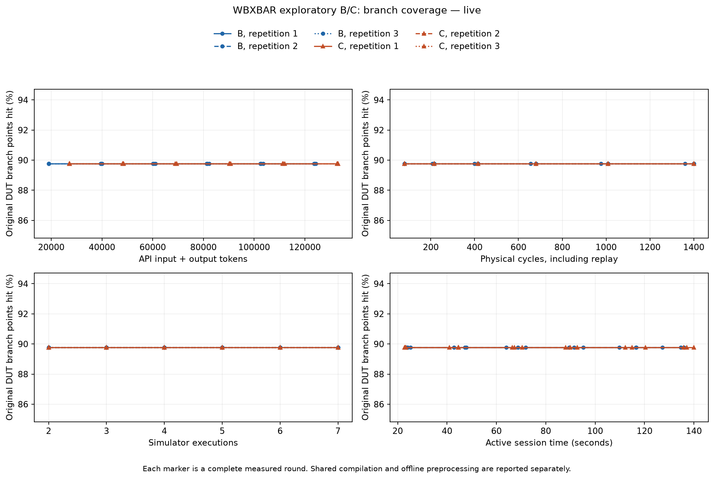
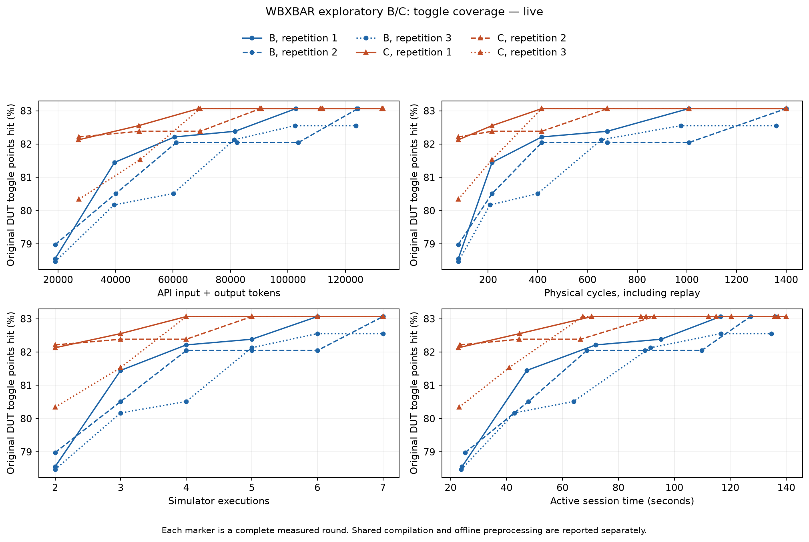

# WBXBAR exploratory B/C result — 4 November 2026

**All six sessions hit all 17 registered source targets in round 1. C did not
improve target round, simulator executions to target, or final line/branch
coverage. Its mean token cost to the raw target was 43.30% higher.** C had higher
first-round toggle coverage in these three repetitions, but the final median
was tied. This is a known-easy exploratory control, not a confirmatory test of
semantic superiority. Functional verification remains inconclusive: independent
post-run review and external checker-state tracing identify an abort bookkeeping
limitation behind the routing alarms. No new DUT defect is confirmed.

## Frozen method and what actually ran

The [preparation report](wbxbar_exploratory_bc_2026-11-04.md) documents the original
screen rejection, the user's separate difficulty waiver, independent Claude
checker versions, positive/fault controls, driver, source mappings and proofs.
The original rejection was not changed. All eight groups and 17 original source
counters were fixed before any live stimulus outcome; ordinary traffic was
already known to reach all of them. These are mixed line/branch counters, not
17 independent branch points or eight distinct late events.

- Original `ZipCPU/wb2axip@2e8d3bc2d26ddc33d1881022a2a2b9d3f0c16b9b`, with
  `wbxbar`, real `skidbuffer` and `addrdecode`; DUT files unchanged.
- NM=2, NS=2, AW=8, DW=32, LGMAXBURST=3, OPT_TIMEOUT=16, starvation/double-buffer/
  low-power enabled. Synchronous active-high reset. Prompt one-cycle slave
  ACK/ERR environment, no slave backpressure.
- B and C: three independent stateless sessions, six rounds each, at most 64
  new physical cycles per round, eight common seed cycles. All rounds ran,
  including after target saturation. Arms interleaved, order reversed in rep 2.
- Exact requested and returned model: `gpt-6.1-sol`, low reasoning, input cap
  32,000, output cap 16,384, timeout 120 seconds, at most one retry. No retries
  or failed generation attempts occurred. Provider input counts checked each call.
- Both arms receive the same public spec, complete active preprocessed RTL,
  fixed JSON interface, own recent stimulus/pin history, full-batch checker
  feedback and raw coverage selection. C adds only certified guard relations,
  typed atoms, egg representatives and explanations. No calibration witnesses,
  solver stimulus or manual targeting hints enter prompts.
- Common prompt packing and 64-cycle history window were registered before
  live calls to fit the unchanged token cap. Source line coordinates remain
  original. Complete cumulative stimulus stays on disk and is replayed in full.
- Fresh process/counters for each cumulative seed+actions replay. Initialization
  and reset activity count; no uncounted drain. Coverage is flushed before the
  independently authored checker executes. Only the three DUT files are counted.

The measured scope is **stimulus generation through a fixed driver**, not an
LLM's ability to write arbitrary SystemVerilog benches, checkers or assertions.
Claude authored the frozen checker; GPT/Codex authored the driver and controls;
GPT-6.1-Sol generated only JSON stimulus. Source equivalences and coverage counts
come from deterministic tools, not a model's self-evaluation.

Repository baseline commit: `50d7ee83d61989017e28e981420cd58f4c5f0787` plus the
hash-bound uncommitted implementation. No commit or push is claimed.
Final freeze SHA-256:
`216ef3ea4cf3748c6a65be215bbdca7fb2c2ce832ff4dc745c1386641b5715aa`.
Original wbxbar.v SHA-256:
`d3fd1f2d7fb8909c2c2950c666e04c97d704c501c867201aedab5011ee106d2e`.
Claude v3 checker SHA-256:
`163fd64a9fe3925b3cd64130c2b9a22e4489c1acfea36b985026c228aa6f3545`.

Versions: Python 3.13.9, OpenAI SDK 2.54.0, Verilator 5.050, Icarus 12.0,
Yosys 0.70+post, Rust/Cargo 1.99.0, egg 0.11.0, Matplotlib 3.11.2.
Full tool strings and commands are in `live-v1/metadata.json` and the freeze.
The conditional state-domain proof and two-state rewrite/source certificates
are reused offline artifacts. They do not prove whole-IP sequential correctness
or four-state equivalence. Unresolved/unproven-unreachable counters stay in the
raw denominator.

## Individual outcomes

| Arm/session | Raw target round | Tokens at target | Total tokens, 6 rounds | Final toggle / 2,350 | Original final checker verdict |
|---|---:|---:|---:|---:|---|
| B1 | 1 | 18,966 | 123,913 | 1,952 | dut_violation |
| B2 | 1 | 18,988 | 124,335 | 1,952 | dut_violation |
| B3 | 1 | 18,982 | 123,619 | 1,940 | dut_violation |
| C1 | 1 | 27,146 | 132,627 | 1,952 | dut_violation |
| C2 | 1 | 27,184 | 132,994 | 1,952 | dut_violation |
| C3 | 1 | 27,259 | 133,043 | 1,952 | unresolved |

Every raw target attainment cost **80 executed cycles and two executions**:
an eight-cycle seed measurement plus replay of the seed and 64 new cycles.
All six **checker-complete target endpoints are “not reached”**; none was dropped
or relabelled a verified pass. The original checker verdicts above are retained
as observations, not accepted as proof of five faulty DUTs.

All sessions end at line **82/86 (95.349%)**, branch **79/88 (89.773%)**, and
expression **282/321 (87.850%)**. Branch coverage is already 79/88 after round 1
and does not improve in later rounds. Raw denominator remains **2,845**:
86 line, 88 branch, 321 expression and 2,350 toggle counters.

These are Verilator's tool-defined counters. Line points are instrumented
execution locations, not all textual lines. Branch points distinguish instrumented
outcomes. Expression points describe instrumented expression outcomes. Toggle
points describe directed signal-bit changes. They do not prove conformance to
specification. Equivalent guards keep their original separate source counters.

C's first-round toggle counts were 1,930 / 1,932 / 1,888; B's were
1,846 / 1,856 / 1,844. Mean difference: **68 counters, 2.894 percentage points**.
Final medians both equal 1,952; final means are C=1,952 and B=1,948, a difference
of only four counters (0.170 percentage points), driven by B3. These descriptive
differences are retained; no significance or isolated semantic benefit is claimed.

## Cost and variability

| Metric, per session unless noted | B | C |
|---|---:|---:|
| Mean tokens at raw target | 18,978.67 | 27,196.33 |
| Range of tokens at raw target | 18,966–18,988 | 27,146–27,259 |
| Mean total tokens, six rounds | 123,955.67 | 132,888.00 |
| Mean branch Token ROI at target | 2.266 | 1.581 |
| Mean active seconds at raw target | 24.35 | 23.08 |
| Actual executed cycles, all three sessions | 4,160 | 4,200 |
| Generated cycles, excluding repeated replay/seed | 1,144 | 1,152 |

Token ROI = (newly covered original DUT branch points since the seed) × 1,000 /
(API-reported input + output tokens). The seed covers 36 branch points; each
first round adds 43. Cached input and reasoning output are subsets, never added
again. C uses **43.30% more mean tokens to target**, and **7.21% more total tokens**
over the fixed six rounds. All individual data and sample standard deviations
are in `descriptive-statistics.json`; no significance test is claimed.

C's observed mean active time to target was about 1.27 seconds shorter. With
three sessions, network/backend latency and caching, this does not establish a
repeatable speed improvement. Do not conceal this timing observation or interpret
it as an independently controlled semantic effect.

The complete primary run has **36 generation requests + 36 token-count requests**,
697,240 input + 73,291 output = **770,531 API tokens**, **42 simulations**,
**8,360 physical cycles**, two shared compilations, 15.78 seconds compilation,
1.99 seconds simulator process time, and 827.25 seconds total wall time.
The caps are matched; actual generated lengths can differ. No billing-dollar
estimate is fabricated from token counts. Each call's actual usage is retained.

E-graph preprocessing during this run is zero because the certified artifacts
were reused. Historical egg saturation alone was 0.04536 seconds; that is **not**
the total RTL extraction/Z3/mapping/proof cost. Those offline development costs
are not amortized into the timing curves, so this is not an end-to-end extraction
throughput claim. Active session time excludes other interleaved sessions and
shared compilation; the full run wall time is separately reported.





## Independent failure review and read-only state evidence

A fresh Claude Opus 5.5 session reviewed the earliest failing batch in each arm,
anonymized, plus two independent positive controls. It saw public authority,
active DUT RTL, fixed driver, frozen checker and complete losslessly packed pin
traces. It did **not** see arm names, semantic groups, source coverage counts,
model prompts, token cost or performance rankings. This is a diagnostic review,
not a blinded statistical evaluation of B versus C.

Both selected batches replay identically in Icarus at meaningful pins and in
complete checker output: **two additional diagnostic simulations / 400 cycles**,
reported separately from the primary budget. Packet: 149,010 bytes, 448 total
trace rows including controls. One actual read-only call cost **$0.575131** and
89,353 tokens. No checker/DUT edits and no new stimulus-generation calls occurred.

Claude's initial diagnosis was low-confidence unresolved: a shared abort/ERR
boundary mechanism, with a possible checker false positive from its head-only
aborted-request matching. It did not identify illegal driver input or a
measurement defect, and did not confirm a DUT defect.

The requested external Python trace hook subsequently inspected the **unchanged**
checker. Its output remained identical. It establishes:

- Anonymous case 1, failure at cycle 44: the matching master-1 request was accepted
  at cycle 42 and is `ab[1][1]`, behind a different request accepted at 41.
- Anonymous case 2, failure at cycle 308: the matching master-1 request was accepted
  at cycle 306 and is `ab[1][1]`, behind a different request accepted at 305.
- Across all six final cumulative traces, **all 18 routing diagnostics** have a
  unique matching accepted request in a non-head position of an aborted queue.
  The current matcher only tests the first entry for that slave and rejects them.

This localizes a shared checker attribution limitation. It does not prove that
all post-abort forwarding is allowed, nor justify searching arbitrary live queues
and accepting reordering. The public abort-propagation/cancellation contract
remains incomplete. These observations therefore cannot count as 18 independent
DUT defects or be silently converted into successful verification.

Repeated round reports contain **59 diagnostics** (B23/C36), because cumulative
replay repeats earlier failures. The six final prefixes contain **18 diagnostic
instances** (B6/C12), all labelled `routing_payload`, with one shared matching
limitation evidenced. There are **zero confirmed new DUT defect types** here.
The final C3 trace remains unresolved despite no functional diagnostic. All six
sessions have zero reported input-assumption violations.

Reviewer prose was checked rather than treated as an oracle. Reset clears current
queue/ambiguity state, but not the accumulated unresolved list. The masked-write
control actually forwards `0x1234a978` instead of `0x12345678`; only a disabled
byte differs, which is exactly why it should pass. Exact acceptance cycles and
queue contents are in the state-diagnosis artifacts; the reviewer explicitly
warned its manual trace indexing was approximate.

The six checker-development calls cost $2.459941 / 354,236 tokens. Including this
post-run diagnostic review, seven Claude calls total **$3.035072 / 443,589 tokens**.
Both staged credential files were deleted; no credentials are in reports.

## Interpretation and next experiment

The raw first-round endpoint comparison is unaffected by later erroneous checker
feedback: both models saw the same clean seed before generating that first batch.
It supports the narrow conclusion that this task does not expose a first-target
round or branch-token-efficiency benefit for this C package. C's initial toggle
increase is a descriptive observation with extra token cost; no placebo isolates
semantic relations from additional text or sampling variation.

After every target is hit, this policy's semantic groups disappear from the
appendix, leaving only scope notes. Thus later rounds do not test progressively
useful normalization of new difficult target groups. They also receive the
frozen checker's abort-boundary alarms, so later coverage differences are not a
clean functional-quality comparison. This is not evidence that e-graphs cannot
help harder verification tasks.

Before another run, keep the roles separate: Claude should derive an explicit
abort/cancellation attribution policy from public authority and independent
synthetic fixtures; GPT should supply driver/transport controls. Test multiple
aborted outstanding requests where an earlier request disappears but a later
buffered request is observed, duplicate reuse, new-epoch misattribution, reset,
and enabled-byte corruption. Normal live-request FIFO/order checks must not be
weakened to forgive aborted-queue ambiguity. Any revised checker needs a separate
version, review and freeze; the present records must not be overwritten.

For effectiveness, restore independent ordinary-operation exclusion and B
screening for future non-control benchmarks. Select multiple event-specific,
source-distinct equivalent guards that need stateful progress and remain
reachable within the original budget. Do not shorten the budget or choose new
targets from these C outcomes. This experiment does not justify more same-IP
repetitions merely to hunt a positive C result.

## Evidence and reproduction

- [Frozen configuration](../configs/wbxbar_exploratory_bc_freeze_v1.json)
- [Live raw evidence](../results/wbxbar_exploratory_bc_20261104/live-v1/)
- [Independent raw-accounting audit](../results/wbxbar_exploratory_bc_20261104/live-v1/audit.json)
- [Round CSV](../results/wbxbar_exploratory_bc_20261104/live-v1/rounds.csv) and
  [endpoint CSV](../results/wbxbar_exploratory_bc_20261104/live-v1/endpoints.csv)
- [Claude diagnostic review](../results/wbxbar_exploratory_bc_20261104/failure-review-v1/review.json)
- [Unchanged-checker state evidence](../results/wbxbar_exploratory_bc_20261104/checker-final-diagnosis-v1/state.json)

```sh
.venv/bin/python scripts/audit_wbxbar_live.py --run results/wbxbar_exploratory_bc_20261104/live-v1 --output build/wbxbar-live-audit.json
MPLCONFIGDIR=build/matplotlib-cache .venv/bin/python scripts/report_wbxbar_bc.py --run results/wbxbar_exploratory_bc_20261104/live-v1
MPLCONFIGDIR=build/matplotlib-cache .venv/bin/python scripts/plot_wbxbar_costs.py --run results/wbxbar_exploratory_bc_20261104/live-v1
.venv/bin/python scripts/diagnose_wbxbar_checker_state.py --packet results/wbxbar_exploratory_bc_20261104/checker-final-diagnostic-inputs-v1 --output build/wbxbar-checker-state-replay
```

Use fresh audit/diagnostic output directories. These commands use saved evidence
and do not call either model API. The live runner's replay mode can reproduce all
accepted actions without new API usage, but adds separately accounted compilation
and simulation cost. Thirty-one focused checks, full mock/replay and the complete
36-round live evidence audit passed. All known failures and limitations above are
retained rather than filtered from the report.
