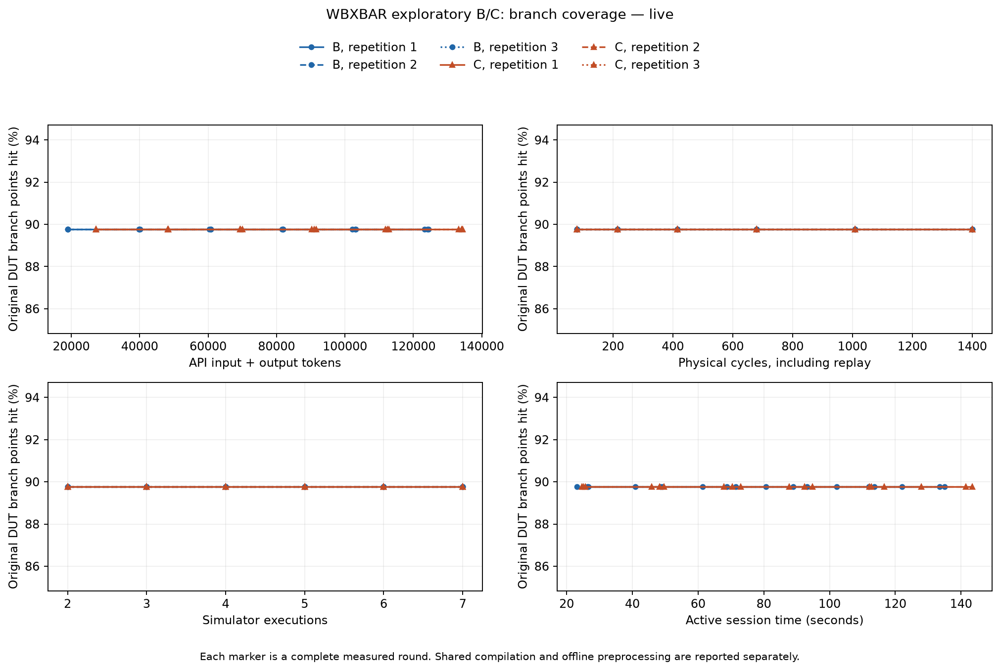
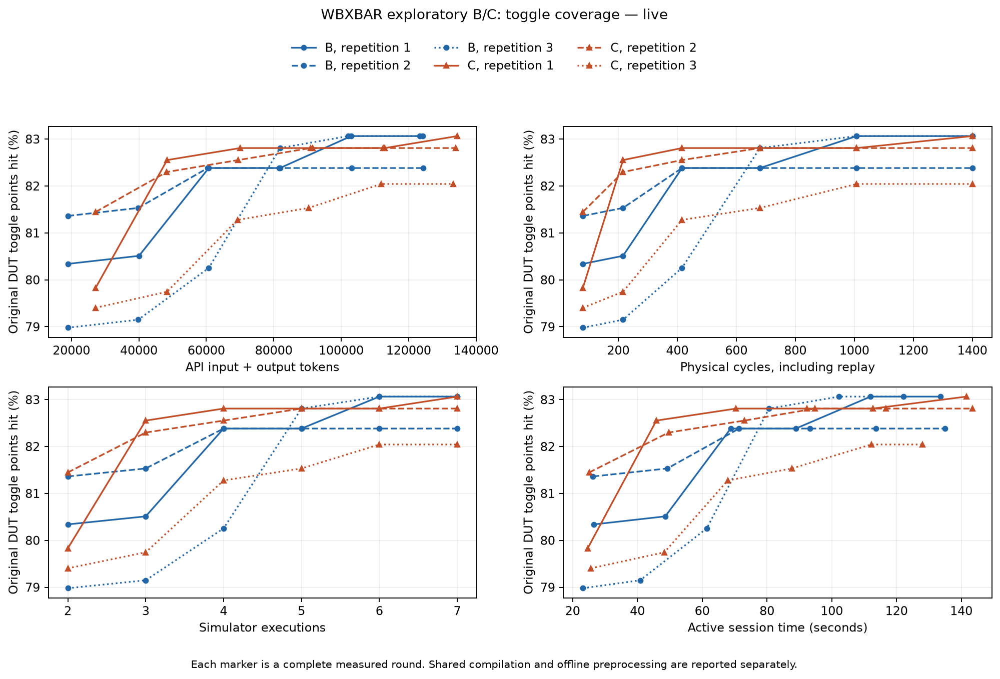

# Fresh WBXBAR B/C with the frozen reference checker — 4 November 2026

**Completed and audited:** 36 fresh model rounds, 42 simulations, 8,400 physical
cycles, no retries. All six sessions hit the 17 raw targets in round 1 and finish
functionally **unresolved**. C costs 43.34% more tokens to the raw target and 8.03%
more over six rounds, with no final line/branch gain. Intermediate toggle leads
are retained below; they do not persist as a final C advantage. The existing [retrospective replay](wbxbar_reference_replay_2026-11-04.md)
is complete and remains separate evidence.

The user authorized fresh B/C generation using the reviewed reference checker,
with unchanged budget, target counters and role separation. This is an exploratory
reliability/feedback control on the same known-easy WBXBAR scope. Earlier trials
reached all 17 counters in round 1; that selection knowledge is disclosed here and
never supplied to the experimental model. This experiment does not retroactively
pass the failed ordinary-operation or difficulty screen.

## Live results and interpretation

Exact `gpt-6.1-sol` returned in all 36 calls. All 36 token-count requests succeeded;
all actions validated and all scheduled rounds completed. The six session UUIDs
are distinct. The credential was removed by the runner after completion and its
absence was verified. No new Anthropic call or checker edit was made.

| Session | First raw target round | Tokens to target | Tokens over six rounds | Final toggle / 2,350 | Final unknown records | Final verdict |
|---|---:|---:|---:|---:|---:|---|
| B-1 | 1 | 18,981 | 124,148 | 1,952 | 15 | unresolved |
| B-2 | 1 | 18,991 | 124,390 | 1,936 | 11 | unresolved |
| B-3 | 1 | 18,936 | 123,268 | 1,952 | 8 | unresolved |
| C-1 | 1 | 27,189 | 134,425 | 1,952 | 16 | unresolved |
| C-2 | 1 | 27,195 | 134,044 | 1,946 | 15 | unresolved |
| C-3 | 1 | 27,189 | 133,179 | 1,928 | 21 | unresolved |

Every final session has line **82/86**, branch **79/88**, expression **282/321**,
17/17 target source counters, 384 generated cycles, 1,400 physically executed
cycles including cumulative replay, and seven executions including the seed.
Each raw target was reached after two executions / 80 physically executed cycles.
Raw-target not-reached is **0/6**; checker-complete target not-reached is **6/6**.
No unsuccessful functional result is dropped from the comparison.

| Descriptive measure (three sessions per arm) | B | C |
|---|---:|---:|
| Mean tokens to raw target | 18,969.33 | 27,191.00 |
| Median tokens to raw target | 18,981 | 27,189 |
| Range of tokens to raw target | 18,936–18,991 | 27,189–27,195 |
| Total API tokens, all three sessions | 371,806 | 401,648 |
| Mean final toggle points | 1,946.67 | 1,942.00 |
| Median final toggle points | 1,952 | 1,946 |
| Range of final toggle points | 1,936–1,952 | 1,928–1,952 |
| Mean final Token ROI (new branch points / 1,000 tokens) | 0.34696 | 0.32118 |
| Mean active seconds to raw target | 25.363 | 25.141 |
| Range of active seconds to raw target | 23.174–26.615 | 24.649–25.659 |

The primary target and final line/branch/expression comparisons tie. C's token cost
is higher, and its final toggle mean is 4.67 points lower out of 2,350; this small
pilot does not establish statistical significance. Target wall-time distributions
overlap; the slightly lower C mean does not establish a stable latency improvement.
Each final batch adds 43 branch points beyond the seed; Token ROI uses the full
API input-plus-output denominator and therefore decreases as later calls add cost
without new branch points.

The full trajectory is mixed, rather than C being uniformly worse. Both arms have
first-round mean toggle 1,885.33. At round 2, B/C means are 1,889.33/1,916.00; at
round 3 they are 1,919.33/1,932.00. These transient C leads occur at matched round,
cycle and execution counts but different realized token costs. B's mean is higher
in rounds 4–6. These exploratory trajectory differences are reported without a
post-hoc coverage threshold, changed budget or significance claim.





### Why the primary target still does not discriminate

All six sessions reached all targets in the first allowed generation batch, so the
registered target-round endpoint cannot improve below one. The saved C prompts
contain eight semantic groups in each first round, then zero groups in each of the
15 later C calls because the frozen selection policy removes fully hit groups.
The remaining scope/type notes are still present. Thus later coverage refinement
mostly receives the common raw coverage evidence, and additional calls cannot
improve the already attained target endpoint. This describes information available
to the model; it does not prove whether the model used or ignored that information.

There is no token-matched placebo in this B/C scope, and only three repetitions per
arm. The intermediate toggle differences cannot be attributed uniquely to semantic
relations rather than response variability or extra context. The experiment supports
**no stable primary/final C-over-B gain on this known-easy target**, not a universal
claim that E-graphs cannot help verification. The revised checker resolves a
measurement-reliability problem; it does not itself make the target harder. Budgets,
source counts and targets were not modified in response to these outcomes.

### Functional uncertainty remains explicit

All six seeds are `scoped_pass`; all 36 generated-round batches are `unresolved`.
There are zero recorded checker failure instances and zero input-assumption
violations. This is not proof of a defect-free DUT. The final six traces retain
**86 unknown records**: 49 `possible_starvation_err`, 23 `post_abort_forward`,
11 `same_edge_response_after_abort`, and three `pending_at_batch_end`.
Across all cumulative rounds there are 343 repeated unknown records; these are not
343 distinct defects. B/C final unknown totals are 34/52, which describe sampled
behavior and checker scope, not an independently scored defect-detection rate.

All 8,400 trace rows were processed, including 203 reset rows; all 8,197 non-reset
rows were association-checked. No batch exhausted the hypothesis/resource limits,
suspended checking, crossed an invalid-input boundary or terminated on undefined
DUT output. K6 remains unresolved in all six final sessions. K13 was not activated
in C-1/B-3 and unresolved in the other four; unactivated is not counted as checked.
K5 remains excluded, C1–C4/F1–F8 unproved, and the reviewed non-normative read-ACK
assumption remains in force. No new independent DUT-defect adjudication occurred.

### Cost, audit and reproducibility

| Live work | Actual count/time |
|---|---:|
| Generation / token-count requests | 36 / 36 |
| Failed attempts / retries | 0 / 0 |
| Input / output tokens | 699,656 / 73,798 |
| Total API tokens | **773,454** |
| Cached input subset / reasoning output subset | 84,240 / 1,824 |
| Verilator + Icarus compilations | 2 |
| Verilator executions / physical cycles | 42 / 8,400 |
| Compilation time | 15.457057 s |
| Simulation subprocess time | 1.927009 s |
| Complete runner wall time | 819.620187 s |
| Active session wall time, B / C totals | 390.507328 / 412.921771 s |
| E-graph preprocessing in this run | 0 s; frozen prior artifacts reused |

Timing rows overlap; simulation is included in active session/runner time, and
compilation is included in runner time. Offline preparation and subsequent audits
are separate work. API billing cost is not inferred from an unverified price table.
The original token budgets and model settings are unchanged. Full runtime/package
versions are retained in `live-v1/metadata.json`; Git HEAD at registration was
`50d7ee83d61989017e28e981420cd58f4c5f0787` with a dirty tree, so the frozen artifact
hashes identify the actual implementation.

The primary audit reconstructs all 36 own-session prompts, raw counters and pin
traces, and freshly executes the frozen checker over all 42 batches (58 selftests
pass). The separate accounting audit recomputes every round's token totals,
subsets, generated/physical cycles, executions, simulation time and Token ROI.
Two negative controls reject a forged ROI and an unresolved batch relabeled
complete. These audits call no model or simulator; the checker audit adds
2.166074 seconds of post-run work. All historical freezes remain valid.

Live evidence:

- [Primary audit](../results/wbxbar_reference_bc_20261104/live-audit-v1.json),
  [accounting audit](../results/wbxbar_reference_bc_20261104/live-accounting-audit-v1.json),
  [negative controls](../results/wbxbar_reference_bc_20261104/accounting-negative-controls-v1.json).
- [Structured result](../results/wbxbar_reference_bc_20261104/live-v1/reference-result.json),
  [comparison calculations](../results/wbxbar_reference_bc_20261104/live-comparison-v1.json),
  [round CSV](../results/wbxbar_reference_bc_20261104/live-v1/rounds.csv),
  [endpoint CSV](../results/wbxbar_reference_bc_20261104/live-v1/endpoints.csv),
  [diagnostic CSV](../results/wbxbar_reference_bc_20261104/live-v1/diagnostics.csv).
- [Branch plot PDF](../results/wbxbar_reference_bc_20261104/live-v1/coverage-cost.pdf) and
  [toggle plot PDF](../results/wbxbar_reference_bc_20261104/live-v1/toggle-cost.pdf).

## Registered comparison

| Item | Frozen setting |
|---|---|
| DUT | Original WBXBAR plus skidbuffer/addrdecode at `2e8d3bc2d26ddc33d1881022a2a2b9d3f0c16b9b`, original fixed 2-master/2-slave parameters |
| Specification and driver | Original public-specification prompt packet and unchanged fixed JSON offer driver |
| Checker | Claude-authored and independently reviewed reference contract, properties, checker and selftests; byte-identical to the replay freeze |
| Generation | Exact `gpt-6.1-sol`, low reasoning; JSON cycle stimulus only |
| Schedule | B/C each 3 repetitions × 6 rounds; alternating arm order between repetitions |
| Cycle limits | Eight-cycle common seed; at most 64 new cycles per round; full cumulative replay each round, no automatic drain |
| Token/request limits | 32,000 input / 16,384 output tokens; 120-second timeout; at most one retry per round; SDK automatic retries disabled |
| Coverage denominator | 2,845 original DUT counters: line 86, branch 88, expression 321, toggle 2,350 |
| Registered target | All 17 separate source counters in eight semantic groups; equivalent predicates never combine source counters |
| Independence | Six fresh local session IDs; no Responses conversation or previous-response ID; only the current arm/repetition history is rendered |

B and C reuse the same base instructions, source representation, raw coverage
selection, schema, driver and checker-diagnostic selection. Both see all 17 target
counters plus a rotating page of at most 48 uncovered line/branch/expression points.
C appends the previously validated typed guard relations for groups still not fully
hit. No solver witness, private calibration action, prior live stimulus or golden
answer is provided. Clock/reset context and two-state equivalence limitations remain.

All raw checker results—including every unknown record, failure, assumption
violation, property status and checked-scope count—are saved. The unchanged model
feedback policy sends each category's total and first eight records equally to
B/C, the latest 64 generated actions and 16 trace rows. This prompt truncation is
explicit; it does not truncate the saved results or cumulative simulation.
`unresolved` is never counted as a functional pass. No round is stopped or dropped
because it has unresolved results or has already reached the raw target.

The primary comparison is C versus B **within this new experiment**: raw target
attainment round, not-reached rate, original coverage, tokens, executed cycles,
simulation executions and wall time. Checker-complete attainment is separately
defined as raw target hit, driver delivery complete and `scoped_pass`; the checker's
declared exclusions still apply. Token ROI is newly hit DUT branch points since
seed per 1,000 API-reported input-plus-output tokens. Cache and reasoning subsets
are recorded without adding them again. No statistical significance is claimed
from three repetitions; there is no placebo arm in this requested B/C scope.

## Registration, freeze and independent boundary

- Registration: `configs/wbxbar_reference_bc_v1.json`, SHA-256
  `a5a59617cbdf5db6a64ce86c084b36fc6156d325cf096c77f2de6ef8132b6420`.
- Live freeze: `configs/wbxbar_reference_bc_freeze_v1.json`, SHA-256
  `094ff2a54540e73d73186c7cf0a6746089bac570637bbd5ecb2c420ed67f23ae`.
- Checker SHA-256:
  `682fcf01eb44079cc9814aa66b551cfe40e45756f05fea8d82bbdc703c117a1d`.
- Checker bundle: `results/wbxbar_reference_replay_20261104/frozen-checker/`.
- Evidence root: `results/wbxbar_reference_bc_20261104/`.

The original runner hard-codes the earlier checker. To preserve its historical
freeze, the new `wbxbar_reference_experiment.py` and `run_wbxbar_reference_bc.py`
provide a separately versioned boundary. The worker and simulation function bodies
are identical to their original counterparts; only the module's checker binding
changes. The driver/compiler, message renderer, schema, stimulus validation and
semantic-group accounting are reused directly. The new freeze verifier checks
the original settings, reviewed-checker freeze, successful replay audit and new
offline runner validation before allowing live calls. The replay-only freeze itself
still cannot launch a live trial.

Claude retains checker authorship. GPT/Codex implemented the new runner, registration,
measurement audit and report integration without editing checker behavior. The
experimental GPT cannot edit trusted artifacts. No new Claude call is needed to
reuse the unchanged, already reviewed bundle.

## Completed offline checks

Eight focused tests pass. They verify the fixed budget/targets/new-checker binding,
unchanged worker/simulation/driver implementation, real reference-checker execution
on an existing unresolved trace, B/C common feedback, full unknown preservation in
that fixture, freeze tamper rejection, live launch rejection from an offline config,
the original schedule/schema and stateless exact-model SDK requests.

A complete mock run and replay of its saved call log both pass independent audits:

- Each has 36 scheduled refinement rounds plus six seed executions: **42 simulator
  executions / 8,400 physical cycles**. Together they use 84 executions / 16,800
  cycles and four compilations (Verilator and Icarus for each run). These are
  separate offline infrastructure costs, not a change to live trial limits.
- Every action, pin trace, raw DUT counter and checker output agrees between mock
  and replay. The SV driver bytes and all six seed traces/counters also match the
  preserved original experiment.
- Each audit reexecutes the frozen checker over all 42 batches; 58 selftests pass.
  The mock uses arm-blind idle actions, reaches none of the target groups, and is
  explicitly excluded from all LLM-effectiveness claims.
- API generation/count calls are zero. Mock/replay zero tokens are not live token
  efficiency measurements. The reporting/plot pipeline runs successfully offline.

Machine-readable evidence:
[runner validation](../results/wbxbar_reference_bc_20261104/runner-validation-v1.json),
[mock audit](../results/wbxbar_reference_bc_20261104/mock-audit-v1.json), and
[replay audit](../results/wbxbar_reference_bc_20261104/replay-audit-v1.json).

## Executed live and audit commands

The user stages the key through the existing hidden-input helper. The runner reads
it from `build/private/midterm-openai-key`, requires private file permissions, and
removes it in its completion/failure cleanup. Keys never enter prompts or results.
No Anthropic credential is required for this unchanged-checker trial.

From the repository root, after private staging, the executed commands were:

```sh
.venv/bin/python scripts/run_wbxbar_reference_bc.py --mode live --config configs/wbxbar_reference_bc_freeze_v1.json --output results/wbxbar_reference_bc_20261104/live-v1
.venv/bin/python scripts/audit_wbxbar_reference_bc.py --run results/wbxbar_reference_bc_20261104/live-v1 --output results/wbxbar_reference_bc_20261104/live-audit-v1.json
.venv/bin/python scripts/audit_wbxbar_reference_accounting.py --run results/wbxbar_reference_bc_20261104/live-v1 --output results/wbxbar_reference_bc_20261104/live-accounting-audit-v1.json
.venv/bin/python scripts/report_wbxbar_reference_bc.py --run results/wbxbar_reference_bc_20261104/live-v1
```

The runner retains per-call and per-round JSONL, rendered prompts, returned model
IDs/response IDs/token usage, all attempts, actions, full traces and raw counters.
The audit reconstructs prompts from each session's own history and reexecutes the
frozen checker. Reports include CSV endpoints/diagnostics, per-session unresolved
counts, descriptive variability and branch/toggle cost curves. Not-reached trials
remain in the report. Compilation and preprocessing costs stay separate from active
session time; all replayed physical cycles are counted.

These commands completed and both live audits passed. Historical and retrospective
results remain immutable. A future experiment should separately preregister a
discriminating target and its independent admission evidence; this result does not
authorize tuning this trial or launching more calls. Any future model alarm still
requires independent attribution before being called a confirmed DUT defect.
