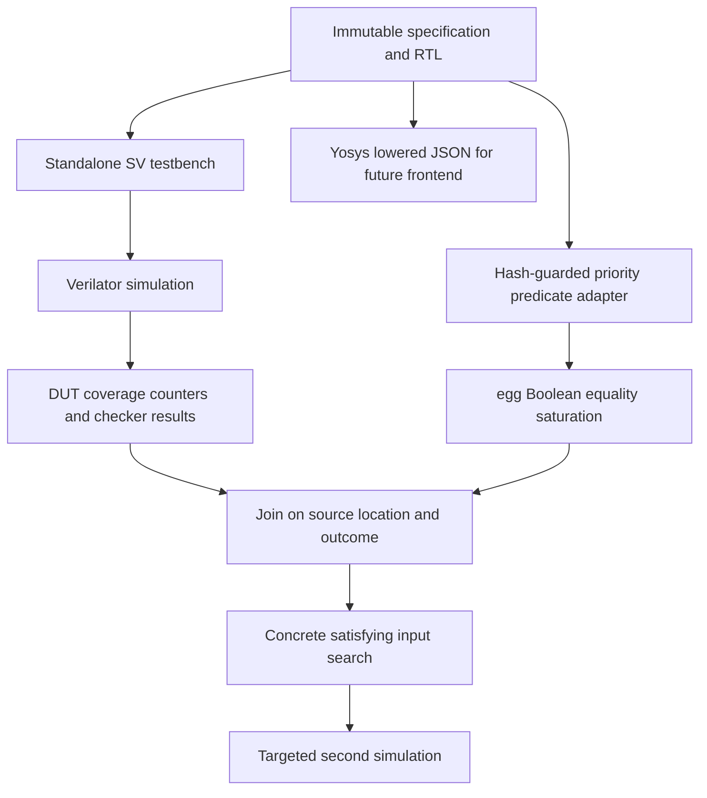

# Accepted workflow and next milestones

## Sources and interpretation

Read the user's [shared conversation](https://chatgpt.com/share/6ad2379f-fa20-83ea-9100-8175c13b6986)
through its visible transcript, including the initial prompt, arbiter example,
reported defects, and the follow-up architecture/ablation discussion. Read the
completed proposal in `project_background_reading/`. The proposal remains intact.
The shared download bundle was not required: this repository reconstructs the
source example directly from the pinned official CVDP JSONL.

The history's first arbiter run was a structural verification example without
actual equality saturation or instrumented coverage. Its later message corrected
"nine E-classes" to nine behavioral priority partitions. This repository implements
the next requested integration: actual coverage, real egg normalization, preserved
source mapping, and one measured targeted refinement. Historical run counts are
not treated as new measurements.

## Implemented flow

The adapter extracts request `else if` indices and override ternary indices from
the fixed source. It attaches all lower-priority exclusions and the enclosing
reset/override guard. Source SHA-256 is checked before extraction. Raw regexes
are used only for this reviewed, hash-locked fixture; arbitrary SV inputs are
rejected rather than accepted as a general parser.

For request index k, the activation condition is:

`!reset && !override_any && req[k] && !(req[0] || ... || req[k-1])`.

The equivalent expanded form distributes the negation over the lower bits.
`egg` derives their equality using sound Boolean rules and congruence; it never
unconditionally unions the pair. Override-index predicates use `override_any`
and the same lowest-set-bit exclusions over override bits. Atom widths are one.
The witness enumerator preserves `override_any == (priority_override != 0)`.

Normalization uses six bounded rules: two De Morgan rules, double negation,
left/right AND true elimination, and NOT false. Limits: 20 iterations, 20,000
nodes, five seconds. The observed graph saturates in seven iterations, has 152
classes, and keeps 16 different winning predicates distinct. Extraction uses
`egg::AstSize` to select a compact explanation, not an optimized replacement DUT.

The JSON graph serializes each E-class's E-nodes, their operator/atom, and child
class IDs. Class IDs are local to a run and must not serve as stable database
keys. Persistent keys are predicate IDs plus source hash/location/outcome.

## Measurement contract

The runner keeps the DUT fixed and compiles the same TB once per invocation of
the experiment runner. Mode 0 is the initial four-cycle draft. Mode 1 repeats
that draft and appends witnesses for 14 uncovered priority targets, plus four
spec probes. Mode 2 repeats the draft, exhausts 256 x 256 input pairs, and adds
three reset/recovery cycles. Every row starts from a fresh simulator process and
fresh counters; counters are not accumulated across runs.

Coverage records are filtered by exact DUT source and `.dut` hierarchy. The
join checks line, coverage type and outcome, retaining the unique column and
source span in feedback. It fails on missing/ambiguous mappings. Verilator 5.050
reports the final request chain location with `if`, earlier locations with
`elsif`; the validated adapter accounts for that distinction. It does not infer
that an equivalent predicate's hit covers another location.

Line, branch, toggle, and expression point sets are reported independently.
Unreachable counters stay in raw totals, with separate explanations. The last
override `cond_else` is unreachable in the binary model: the enclosing condition
requires a nonzero override, while passing all eight ternary tests requires zero.
The unit test enumerates all 256 override values to check this contradiction.
This does not assert four-state X/Z reachability.

The checker uses arithmetic isolation of the least set bit, unlike the DUT's
priority chain. Inputs are driven at falling edges, stability is sampled 1 ns
later, outputs are checked 1 ns after rising edges. Reset is checked against the
specification, including active-grant reset assertion between edges. Grant index
is compared when reset or valid; idle index is unspecified. The watchdog fails
an incomplete run. Known violations are accumulated; strict standalone mode
exits nonzero, whereas collection mode permits coverage flushing and retains
failure counts in JSON.

Checker validation generates disposable controls under `build/checker-controls`:
a conforming implementation must pass; override-only and reset-only defects must
be distinguished. The original fixture is never repaired in-place. Those test
runs are validation overhead, separate from the four measured experiment runs.

## Research phases still to implement

1. **Model orchestration:** provide the same initial spec/RTL and checker contract
   to A/B/C. Use the saved reusable prompt and typed feedback artifacts. Record
   actual API usage, model/version, seed, generation options and timestamps.
2. **Ablations:** A receives compilation/log/checker feedback; B additionally
   receives raw coverage and unnormalized predicates; C additionally receives
   normalized equivalent forms, dependency guards and semantic grouping. Use
   the same model, cycle/token/execution budgets and stopping rules. Compare C
   against B to isolate semantic feedback, A against B for coverage feedback.
3. **General frontend:** replace this adapter with a reviewed AST/IR path with
   widths, signedness, truncation, combinational/sequential separation, source
   provenance, and explicit unsupported constructs. Yosys JSON is an available
   starting point; preserve original branch/source identity before synthesis.
4. **Stateful FIFO:** add depth/width parameters, empty/full boundaries,
   simultaneous enqueue/dequeue, wraparound and reset while occupied. Use
   transition/path guards and a scoreboard. A state-free Boolean E-graph cannot
   establish sequential reachability or timing equivalence.
5. **Evaluation set:** select appropriate public cid012 execution-coverage tasks,
   retain public split/licensing/version records, and build independent holdouts.
   CVDP-ECov and AutoEval-ECov use revised protocols; AutoEval is adapted from
   VerilogEval, not simply another directory in the CVDP repository. Establish
   compatibility and availability before claiming reproduction of LLM4Cov.
6. **Representation robustness:** add syntactically different, formally checked
   equivalent designs. Keep results paired across designs and seeds.

Report coverage against cumulative input/output tokens, simulation executions,
checked cycles and wall time. Also report compilation failure, completion,
checker validity and DUT bug detection separately. Define local token ROI as
newly covered DUT branch points per 1,000 total API tokens. Token counts and ROI
are null in this deterministic experiment; do not estimate them from text length.
The proposal's Token ROI motivation does not prescribe this exact local formula.

The 22-cycle result demonstrates plumbing and useful directed stimulus. Exhaustive
enumeration and raw coverage can solve this small arbiter too. It is not evidence
that an E-graph improves a model, nor that 22 cycles is a global optimum.
