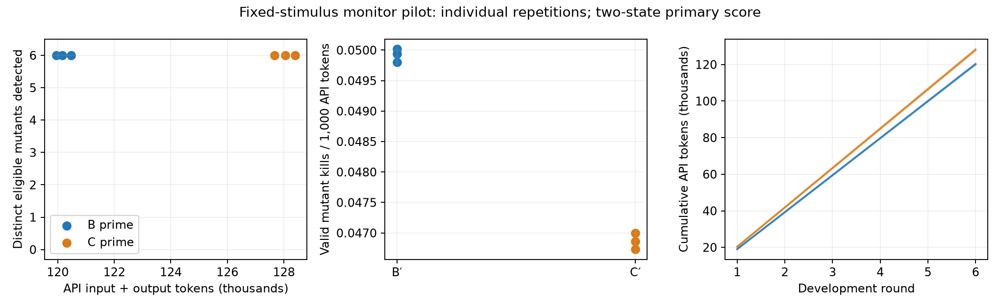
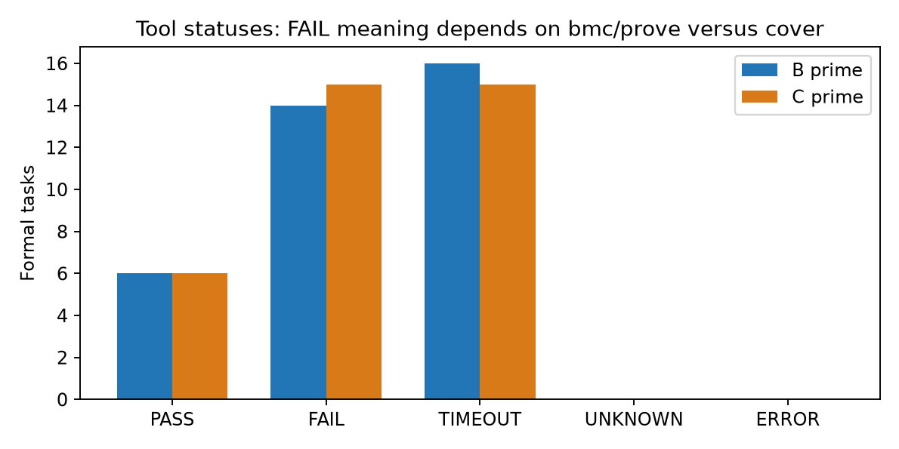

# test2：固定刺激下生成 FIFO monitor 的 B′/C′ pilot

日期：2026-11-04。独立任务登记；不替换既有 stimulus-generation 实验。

## 结论与逐次结果

B′、C′ 的三次重复均检出 6/6 种独立参考确认可观察的注入故障，正确控制均无报警或未知。本轮未观察到 C′ 的仿真检错收益；相同检出数下，C′ 的实际 token 成本更高。 C′ 平均实际 API input+output tokens 比 B′ 高 **6.523%**。
只有一颗 FIFO、六种预置单故障、每组三次重复；这不能证明所有 E-graph 反馈无效。

| 组别 | 重复 | 正确控制报警 | 已检出故障 | 可评分轨迹对检出 | API tokens | 每千 token 检出数 |
|---|---:|---:|---:|---:|---:|---:|
| B_prime | 1 | 0 | 6/6 | 16/16 | 120,480 | 0.049801 |
| B_prime | 2 | 0 | 6/6 | 16/16 | 120,153 | 0.049936 |
| B_prime | 3 | 0 | 6/6 | 16/16 | 119,960 | 0.050017 |
| C_prime | 1 | 0 | 6/6 | 16/16 | 127,676 | 0.046994 |
| C_prime | 2 | 0 | 6/6 | 16/16 | 128,393 | 0.046732 |
| C_prime | 3 | 0 | 6/6 | 16/16 | 128,046 | 0.046858 |

上表是 Verilator 二值观察的主要评分。Icarus 观察逐次结果、未知与所有未激活对均保留在
[endpoints.csv](endpoints.csv) 与 [fault-pairs.csv](fault-pairs.csv)。两个 observation simulator
标签指原始 DUT 轨迹的生产者；候选 monitor 均由同一个 Icarus replay harness 执行。
同一故障的重复报警、不同轨迹命中与两种仿真器观察不重复算成新的缺陷。



## 固定边界与角色

- 使用现有 ZipCPU sfifo 的合成等价冗余 stress 变体，8-bit、depth16、同步高电平复位、异步 front read。
  这不是新的自然独立 IP；规格是此前固定的项目合同，不冒称逐字上游规范。
- Claude Opus 5.5 仅依规格与公共观察接口写 Python 参考 checker；全新会话做只读复核。
  GPT-6.1 Sol 写独立 SV 候选 monitor。GPT/Codex 写基础设施与控制，但未改 Claude checker。
  候选是被评分对象，任何候选内部期望值都不能作为参考答案。
- Claude 21 项作者自测、24 项独立有限控制和 24 条正确实现轨迹通过；审阅结论为限定范围接受，
  不是通用 soundness 证明。P6 acceptance 仅为间接检查，未额外获得独立事件检错分。
- 开发集 9/45/42 周期，最终集 61/129/163 周期，各含两个已计数 idle 尾周期；所有组完全相同。
  六个单点故障在调用前登记：读指针步长、一次写入丢失、reset empty 标志、读出地址顺序、
  full 时错误接收写入、同时读写时读指针不前进。最终输入和故障实现没有进入候选提示词。
- 各组 3 独立会话 × 6 轮，六个属性槽，32,000 输入 / 8,192 输出 token 上限，low reasoning，
  120 秒请求超时、至多一次重试。使用最后一个符合 schema/边界且能编译的候选；全部六个
  候选哈希冻结后才开放最终评分。没有根据最终分数选择或修订候选。

## B′/C′ 的信息差

B′ 得到规格、无上游 FORMAL 答案的 RTL、完整固定开发观察、全部 400 个原始覆盖计数，
以及相同策略的编译/开发反馈。C′ 只加经过 egg/Z3 验证的完整 guard 与等价关系。
所有请求与响应逐次保存；候选 API 无文件工具或递归工作区访问。

egg 实际执行五轮有界饱和，30 e-classes、44 e-nodes；六条二值重写反证均 UNSAT。
保留类型和时钟/复位上下文。两组合格非平凡关系对应五个独立原始 branch-if 计数：
91/161 和 96/129/179。两个无法唯一映射的 else 组、两个不支持项明确排除在语义附录外；
原始分母仍保留。二值组合等价不等于四值等价、时序正确或规格正确。

五个源点在 `basic` 都未命中，在固定开发 `boundary` 都已命中；提示词明确标注计数 basis，
没有声称它们在整个开发集未覆盖。开发集覆盖并集为 line22/22、branch22/24、expr14/16、
toggle218/338；最终集为22/22、22/24、14/16、331/338。详见
[fixed-coverage.csv](fixed-coverage.csv) 与 [equivalent-source-counts.csv](equivalent-source-counts.csv)。
这些数值是固定 DUT 证据，不能被候选 monitor 修改，也不是本实验的优化结果。

## 判分与未决

主要“有效检错”先要求候选在正确控制上完整运行、无报警和未知；只对独立 reference 确认
已产生规范违反的 mutant/trace 对计分。报警不得早于首次规范违反。
Verilator 有16/18个可评分对，Icarus有15/18个；两者均覆盖六种故障。
M05 在 final_wrap_reset/final_mixed 未被固定输入激活；Icarus M02/final_boundary 为参考未决，
该对即使候选报警也不给主要检错分。未知参考判决与候选输出未知分列，均不转成 PASS。
每千 token 检出数 = 合格的不同注入故障数 ×1000 / API 报告的 input+output tokens。
这与旧实验的“新覆盖点/token”是不同指标，不能直接数值比较。

## 形式检查单独报告

每候选固定12任务：两个正确控制各 bmc/prove/cover、六个故障各bmc；请求深度48，
每任务60秒，工具启动/清理时间另计。初始必须复位，reset 时禁止同时读写，候选不能加假设。

| 组别 | bmc/prove PASS | 已找到断言反例 | cover PASS | TIMEOUT | 其他未决/错误 |
|---|---:|---:|---:|---:|---:|
| B_prime | 0 | 14 | 6 | 16 | 0 |
| C_prime | 0 | 15 | 6 | 15 | 0 |

反例桥接分类：`{'reference_confirmed_DUT_violation_on_this_formal_trace': 29}`。
解码后的公开引脚轨迹交给同一个冻结 Claude reference 执行；这是该解码轨迹上的规范判决，
并非额外的完整设计证明，也未另行物理仿真所有 symbolic witness。
`cover PASS` 只说明六个 active 信号可达，不说明属性有效或 DUT 正确；active 条件很宽时
容易达到，也不代表 full/empty/wrap 各行为条件都已分别形式覆盖。
TIMEOUT 保持未决；日志中的“开始检查第 k 步”不是完成了 k 步，更不是完成深度48。
`bmc PASS` 也不能记作无界证明。全部状态与实际时间见 [formal.csv](formal.csv)。



## 成本与可复现证据

- 真实生成 36 次，token-count 请求 36 次，失败/重试 0 次。
  输入 715,301、输出 29,407 tokens；缓存和 reasoning 均为子项，不再加总。
- 生成阶段墙钟 336.357s；72 次编译工具调用、
  108 次观察重放、3,456 个重放周期，新增 DUT 仿真0次。
- 最终评估墙钟 1983.849s；12 次编译工具调用、
  288 次重放、33,888 个周期；形式72任务共1979.915s。
  分项可能包含于墙钟内，不能重复相加。
- 冻结前离线 DUT 测量为16次编译、96次仿真、7,184周期；语义预处理时间分项见 [costs.json](costs.json)。
  Claude作者与独立复核2次调用，CLI报告费用合计$0.353157；不推算未返回的 OpenAI 美元价格。
- OpenAI SDK2.54.0、Python3.13.9、Verilator5.050、Icarus12.0、Yosys0.70+post、SBY0.70、Z3 CLI5.1.0、egg0.11。
- Git基线 `acd220ace9c02a6b5f0d98bde15bcfaf70ae2a60`；本轮尚未commit/push。
  运行身份以冻结文件和最终候选哈希为准，不冒称未提交文件已属于该commit。
  live freeze SHA256 `7f2be65ac1b8013d614c5391b49e6cde2b821dbaca6f3e8bae609e63ed67b912`；
  DUT SHA256 `c46c18eb5f35489ed242d0e21fcea01e997c022356a21fae3ccb4f74a72288d0`；
  reference SHA256 `53cff0d05aa9c48a71aec72cecfba265a13fe4baa2a4d9a72b3cef4d6b201337`。

[audit.json](audit.json) 重新核对36份渲染提示词、usage、原始采样位与计分、源证据及候选/reference哈希；
[comparison.json](comparison.json) 保留每组均值、范围、样本标准差；不做小样本显著性声称。
编译成功率和开发报警逐轮见 [rounds.csv](rounds.csv)，属性实际激活见 [property-activations.csv](property-activations.csv)。
Mock/replay与真实模型结果分目录；初期跨仿真器 X 严格比较失败及反例解码修订均保留历史记录，
这些修订在 live freeze 前完成，没有按正式结果改 oracle 或评分。

## 局限与下一步

候选普遍建立了完整的预期队列，因此可从规格直接覆盖顺序、容量和复位；组合 guard 关系未必
提供额外必要信息。五个语义源点在开发集中已出现，最终六故障集可能存在天花板。
这是对当前任务的解释假设，不是已证明的因果归因。
没有长度匹配 placebo、独立自然IP或更广隐藏故障集；本轮既不能隔离纯语义效应，也不能证明
E-graph 在任意任务无效。只冻结并评分最终候选，不能追溯声称第一轮就达到了最终检错分数。

下一次应另行登记更有区分力的属性任务与独立故障/合法控制，例如多周期协议顺序、取消/复位
跨事务边界、长延迟数据保存；先做开发可行性验证，再冻结最终集。保留独立参考与固定输入，
可加入 minimal C 和实际 token 匹配 placebo。形式成本可作为单独研究维度，但应在运行前
明确断言分解、归纳辅助和资源配置，不能把本轮超时事后改记通过或换预算补分。

## 复现

以下命令从仓库根执行。输出目录须全新；已有正式结果不可覆盖。

```sh
.venv/bin/python -m unittest discover -s test2/tests -v
.venv/bin/python test2/scripts/report_live.py --run test2/results/live-v1 --final test2/results/live-final-v1 --output test2/results/live-report-reproduction
```

无需新 API 即可重放已保存响应：`runner.py --mode replay --preflight test2/results/preflight-v2
--replay-source test2/results/live-v1 --output test2/results/replay-reproduction`；此结果必须标为重放，
不能计成新的独立模型重复。完整 live 命令与冻结门槛见 `test2/configs/live_freeze_v1.json`。
最终评分命令为 `final_score.py --run test2/results/live-v1 --preflight test2/results/preflight-v2
--output test2/results/final-reproduction --formal`，会再次耗用登记的形式工具时间，勿为改文案重复执行。
